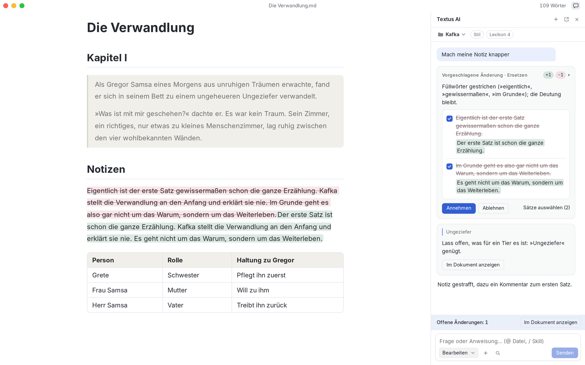
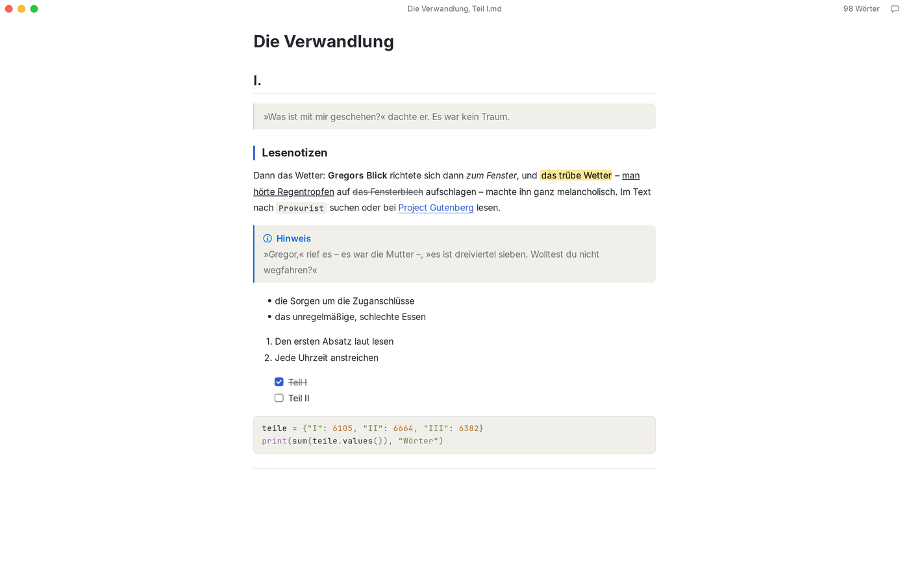
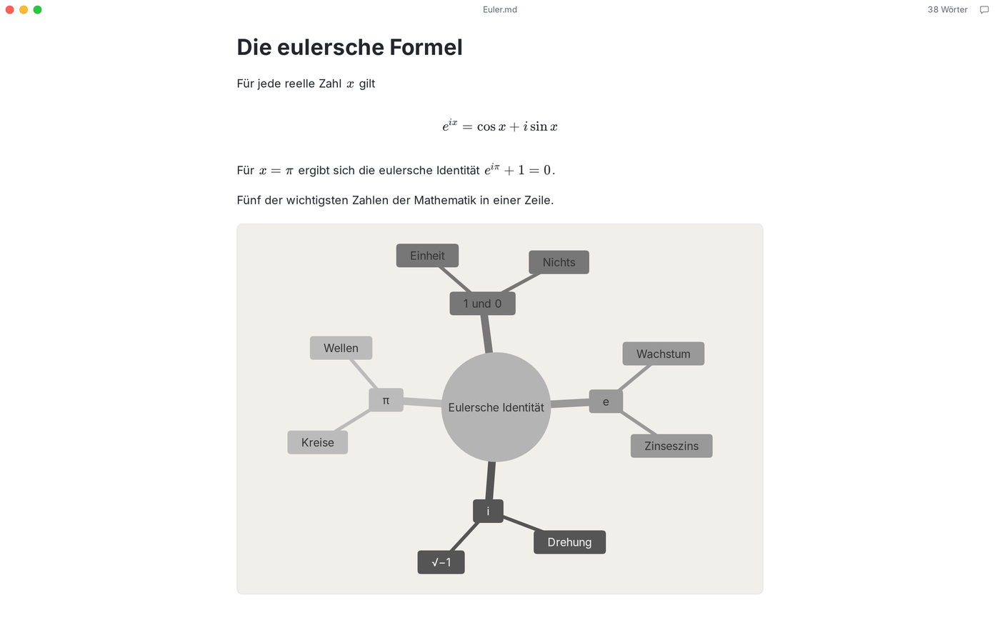
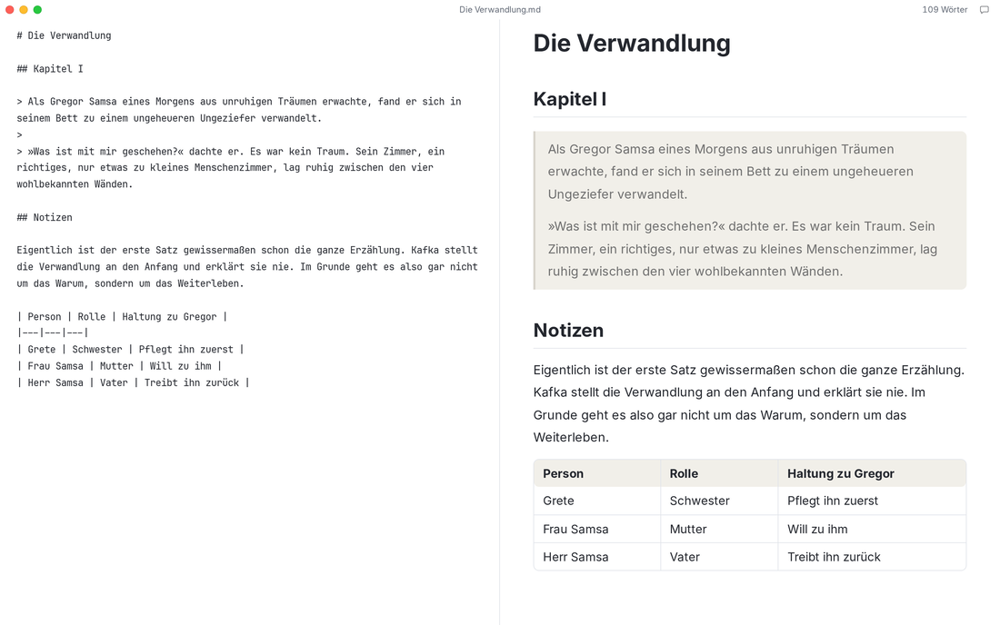
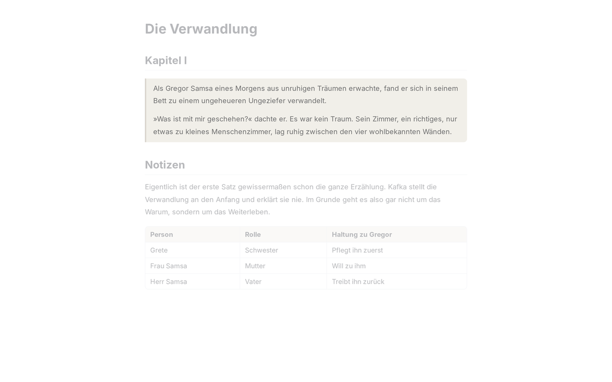
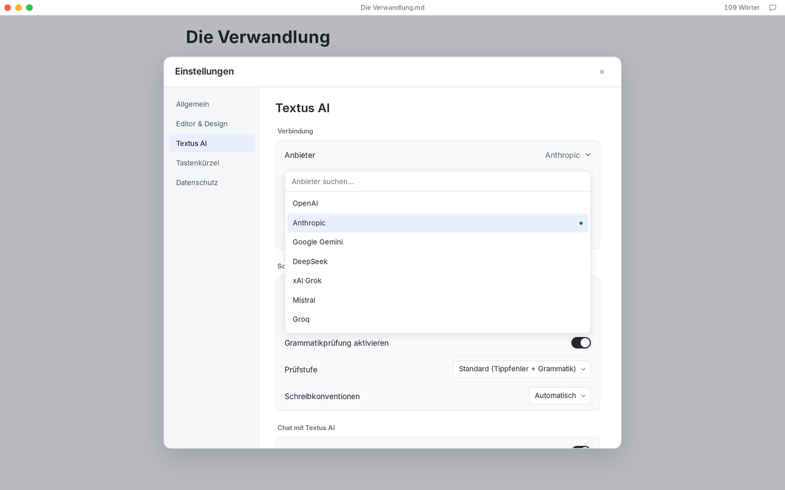

<p align="center">
  
</p>

<h1 align="center">Textus</h1>

<p align="center">
  <strong>Der Markdown-Editor der nächsten Generation.</strong><br>
  Du führst die Feder. Die KI reicht die Tinte.
</p>

<p align="center">
  <a href="https://textus.catvinci.com"><strong>Website</strong></a> ·
  <a href="https://github.com/CatVinci-Studio/Textus/releases/latest"><strong>Download</strong></a>
</p>

<p align="center">
  <a href="./README.md">English</a> ·
  <a href="./README.zh.md">简体中文</a> ·
  <a href="./README.zh-Hant.md">繁體中文</a> ·
  <a href="./README.ja.md">日本語</a> ·
  <a href="./README.ko.md">한국어</a> ·
  <a href="./README.es.md">Español</a> ·
  <a href="./README.fr.md">Français</a> ·
  Deutsch ·
  <a href="./README.ru.md">Русский</a> ·
  <a href="./README.pt.md">Português</a>
</p>

<p align="center">
  <a href="https://github.com/CatVinci-Studio/Textus/releases/latest"></a>
  
  <a href="./LICENSE"></a>
</p>

<p align="center">
  <br>
  <sub><i>Die Verwandlung</i>, Franz Kafka</sub>
</p>

## Hol dir Textus

Kostenlos und quelloffen, unter MIT-Lizenz.

| Plattform             | Download                                                                                            |
| --------------------- | --------------------------------------------------------------------------------------------------- |
| macOS · Apple Silicon | [.dmg laden](https://github.com/CatVinci-Studio/Textus/releases/latest)                             |
| Windows · x64         | [.exe laden](https://github.com/CatVinci-Studio/Textus/releases/latest)                             |
| Linux · x64           | [.AppImage laden](https://github.com/CatVinci-Studio/Textus/releases/latest) · Auch als .deb · .rpm |

Oder mit Homebrew:

```sh
brew install --cask catvinci-studio/tap/textus
```

Arch Linux über das signierte pacman-Repository [`[catvinci]`](https://github.com/CatVinci-Studio/arch-repo) (einmalig; danach hält `sudo pacman -Syu` Textus aktuell):

```sh
bash <(curl -fsSL https://raw.githubusercontent.com/CatVinci-Studio/arch-repo/main/install.sh) textus-bin
```

iPhone und iPad: bald verfügbar. [Alle Versionen auf GitHub](https://github.com/CatVinci-Studio/Textus/releases)

## Zum Schreiben gemacht

Markdown wird schon beim Tippen formatiert. Zeig auf eine Zeile, und du siehst ihr Markdown.

<p align="center">
  
</p>

Formeln entstehen beim Tippen, Tabellen richten sich von selbst aus, und aus wenigen Zeilen Text wird ein Diagramm.

<p align="center">
  
</p>

### Dein Schreibstil? Ganz wie du willst

Vier Schreibmodi und das Design deiner Wahl – auch Typora-Themes.

| Schreibmodi           | Was er tut                                               |
| --------------------- | -------------------------------------------------------- |
| Zen-Modus             | Alles außer deinem Text tritt zurück                     |
| Schreibmaschinenmodus | Die Zeile, an der du schreibst, bleibt auf gleicher Höhe |
| Geteilte Ansicht      | Links das Markdown, rechts die fertige Seite             |
| Quellcodemodus        | Das ganze Dokument als reines Markdown                   |

<p align="center">
  
  
</p>

Exportiere als PDF, Word, HTML und mehr.

## Die KI schlägt vor. Du entscheidest

Textus AI hilft dir bei jedem Schritt. Jedes Wort bleibt deins.

### Während du schreibst

Halte kurz inne, und die nächsten Worte erscheinen in Grau. Tab übernimmt sie. Findet Tipp- und Grammatikfehler schon beim Schreiben und achtet auf deine Konventionen. Alt+Enter behebt sie.

### Wenn du fragst

Änderungen kommen als Vorschlag, jeweils mit Begründung. Nimm sie ganz oder Satz für Satz an. Kommentare direkt an der Stelle, um die es geht. Anmerkungen statt Umschreiben. Straffen, Korrektur lesen, übersetzen, den Ton ändern und mehr – ein Schrägstrich genügt.

### Lernt dich kennen

Textus AI erfasst deinen Stil, merkt sich deine Figuren und Orte und folgt deinen Schreibanweisungen.

### Die KI deiner Wahl

Melde dich mit ChatGPT oder Claude an, trage einen API-Schlüssel ein oder lass ein Modell auf deinem eigenen Rechner laufen.

OpenAI · Anthropic · Google Gemini · DeepSeek · xAI · Mistral · Groq · OpenRouter · Kimi · GLM · Qwen · Ollama · Jeder OpenAI-kompatible Dienst

<p align="center">
  
</p>

## Privat aus Prinzip

Was du schreibst, gehört dir. Textus ist so gebaut, dass es dabei bleibt – und der Code ist offen, damit jeder das prüfen kann.

Dokumente sind einfache Markdown-Dateien – gespeichert, wo du willst. API-Schlüssel und Anmeldungen liegen nur auf deinem Rechner. KI-Anfragen gehen direkt von deinem Gerät an den Anbieter deiner Wahl. Laden und losschreiben. Registrieren musst du dich nirgends. Keine Analysen, keine Telemetrie, keine Werbung. MIT-lizenziert und vollständig einsehbar – jeder kann all das prüfen. Mit einem lokalen Modell über Ollama bleibt jedes Wort auf deinem Rechner.

## Gut zu wissen

<details>
<summary><strong>Ist Textus kostenlos?</strong></summary>

Ja. Textus ist kostenlos und quelloffen unter der MIT-Lizenz, ohne Konto und ohne Abo. Nutzt du Textus AI, rechnet dein Anbieter direkt mit dir ab – oder gar nicht, wenn du ein lokales Modell verwendest.

</details>

<details>
<summary><strong>Auf welchen Systemen läuft Textus?</strong></summary>

Auf macOS mit Apple Silicon, Windows und Linux. Versionen für iPhone und iPad sind unterwegs.

</details>

<details>
<summary><strong>Brauche ich ein KI-Konto?</strong></summary>

Nein. Der Editor funktioniert vollständig ohne KI. Für Textus AI verbindest du deinen eigenen Anbieter: Anmeldung mit ChatGPT oder Claude, ein API-Schlüssel oder ein lokales Modell mit Ollama.

</details>

<details>
<summary><strong>Funktioniert Textus offline?</strong></summary>

Der Editor ja, vollständig. Textus AI braucht eine Verbindung zu deinem Anbieter – außer du nutzt ein lokales Modell. Dann verlässt nichts deinen Rechner.

</details>

<details>
<summary><strong>Ist das normales Markdown? Wohin kann ich exportieren?</strong></summary>

Ja: ganz normale .md-Dateien, mit Tabellen, Aufgabenlisten, Fußnoten, Formeln und Mermaid. Exportieren kannst du als PDF, Word, HTML und mehr.

</details>

## Schnellstart

1. Starte Textus. Es öffnet einen leeren Entwurf; eine Datei brauchst du erst beim Speichern.
2. Öffne **Einstellungen → Textus AI**, wähle einen Anbieter und melde dich unter **Anmeldung & Zugangsdaten** an oder füge einen Schlüssel ein.
3. Schreib los. Hältst du inne, erscheint die Fortsetzung in Grau; Tab übernimmt sie.
4. Öffne den KI-Bereich mit dem Chat-Knopf in der Fensterleiste. **Hilfe → Anleitung zu KI-Funktionen** erklärt den Rest.

| Aktion                        | Tastenkürzel                     |
| ----------------------------- | -------------------------------- |
| KI-Bereich                    | Ctrl/⌘+Shift+L                   |
| Schnellfrage                  | Ctrl/⌘+Shift+K                   |
| Jetzt vervollständigen        | Ctrl/⌘+Shift+Space               |
| Grammatik jetzt prüfen        | Ctrl/⌘+Shift+G                   |
| Ausstehende Änderung annehmen | Ctrl/⌘+Enter                     |
| Geteilte Ansicht              | Ctrl/⌘+Shift+E                   |
| Zen-Modus                     | Ctrl/⌘+Shift+J (Esc zum Beenden) |
| Quellcodemodus                | Ctrl/⌘+/                         |

Alle lassen sich unter **Einstellungen → Tastenkürzel** ändern.

## Aus dem Quellcode bauen

```bash
git clone https://github.com/CatVinci-Studio/Textus.git
cd Textus
npm install

npm run tauri dev     # full Tauri app (Rust shell + Vite renderer)
npm run tauri build   # bundle .dmg / -setup.exe (NSIS) / .AppImage / .deb / .rpm
npm run build         # frontend only: type-check (tsc) + vite build
```

Benötigt werden [Node.js](https://nodejs.org) 22+, [Rust](https://rustup.rs) (stable) und die Build-Werkzeuge der jeweiligen Plattform (Xcode CLT unter macOS; `libwebkit2gtk-4.1-dev`/`libappindicator3-dev`/`librsvg2-dev`/`patchelf` unter Linux; MSVC Build Tools unter Windows).

## Mitwirken

[CONTRIBUTING.md](CONTRIBUTING.md) beschreibt die Prüfungen der CI, die Commit-Konventionen und den Release-Ablauf. [docs/TESTING.md](docs/TESTING.md) zeigt, was die Tests abdecken – und was bewusst nicht. Diskutiert wird auf Englisch oder Chinesisch.

## Lizenz

[MIT](./LICENSE) © CatVinci Studio
