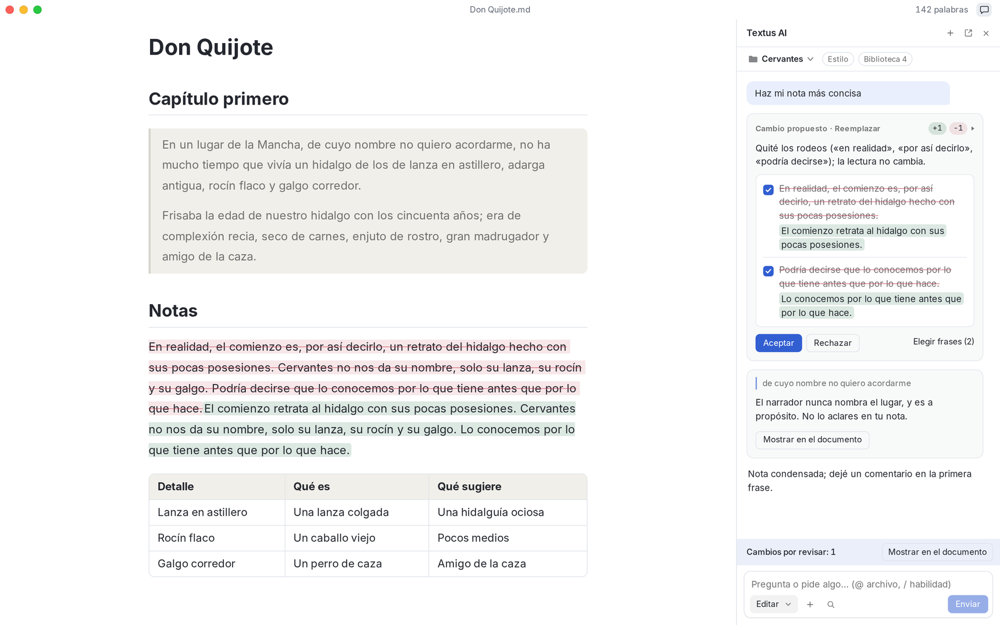
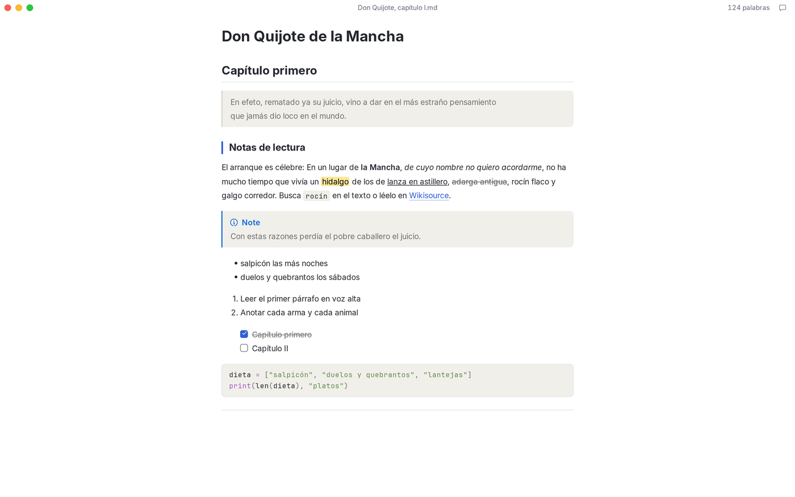
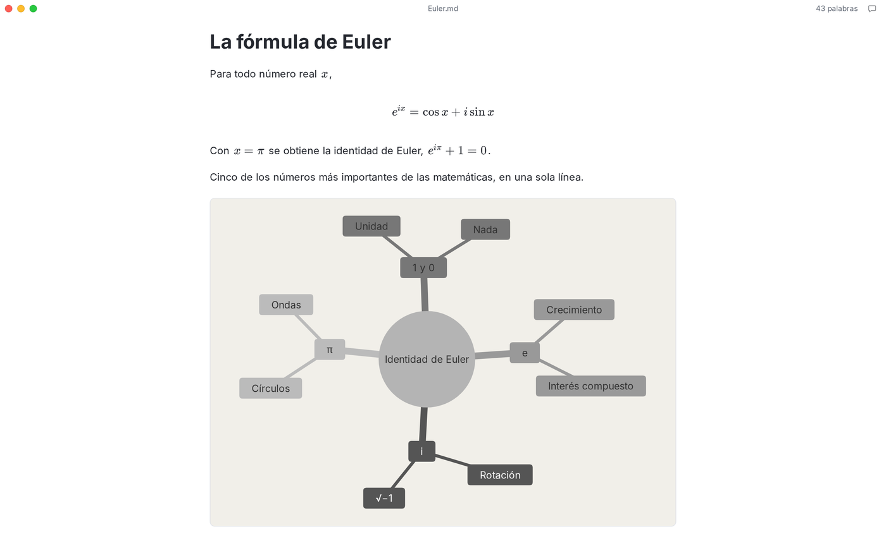
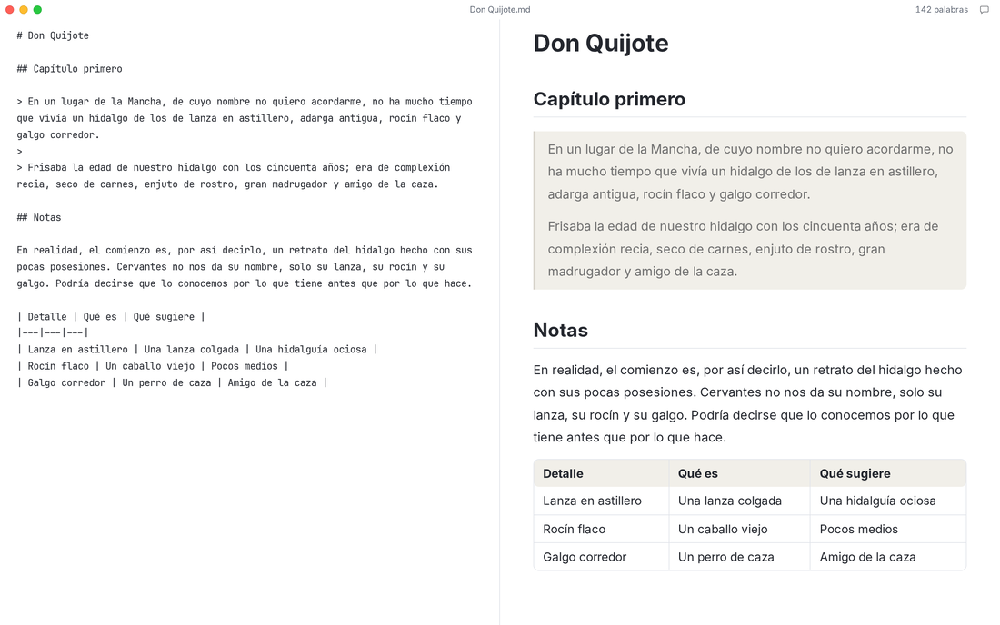
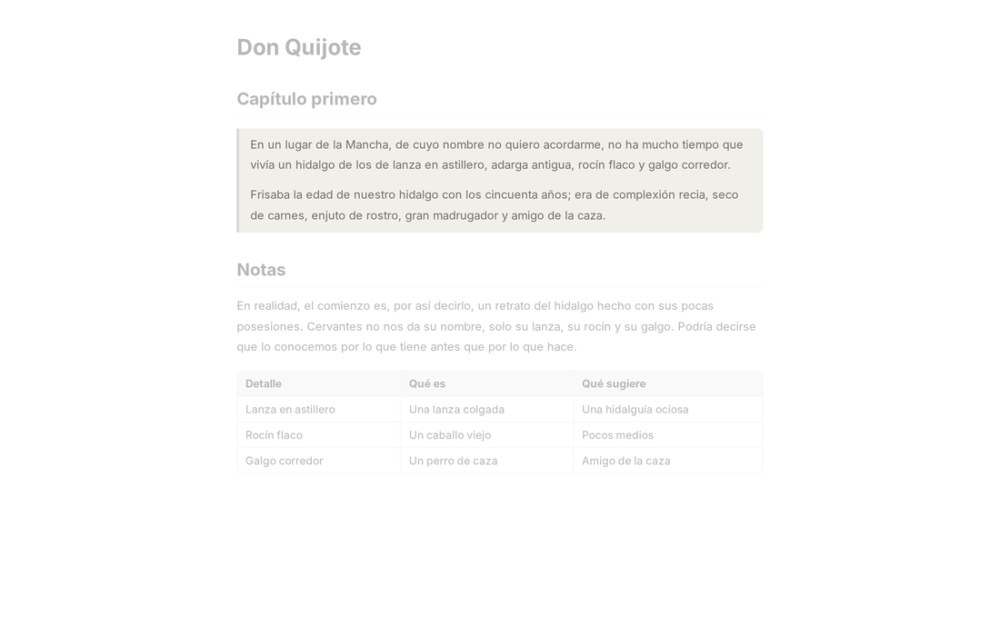
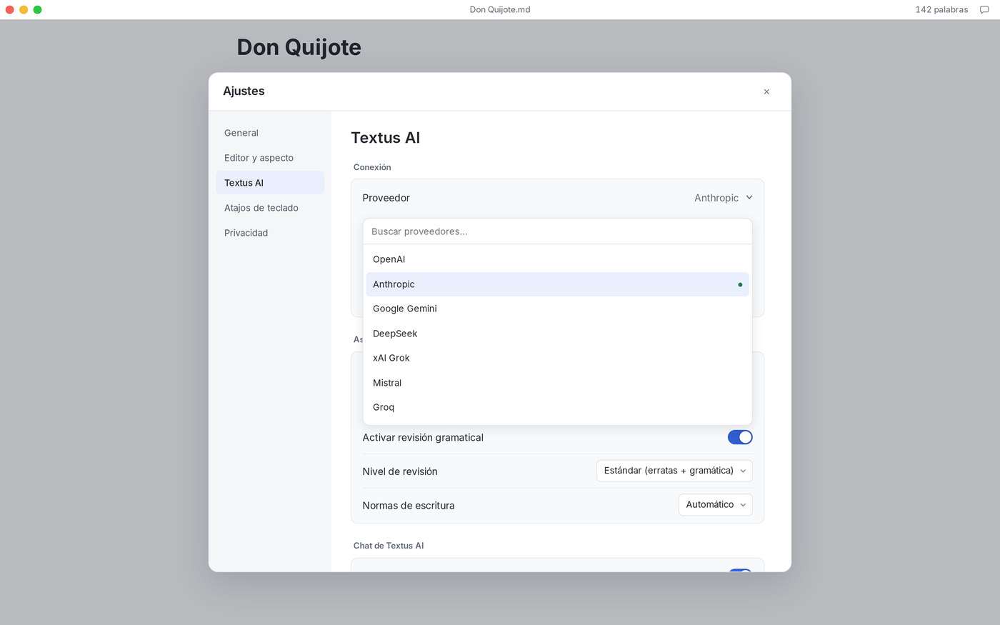

<p align="center">
  
</p>

<h1 align="center">Textus</h1>

<p align="center">
  <strong>El editor de Markdown de nueva generación.</strong><br>
  Tú pones la pluma. La IA, la tinta.
</p>

<p align="center">
  <a href="https://textus.catvinci.com"><strong>Sitio web</strong></a> ·
  <a href="https://github.com/CatVinci-Studio/Textus/releases/latest"><strong>Descargar</strong></a>
</p>

<p align="center">
  <a href="./README.md">English</a> ·
  <a href="./README.zh.md">简体中文</a> ·
  <a href="./README.zh-Hant.md">繁體中文</a> ·
  <a href="./README.ja.md">日本語</a> ·
  <a href="./README.ko.md">한국어</a> ·
  Español ·
  <a href="./README.fr.md">Français</a> ·
  <a href="./README.de.md">Deutsch</a> ·
  <a href="./README.ru.md">Русский</a> ·
  <a href="./README.pt.md">Português</a>
</p>

<p align="center">
  <a href="https://github.com/CatVinci-Studio/Textus/releases/latest"></a>
  <a href="https://github.com/CatVinci-Studio/Textus/releases"></a>
  <a href="https://github.com/CatVinci-Studio/Textus/stargazers"></a>
  
  <a href="./LICENSE"></a>
  <a href="https://github.com/CatVinci-Studio/Textus/actions/workflows/ci.yml"></a>
  <a href="https://textus.catvinci.com/discord"></a>
  
  <a href="https://textus.catvinci.com"></a>
</p>

https://github.com/user-attachments/assets/f366f282-e3f9-43d9-9a29-edb6d1ace3f5

<p align="center">
  <br>
  <sub><i>Don Quijote de la Mancha</i>, Miguel de Cervantes</sub>
</p>

## Consigue Textus

Gratuito y de código abierto, con licencia MIT.

| Plataforma            | Descargar                                                                                                   |
| --------------------- | ----------------------------------------------------------------------------------------------------------- |
| macOS · Apple Silicon | [Descargar .dmg](https://github.com/CatVinci-Studio/Textus/releases/latest)                                 |
| macOS · Intel         | [Descargar .dmg](https://github.com/CatVinci-Studio/Textus/releases/latest)                                 |
| Windows · x64         | [Descargar .exe](https://github.com/CatVinci-Studio/Textus/releases/latest)                                 |
| Linux · x64           | [Descargar .AppImage](https://github.com/CatVinci-Studio/Textus/releases/latest) · También como .deb · .rpm |

O instálalo con Homebrew:

```sh
brew install --cask catvinci-studio/tap/textus
```

Arch Linux con el repositorio de pacman firmado [`[catvinci]`](https://github.com/CatVinci-Studio/arch-repo) (una sola vez; después `sudo pacman -Syu` mantiene Textus al día):

```sh
bash <(curl -fsSL https://raw.githubusercontent.com/CatVinci-Studio/arch-repo/main/install.sh) textus-bin
```

iPhone y iPad: muy pronto. [Todas las versiones en GitHub](https://github.com/CatVinci-Studio/Textus/releases)

## Escritura

Todo el Markdown, con formato mientras escribes. Pasa el puntero por una línea para ver su código.

<p align="center">
  
</p>

Las fórmulas se muestran mientras escribes, las tablas se alinean solas y unas pocas líneas de texto bastan para un diagrama.

<p align="center">
  
</p>

### ¿Tu estilo de escritura? Tú decides

Cuatro modos de escritura y el tema que prefieras, incluidos los de Typora.

| Modos de escritura       | Qué hace                                                 |
| ------------------------ | -------------------------------------------------------- |
| Modo zen                 | Todo se aparta salvo tus palabras                        |
| Modo máquina de escribir | La línea que escribes se queda siempre a la misma altura |
| Vista dividida           | Markdown a un lado, la página terminada al otro          |
| Modo código fuente       | Todo el documento en Markdown sin formato                |

<p align="center">
  
  
</p>

Exporta a PDF, Word, HTML y más.

## Textus AI

Tu asistente de escritura. Escribe contigo.

### Mientras escribes

Haz una pausa y las palabras siguientes aparecen en gris. Pulsa Tab para aceptarlas. Detecta erratas y errores gramaticales mientras escribes, y comprueba tus normas de escritura. Alt+Enter los corrige.

### Cuando lo pides

Los cambios llegan como propuestas, cada una con su motivo. Acéptalas enteras o frase a frase. Notas junto a la línea a la que se refieren. Comenta, no reescribe. Condensar, corregir, traducir, cambiar el tono y más, con solo teclear /.

### Te conoce

Aprende tu estilo, recuerda a tus personajes y lugares, y sigue tus instrucciones.

### El LLM que prefieras

Textus funciona con más de 20 LLM y con cualquier LLM que ofrezca una API compatible con OpenAI.

OpenAI · Anthropic · Google Gemini · DeepSeek · xAI · Mistral · Groq · OpenRouter · Kimi · GLM · Qwen · Ollama · Cualquier servicio compatible con OpenAI

<p align="center">
  
</p>

## Lo que escribes es solo tuyo

Lo que escribes es tuyo. Textus está hecho para que siga siéndolo, y su código es abierto para que cualquiera lo compruebe.

Los documentos son archivos Markdown normales, guardados donde tú elijas. Las claves de API y los inicios de sesión se guardan solo en tu ordenador. Las peticiones de IA van directamente de tu dispositivo al proveedor que elijas. Descárgalo y escribe. No hay nada en lo que registrarse. Sin analíticas, sin telemetría, sin anuncios. Con licencia MIT y abierto línea a línea: cualquiera puede comprobar todo esto. Con un modelo local a través de Ollama, tus palabras nunca salen de tu ordenador.

## Preguntas frecuentes

<details>
<summary><strong>¿Es gratis Textus?</strong></summary>

Sí. Es gratuito y de código abierto, con licencia MIT, sin cuenta ni suscripción. Si usas Textus AI, te cobra directamente tu proveedor; con un modelo local, nadie.

</details>

<details>
<summary><strong>¿En qué sistemas funciona?</strong></summary>

En macOS (Apple Silicon e Intel), Windows y Linux. Pronto llegará a iPhone y iPad.

</details>

<details>
<summary><strong>¿Necesito una cuenta de IA?</strong></summary>

No. El editor funciona perfectamente sin IA. Para usar Textus AI, conecta tu propio proveedor: inicia sesión con ChatGPT o Claude, añade una clave de API o ejecuta un modelo local con Ollama.

</details>

<details>
<summary><strong>¿Funciona sin conexión?</strong></summary>

El editor, sí, por completo. Textus AI necesita conectarse a tu proveedor, salvo que uses un modelo local.

</details>

<details>
<summary><strong>¿Es Markdown estándar? ¿A qué formatos exporta?</strong></summary>

Sí: archivos .md normales, con tablas, listas de tareas, notas al pie, fórmulas y Mermaid. Exporta a PDF, Word, HTML y más.

</details>

## Primeros pasos

1. Abre Textus. Empieza con un borrador en blanco; solo necesitas un archivo al guardar.
2. Abre **Ajustes → Textus AI**, elige un proveedor e inicia sesión o pega una clave en **Acceso y credenciales**.
3. Empieza a escribir. Cuando haces una pausa, la continuación aparece en gris; Tab la acepta.
4. Abre el Panel de IA con el botón de chat de la barra de la ventana. **Ayuda → Guía de funciones de IA** explica el resto.

| Acción                        | Atajo                           |
| ----------------------------- | ------------------------------- |
| Panel de IA                   | Ctrl/⌘+Shift+L                  |
| Pregunta rápida               | Ctrl/⌘+Shift+K                  |
| Sugerir continuación ahora    | Ctrl/⌘+Shift+Space              |
| Revisar gramática ahora       | Ctrl/⌘+Shift+G                  |
| Aceptar una edición pendiente | Ctrl/⌘+Enter                    |
| Vista dividida                | Ctrl/⌘+Shift+E                  |
| Modo zen                      | Ctrl/⌘+Shift+J (Esc para salir) |
| Modo código fuente            | Ctrl/⌘+/                        |

Todos se pueden cambiar en **Ajustes → Atajos de teclado**.

## Compilar desde el código

```bash
git clone https://github.com/CatVinci-Studio/Textus.git
cd Textus
npm install

npm run tauri dev     # full Tauri app (Rust shell + Vite renderer)
npm run tauri build   # bundle .dmg / -setup.exe (NSIS) / .AppImage / .deb / .rpm
npm run build         # frontend only: type-check (tsc) + vite build
```

Necesitas [Node.js](https://nodejs.org) 22 o posterior, [Rust](https://rustup.rs) (stable) y las herramientas de compilación de cada plataforma (Xcode CLT en macOS; `libwebkit2gtk-4.1-dev`/`libappindicator3-dev`/`librsvg2-dev`/`patchelf` en Linux; MSVC Build Tools en Windows).

## Contribuir

En [CONTRIBUTING.md](CONTRIBUTING.md) están las comprobaciones que ejecuta la CI, las convenciones de commits y el proceso de publicación. [docs/TESTING.md](docs/TESTING.md) explica qué cubren las pruebas y qué dejan fuera a propósito. Las conversaciones son en inglés o chino.

## Licencia

[MIT](./LICENSE) © CatVinci Studio
