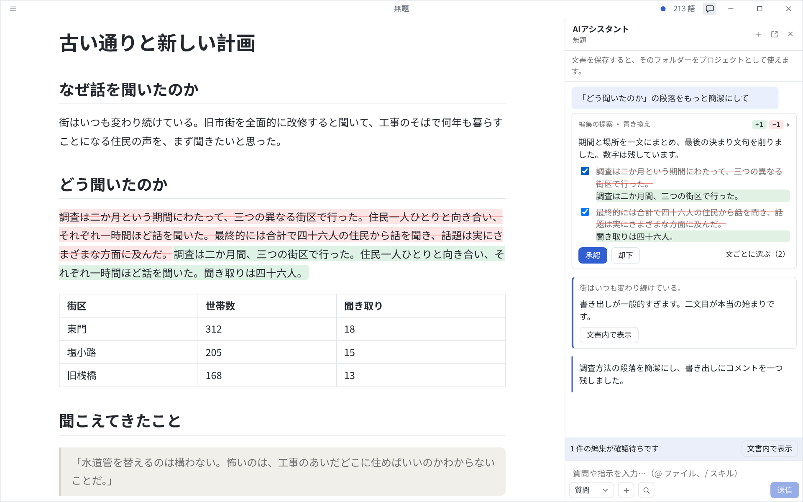
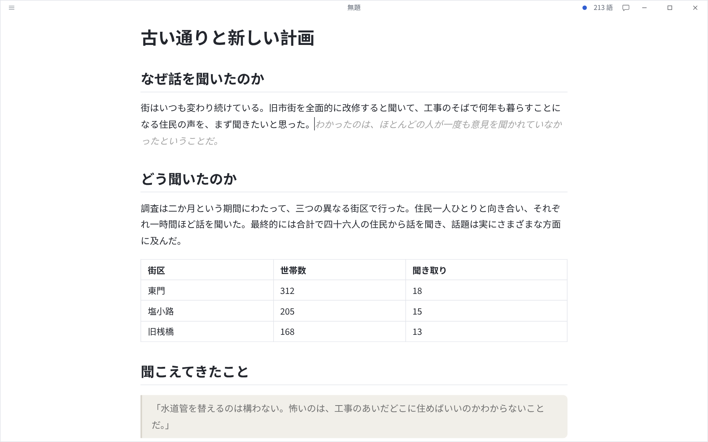

<!-- 構成は README.md と節ごとに対応しています（scripts/check-readmes.mjs で確認）。 -->

<p align="center">
  
</p>

<h1 align="center">Levis</h1>

<p align="center">
  <strong>書き換えるのではなく、提案する AI を備えた WYSIWYG Markdown エディタ。</strong><br>
  オープンソースで軽量。AI は続きを書き、文法を確かめ、修正を提案します。変更はすべて、あなたが決めます。
</p>

<p align="center">
  <a href="https://github.com/CatVinci-Studio/Levis/releases/latest"><strong>ダウンロード</strong></a> ·
  <a href="./README.md">English</a> ·
  <a href="./README.zh.md">中文</a>
</p>

<p align="center">
  <a href="https://github.com/CatVinci-Studio/Levis/releases/latest"></a>
  
  <a href="./LICENSE"></a>
</p>

<p align="center">
  
</p>

## 特長

### エディタ

- **本当の WYSIWYG**：Markdown の記号はカーソルのある場所にだけ表示され、それ以外は仕上がった紙面として読めます。
- 表、数式、Mermaid 図、シンタックスハイライト、脚注、タスクリスト、GitHub アラート。
- **分割表示**（ソースとライブプレビューを並べる）、**タイプライターモード**（書いている行を常に中央に）、**禅モード**（文章だけを残し、今の段落に集中）。
- タブと複数ウィンドウ、検索と置換、Typora テーマの読み込み、独自の CSS。
- PDF と HTML に書き出し。[Pandoc](https://pandoc.org) があれば Word、OpenDocument、RTF にも書き出せます。

<p align="center">
  
  
</p>

### 邪魔をしない AI

- **続き書き**は灰色の文字で表示されます。Tab ですべて、Ctrl/⌘+→ で一語ずつ受け入れます。候補を複数出して切り替えることもできます。
- **文法チェック**は今いる段落の問題に下線を引き、Alt+Enter で修正します。
- **AI パネル**は文書の横に開きます。文書について質問することも、編集を頼むこともできます。編集は理由付きの提案として文書内に表示され、承認・却下のほか、必要な文だけを選んで適用できます。推敲を頼むと、書き換えではなくコメントが届きます。
- **クイック質問**：選択した文章について、書いているその場で尋ねられます。

<p align="center">
  
</p>

### あなたのプロジェクト、あなたの文体

- **プロジェクトフォルダー**：文書を保存すると、そのフォルダーがプロジェクトフォルダーになります（別のフォルダーも選べます）。AI はその中のテキストファイルを読み、検索でき、`@` でファイルを会話に加えられます。
- **文体プロファイル**（`.levis/style.md`）：**文体を学習**で、選んだ見本から下書きされます。続き書きも編集もあなたの書き方に沿います。
- **ライブラリ**（`.levis/library/`）：人物、場所、用語。文章が触れている項目だけが AI に渡されるので、名前や設定がぶれません。
- **執筆の指示**（`agent.md`）と**スキル**（`/名前`）：毎回の会話で守らせる常設のルールと、名前で呼び出す再利用できる指示。すべての文書にも、1つのプロジェクトだけにも設定できます。

### サービスとプライバシー

- OpenAI、Anthropic、Google Gemini、DeepSeek、xAI、Mistral、Groq、OpenRouter、Moonshot、智谱、通義千問、Ollama（ローカル）、および OpenAI 互換の任意のエンドポイントに対応。
- ChatGPT や Claude のアカウントでサインインするか、API キーを使えます。
- リクエストはあなたのコンピューターから選んだサービスへ直接送られます。キーとサインイン情報はコンピューター内にだけ保存されます。Ollama を使えば、内容は外に出ません。

## インストール

macOS（Apple Silicon）は [Homebrew](https://brew.sh) で：

```sh
brew install --cask catvinci-studio/tap/levis
```

Arch Linux は署名付きの [`[catvinci]`](https://github.com/CatVinci-Studio/arch-repo) pacman リポジトリから（設定は一度だけ。以後は `sudo pacman -Syu` で Levis も更新されます）：

```sh
bash <(curl -fsSL https://raw.githubusercontent.com/CatVinci-Studio/arch-repo/main/install.sh) levis-bin
```

または [Releases](https://github.com/CatVinci-Studio/Levis/releases/latest) からインストーラーをダウンロードしてください：

| プラットフォーム       | インストーラー                                                           |
| ---------------------- | ------------------------------------------------------------------------ |
| macOS（Apple Silicon） | `Levis_X.Y.Z_aarch64.dmg`                                                |
| Windows                | `Levis_X.Y.Z_x64-setup.exe`                                              |
| Linux                  | `Levis_X.Y.Z_amd64.AppImage` · `_amd64.deb` · `Levis-X.Y.Z-1.x86_64.rpm` |

## クイックスタート

1. Levis を起動すると、空の下書きが開きます。ファイルが必要になるのは保存するときだけです。
2. **設定 → AI** でサービスを選び、**ログインと認証** でサインインするかキーを入力します。
3. 書き始めます。手を止めると続き書きが灰色の文字で表示され、Tab で受け入れます。
4. ウィンドウ上部のチャットボタンで AI パネルを開きます。そのほかは **ヘルプ → AI 機能ガイド** をご覧ください。

| 操作                   | ショートカット                    |
| ---------------------- | --------------------------------- |
| AI パネル              | Ctrl/⌘+Shift+L                    |
| クイック質問           | Ctrl/⌘+Shift+K                    |
| 続きを書く             | Ctrl/⌘+Shift+Space                |
| 文法チェック           | Ctrl/⌘+Shift+G                    |
| 保留中の編集を承認     | Ctrl/⌘+Enter                      |
| 分割表示               | Ctrl/⌘+Shift+E                    |
| 禅モード               | Ctrl/⌘+Shift+J（Esc で終了）      |
| ソースモード           | Ctrl/⌘+/                          |

いずれも **設定 → ショートカット** で変更できます。

## なぜ Levis か

Markdown を書くことは、ファイルを編集することではなく、文章を書くことであってほしい。プレビューを見比べる必要も、記号に邪魔されることもなく。Levis はオープンソースで小さく、その AI は書き手であり続けたい人のために作られています。提案し、理由を示し、決めるのは常にあなたです。

## ソースからビルド

```bash
git clone https://github.com/CatVinci-Studio/Levis.git
cd Levis
npm install

npm run tauri dev     # Tauri アプリ全体（Rust シェル + Vite レンダラー）
npm run tauri build   # .dmg / -setup.exe（NSIS）/ .AppImage / .deb / .rpm を作成
npm run build         # フロントエンドのみ：型チェック（tsc）+ vite build
```

[Node.js](https://nodejs.org) 22 以上、[Rust](https://rustup.rs)（stable）、各プラットフォームのビルドツール（macOS は Xcode コマンドラインツール、Linux は `libwebkit2gtk-4.1-dev`/`libappindicator3-dev`/`librsvg2-dev`/`patchelf`、Windows は MSVC Build Tools）が必要です。

## コントリビュート

CI で実行されるチェック、コミット規約、リリース手順は [CONTRIBUTING.md](CONTRIBUTING.md)（英語）を参照してください。[docs/TESTING.md](docs/TESTING.md) には、各テストが何を確認し、何を意図的に確認していないかをまとめています。

## License

[MIT](./LICENSE) © CatVinci Studio
