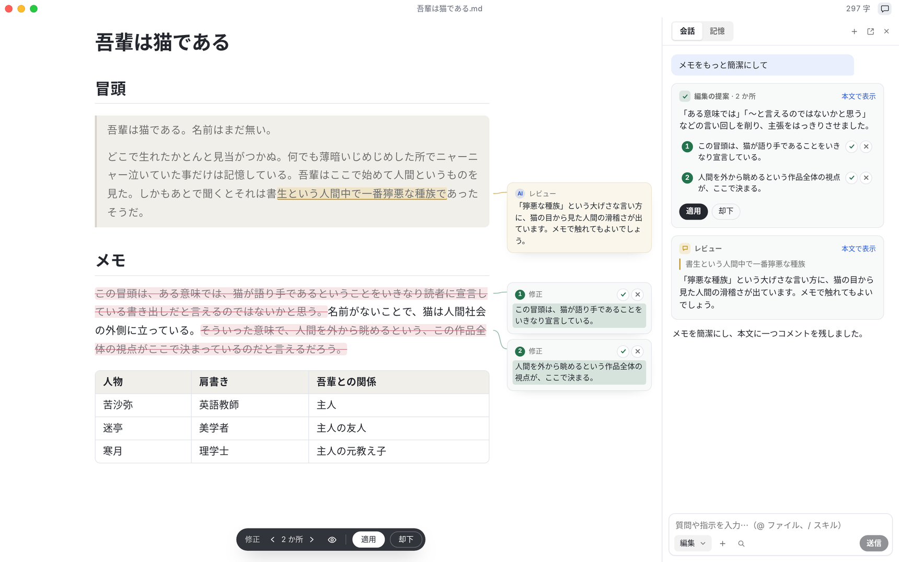
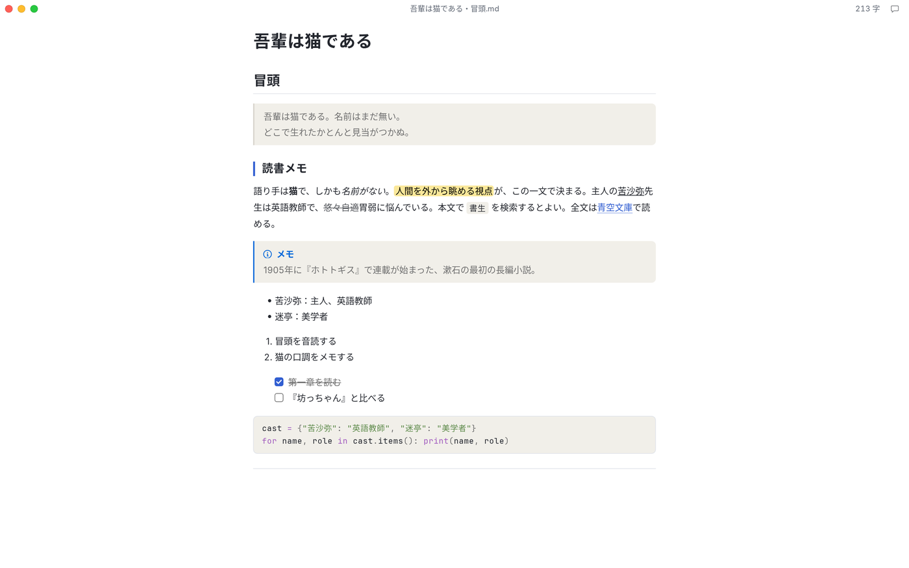
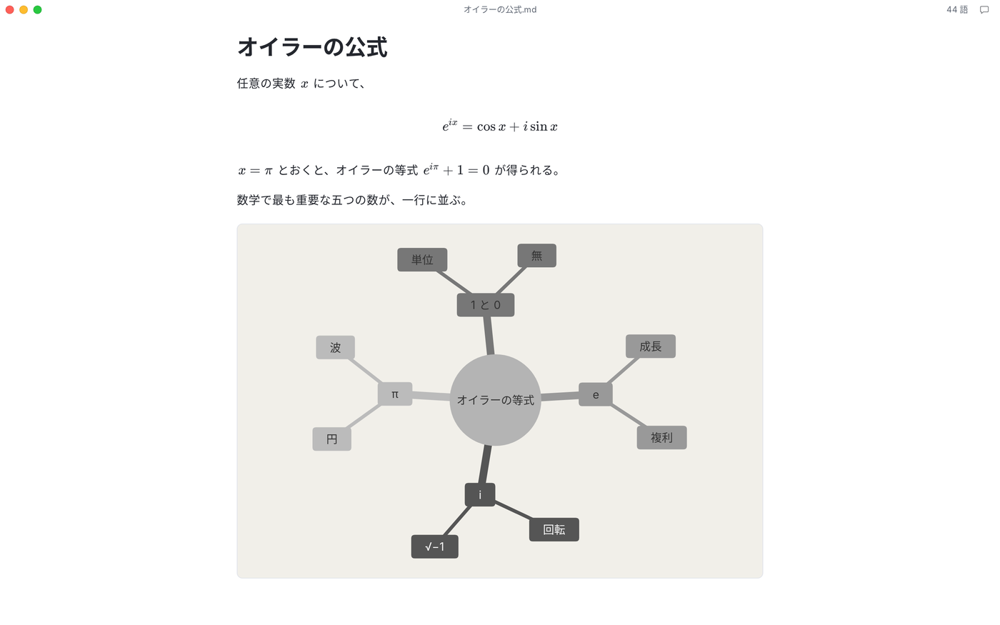
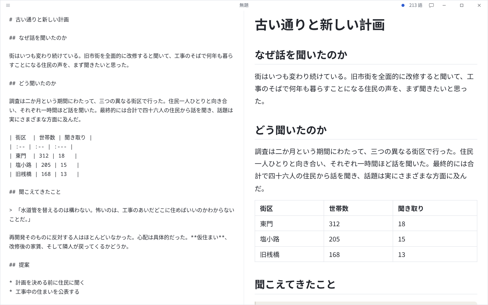
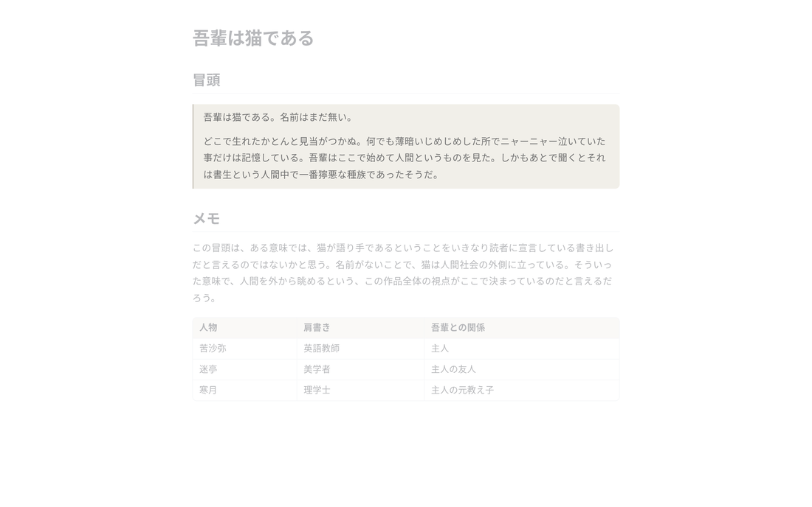
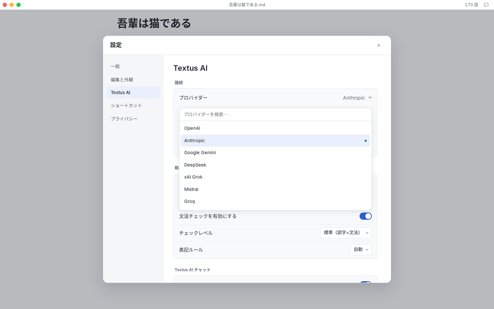

<p align="center">
  
</p>

<h1 align="center">Textus</h1>

<p align="center">
  <strong>次世代のMarkdownエディタ</strong><br>
  筆をとるのは、あなた。墨を磨るのは、AI。
</p>

<p align="center">
  <a href="https://textus.catvinci.com"><strong>公式サイト</strong></a> ·
  <a href="https://github.com/CatVinci-Studio/Textus/releases/latest"><strong>ダウンロード</strong></a>
</p>

<p align="center">
  <a href="./README.md">English</a> ·
  <a href="./README.zh.md">简体中文</a> ·
  <a href="./README.zh-Hant.md">繁體中文</a> ·
  日本語 ·
  <a href="./README.ko.md">한국어</a> ·
  <a href="./README.es.md">Español</a> ·
  <a href="./README.fr.md">Français</a> ·
  <a href="./README.de.md">Deutsch</a> ·
  <a href="./README.ru.md">Русский</a> ·
  <a href="./README.pt.md">Português</a>
</p>

<p align="center">
  <a href="https://github.com/CatVinci-Studio/Textus/releases/latest"></a>
  <a href="https://github.com/CatVinci-Studio/Textus/releases"></a>
  <a href="https://github.com/CatVinci-Studio/Textus/stargazers"></a>
  
  <a href="./LICENSE"></a>
  <a href="https://github.com/CatVinci-Studio/Textus/actions/workflows/ci.yml"></a>
  <a href="https://textus.catvinci.com/discord"></a>
  
  <a href="https://textus.catvinci.com"></a>
</p>

https://github.com/user-attachments/assets/f366f282-e3f9-43d9-9a29-edb6d1ace3f5

<p align="center">
  <br>
  <sub>夏目漱石『吾輩は猫である』</sub>
</p>

## Textusを入手

無料のオープンソース。MITライセンスで公開しています。

| プラットフォーム          | ダウンロード                                                                                             |
| ----------------- | -------------------------------------------------------------------------------------------------- |
| macOS · Appleシリコン | [.dmgをダウンロード](https://github.com/CatVinci-Studio/Textus/releases/latest)                           |
| macOS · Intel     | [.dmgをダウンロード](https://github.com/CatVinci-Studio/Textus/releases/latest)                           |
| Windows · x64     | [.exeをダウンロード](https://github.com/CatVinci-Studio/Textus/releases/latest)                           |
| Linux · x64       | [.AppImageをダウンロード](https://github.com/CatVinci-Studio/Textus/releases/latest) · ほかの形式も .deb · .rpm |

Homebrewでもインストールできます：

```sh
brew install --cask catvinci-studio/tap/textus
```

Arch Linux は署名付きの [`[catvinci]`](https://github.com/CatVinci-Studio/arch-repo) pacman リポジトリで（設定は一度だけ。以後は `sudo pacman -Syu` で Textus も最新に保たれます）：

```sh
bash <(curl -fsSL https://raw.githubusercontent.com/CatVinci-Studio/arch-repo/main/install.sh) textus-bin
```

iPhone版とiPad版も、まもなく登場します。[すべてのリリースをGitHubで見る](https://github.com/CatVinci-Studio/Textus/releases)

## 執筆

Markdownの記法は、書いたそばから仕上がりの姿に。行にポインタを合わせると、元の記法が現れます。

<p align="center">
  
</p>

数式はその場で表示され、表はきれいに揃います。数行のテキストが、そのまま図になります。

<p align="center">
  
</p>

### 書き方は？お好きなように

4つの書き方を自在に切り替え、テーマもすぐに変えられます。Typoraのテーマもそのまま使えます。

| 執筆モード      | どうなるか                   |
| ---------- | ----------------------- |
| 禅モード       | 文字以外のすべてが退きます           |
| タイプライターモード | 書いている行がいつも同じ高さにとどまります   |
| 分割表示       | Markdown と仕上がりを並べて見られます |
| ソースコードモード  | 文書全体を Markdown のまま扱えます  |

<p align="center">
  
  
</p>

PDF、Word、HTMLなどに書き出せます。

## Textus AI

あなたの執筆アシスタント。一緒に書いていきます。

### 書いているとき

手を止めると、続きの言葉が灰色で現れます。Tabキーで採用。誤字や文法の誤りを、書きながら指摘。あなたの表記ルールも確かめます。Alt+Enterで修正。

### 頼んだとき

修正は、理由を添えた提案として届きます。まとめて適用することも、一文ずつ選ぶこともできます。コメントは、該当する行に付きます。書き直すのではなく、助言として。簡潔にする、校正、翻訳、口調を変えるなど。スラッシュひとつで呼び出せます。

### あなたを知っている

あなたの文体を学び、人物や場所の設定を覚え、執筆の指示に従います。

### LLMは、お好きなものを

Textus は20種類以上のLLMに対応し、OpenAI互換のAPIを備えたLLMならどれでも使えます。

OpenAI · Anthropic · Google Gemini · DeepSeek · xAI · Mistral · Groq · OpenRouter · Kimi · GLM · Qwen · Ollama · OpenAI互換のあらゆるエンドポイント

<p align="center">
  
</p>

## あなたが書いたものは、あなただけのもの

あなたの文章は、あなたのもの。Textusはそのために設計され、コードもすべて公開しています。

文書は普通のMarkdownファイル。置き場所はあなたが決めます。APIキーとサインイン情報は、あなたのコンピューターにだけ保存されます。AIへのリクエストは、デバイスから選んだプロバイダーへ直接届きます。ダウンロードして、書くだけ。登録するものは何もありません。分析も、テレメトリーも、広告もありません。MITライセンスで一行残らず公開。ここに書いたことは、誰でも確かめられます。 Ollamaでローカルモデルを使えば、あなたの言葉がコンピューターの外へ出ることはありません。

## よくある質問

<details>
<summary><strong>Textusは無料ですか？</strong></summary>

はい。MITライセンスのオープンソースで、アカウントもサブスクリプションも要りません。Textus AIの利用料は、選んだプロバイダーから直接請求されます。ローカルモデルなら費用はかかりません。

</details>

<details>
<summary><strong>どの環境で使えますか？</strong></summary>

macOS（AppleシリコンとIntel）、Windows、Linuxです。iPhone版とiPad版も準備中です。

</details>

<details>
<summary><strong>AIのアカウントは必要ですか？</strong></summary>

いいえ。エディタの機能は、AIなしですべて使えます。Textus AIを使うときは、ご自身のプロバイダーを接続します。ChatGPTやClaudeでのサインイン、APIキーの入力、Ollamaによるローカルモデルのどれでも使えます。

</details>

<details>
<summary><strong>オフラインでも使えますか？</strong></summary>

エディタはすべての機能が使えます。Textus AIにはプロバイダーへの接続が必要ですが、ローカルモデルならオフラインでも動きます。

</details>

<details>
<summary><strong>普通のMarkdownで、書き出しもできますか？</strong></summary>

はい、普通の.mdファイルです。表、タスクリスト、脚注、数式、Mermaidに対応し、PDF、Word、HTMLなどに書き出せます。

</details>

## はじめかた

1. Textus を起動します。白紙の下書きから始まり、ファイルが必要になるのは保存するときだけです。
2. **設定 → Textus AI** を開いてプロバイダーを選び、**ログインと認証** でサインインするかキーを貼り付けます。
3. 書き始めましょう。手を止めると続きが灰色で現れ、Tab で採用できます。
4. ウィンドウバーのチャットボタンでAIパネルを開きます。詳しくは **ヘルプ → AI 機能ガイド** を。

| 操作         | ショートカット                  |
| ---------- | ------------------------ |
| AIパネル      | Ctrl/⌘+Shift+L           |
| クイック質問     | Ctrl/⌘+Shift+K           |
| 今すぐ補完を提案   | Ctrl/⌘+Shift+Space       |
| 今すぐ文法をチェック | Ctrl/⌘+Shift+G           |
| 保留中の編集を適用  | Ctrl/⌘+Enter             |
| 分割表示       | Ctrl/⌘+Shift+E           |
| 禅モード       | Ctrl/⌘+Shift+J (Esc で終了) |
| ソースコードモード  | Ctrl/⌘+/                 |

どれも **設定 → ショートカット** で変更できます。

## ソースからビルド

```bash
git clone https://github.com/CatVinci-Studio/Textus.git
cd Textus
npm install

npm run tauri dev     # full Tauri app (Rust shell + Vite renderer)
npm run tauri build   # bundle .dmg / -setup.exe (NSIS) / .AppImage / .deb / .rpm
npm run build         # frontend only: type-check (tsc) + vite build
```

[Node.js](https://nodejs.org) 22 以上、[Rust](https://rustup.rs)（stable）、各プラットフォームのビルドツール（macOS は Xcode CLT、Linux は `libwebkit2gtk-4.1-dev`/`libappindicator3-dev`/`librsvg2-dev`/`patchelf`、Windows は MSVC Build Tools）が必要です。

## コントリビュート

CI が実行するチェック、コミットの規約、リリースの手順は [CONTRIBUTING.md](CONTRIBUTING.md) を、テストが何を対象にし、何をあえて対象外にしているかは [docs/TESTING.md](docs/TESTING.md) をご覧ください。やり取りは英語か中国語でお願いします。

## ライセンス

[MIT](./LICENSE) © CatVinci Studio
