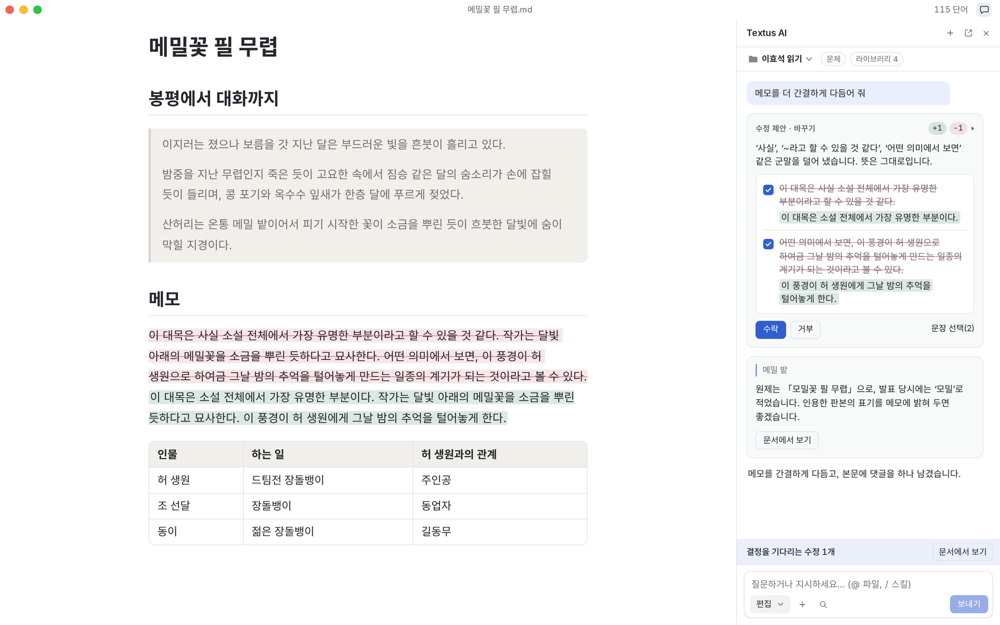
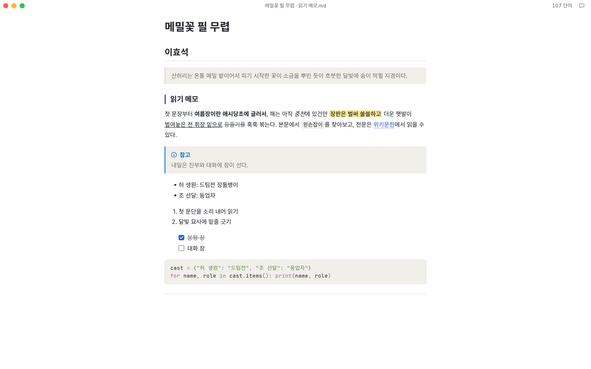
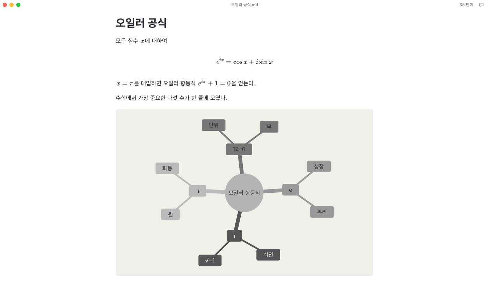
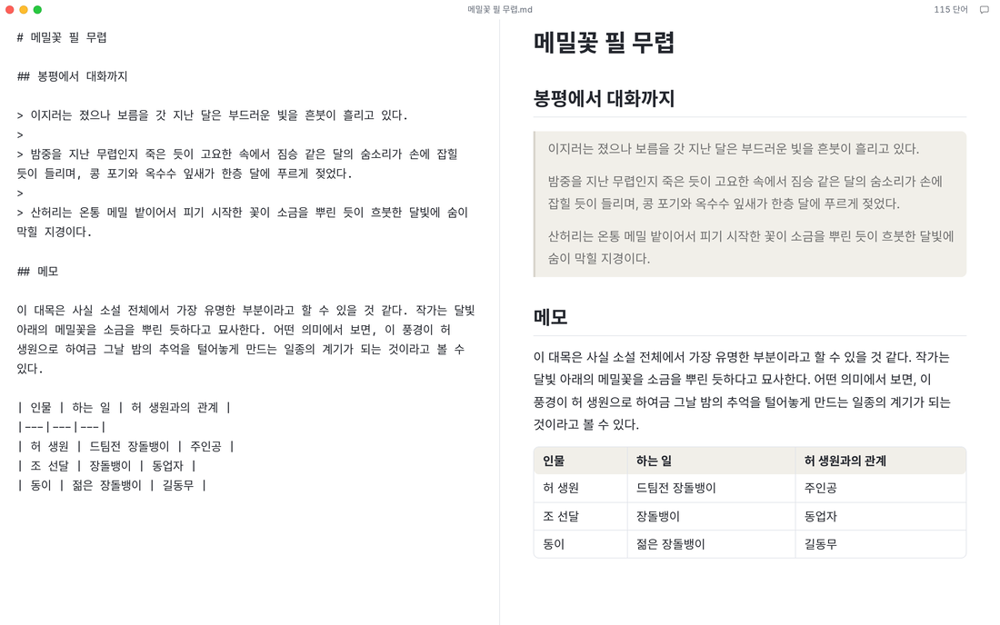
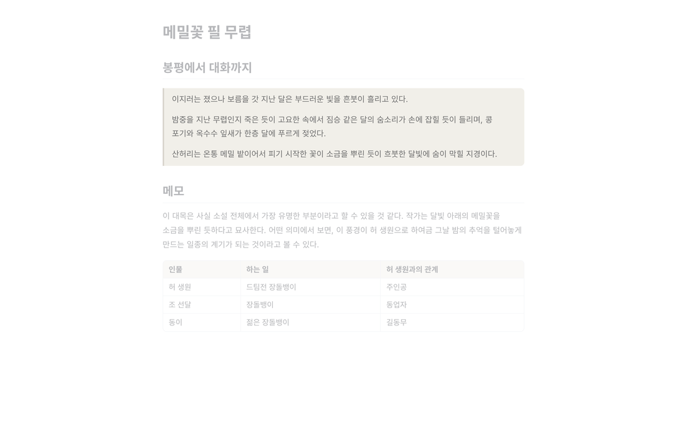
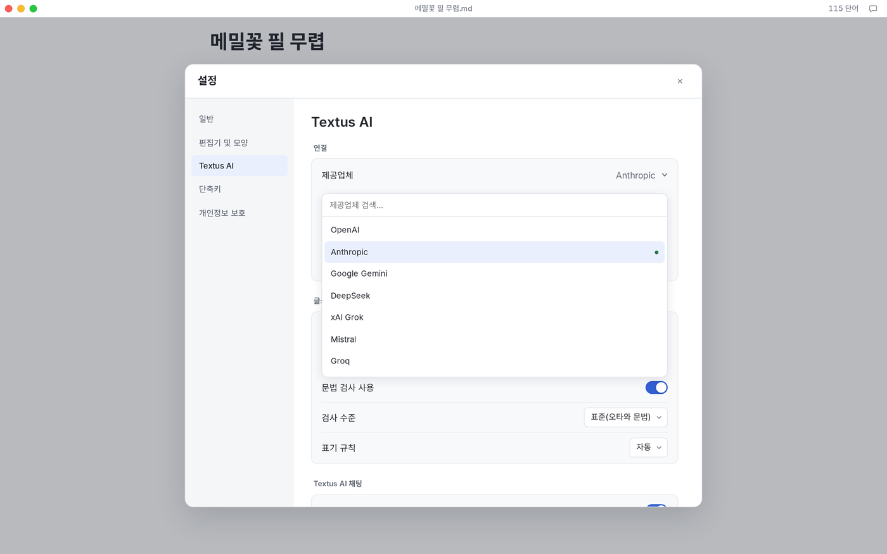

<p align="center">
  
</p>

<h1 align="center">Textus</h1>

<p align="center">
  <strong>차세대 Markdown 편집기</strong><br>
  붓 가는 대로 글이 되고, 먹은 AI가 갈아 줍니다
</p>

<p align="center">
  <a href="https://textus.catvinci.com"><strong>웹사이트</strong></a> ·
  <a href="https://github.com/CatVinci-Studio/Textus/releases/latest"><strong>다운로드</strong></a>
</p>

<p align="center">
  <a href="./README.md">English</a> ·
  <a href="./README.zh.md">简体中文</a> ·
  <a href="./README.zh-Hant.md">繁體中文</a> ·
  <a href="./README.ja.md">日本語</a> ·
  한국어 ·
  <a href="./README.es.md">Español</a> ·
  <a href="./README.fr.md">Français</a> ·
  <a href="./README.de.md">Deutsch</a> ·
  <a href="./README.ru.md">Русский</a> ·
  <a href="./README.pt.md">Português</a>
</p>

<p align="center">
  <a href="https://github.com/CatVinci-Studio/Textus/releases/latest"></a>
  
  <a href="./LICENSE"></a>
</p>

https://github.com/user-attachments/assets/f366f282-e3f9-43d9-9a29-edb6d1ace3f5

<p align="center">
  <br>
  <sub>이효석, <i>「메밀꽃 필 무렵」</i></sub>
</p>

## Textus 시작하기

MIT 라이선스로 공개된 무료 오픈 소스입니다.

| 플랫폼               | 다운로드                                                                                         |
| ----------------- | -------------------------------------------------------------------------------------------- |
| macOS · Apple 실리콘 | [.dmg 다운로드](https://github.com/CatVinci-Studio/Textus/releases/latest)                       |
| Windows · x64     | [.exe 다운로드](https://github.com/CatVinci-Studio/Textus/releases/latest)                       |
| Linux · x64       | [.AppImage 다운로드](https://github.com/CatVinci-Studio/Textus/releases/latest) · 또는 .deb · .rpm |

Homebrew로도 설치할 수 있습니다:

```sh
brew install --cask catvinci-studio/tap/textus
```

Arch Linux는 서명된 [`[catvinci]`](https://github.com/CatVinci-Studio/arch-repo) pacman 저장소로(한 번만 설정하면 이후 `sudo pacman -Syu`로 Textus도 최신 상태가 됩니다):

```sh
bash <(curl -fsSL https://raw.githubusercontent.com/CatVinci-Studio/arch-repo/main/install.sh) textus-bin
```

iPhone·iPad 버전도 곧 나옵니다. [GitHub에서 모든 릴리스 보기](https://github.com/CatVinci-Studio/Textus/releases)

## 글쓰기

어떤 Markdown 표기든 쓰는 즉시 서식으로 바뀝니다. 줄을 가리키면 원래 표기가 보입니다.

<p align="center">
  
</p>

수식은 입력하는 대로 그려지고, 표는 저절로 줄을 맞춥니다. 글 몇 줄이면 다이어그램이 됩니다.

<p align="center">
  
</p>

### 글 쓰는 방식은? 마음 가는 대로

네 가지 쓰기 모드를 자유롭게 오가고, Typora 테마까지 원하는 테마로 바로 바꿀 수 있습니다.

| 쓰기 모드    | 하는 일                                  |
| -------- | ------------------------------------- |
| 젠 모드     | 글 외의 모든 것이 물러납니다                      |
| 타자기 모드   | 지금 쓰는 줄이 늘 같은 높이에 머뭅니다                |
| 분할 보기    | 한쪽에서 Markdown을 쓰고, 다른 쪽에서 완성된 모습을 봅니다 |
| 소스 코드 모드 | 문서 전체를 Markdown 원문 그대로 다룹니다           |

<p align="center">
  
  
</p>

PDF, Word, HTML 등으로 내보낼 수 있습니다.

## Textus AI

당신의 글쓰기 도우미, 함께 씁니다.

### 쓰는 동안

손을 멈추면 다음 말이 회색으로 떠오릅니다. Tab 키로 수락하세요. 쓰는 동안 오타와 문법 오류를 짚어 주고, 내 표기 규칙도 함께 확인합니다. Alt+Enter로 바로 고칩니다.

### 부탁하면

고칠 곳은 이유와 함께 제안으로 옵니다. 통째로 수락하거나 문장별로 고르세요. 댓글이 해당 문장 옆에 붙습니다. 글을 고치지 않고 의견만 남깁니다. 간결하게, 교정, 번역, 어조 바꾸기까지. 슬래시(/) 하나면 됩니다.

### 나를 아는 AI

내 문체를 익히고, 인물과 장소를 기억하며, 내가 정한 지침을 따릅니다.

### 원하는 LLM으로

Textus는 20개가 넘는 LLM을 지원하며, OpenAI 호환 API를 제공하는 LLM이라면 무엇이든 쓸 수 있습니다.

OpenAI · Anthropic · Google Gemini · DeepSeek · xAI · Mistral · Groq · OpenRouter · Kimi · GLM · Qwen · Ollama · OpenAI 호환 엔드포인트

<p align="center">
  
</p>

## 당신이 쓴 글은 오직 당신의 것

내 글은 내 것입니다. Textus는 처음부터 그렇게 설계되었고, 코드는 누구나 확인할 수 있습니다.

문서는 원하는 곳에 저장하는 일반 Markdown 파일입니다. API 키와 로그인 정보는 내 컴퓨터에만 저장됩니다. AI 요청은 내 기기에서 내가 고른 제공업체로 바로 전송됩니다. 내려받아 바로 쓰면 됩니다. 가입할 필요가 없습니다. 분석도, 원격 측정도, 광고도 없습니다. MIT 라이선스로 모든 코드를 공개합니다. 위의 내용은 누구나 확인할 수 있습니다. Ollama로 로컬 모델을 쓰면 글이 내 컴퓨터 밖으로 나가지 않습니다.

## 자주 묻는 질문

<details>
<summary><strong>Textus는 무료인가요?</strong></summary>

네. MIT 라이선스의 무료 오픈 소스이며, 계정도 구독도 필요 없습니다. Textus AI 사용료는 선택한 제공업체가 직접 청구하고, 로컬 모델은 비용이 들지 않습니다.

</details>

<details>
<summary><strong>어떤 운영체제에서 쓸 수 있나요?</strong></summary>

Apple 실리콘 Mac의 macOS, Windows, Linux에서 쓸 수 있습니다. iPhone·iPad 버전도 준비 중입니다.

</details>

<details>
<summary><strong>AI 계정이 필요한가요?</strong></summary>

아니요. 편집기의 모든 기능은 AI 없이도 쓸 수 있습니다. Textus AI를 쓰려면 제공업체를 직접 연결하세요. ChatGPT나 Claude 계정으로 로그인하거나, API 키를 입력하거나, Ollama로 로컬 모델을 실행하면 됩니다.

</details>

<details>
<summary><strong>인터넷 없이도 쓸 수 있나요?</strong></summary>

편집기는 완전히 오프라인으로 작동합니다. Textus AI는 제공업체와 연결되어야 하지만, 로컬 모델을 쓰면 인터넷이 필요 없습니다.

</details>

<details>
<summary><strong>일반 Markdown 파일인가요?</strong></summary>

네. 일반 .md 파일이며 표, 할 일 목록, 각주, 수식, Mermaid를 지원합니다. PDF, Word, HTML 등으로 내보낼 수 있습니다.

</details>

## 빠른 시작

1. Textus를 실행합니다. 빈 초안에서 시작하며, 파일은 저장할 때만 정하면 됩니다.
2. **설정 → Textus AI**를 열어 제공업체를 고르고, **로그인 및 인증 정보**에서 로그인하거나 키를 붙여 넣습니다.
3. 쓰기 시작하세요. 잠시 멈추면 다음 문장이 회색으로 나타나고, Tab으로 받아들입니다.
4. 창 막대의 채팅 버튼으로 AI 패널을 엽니다. 나머지는 **도움말 → AI 기능 가이드**에 있습니다.

| 동작          | 단축키                       |
| ----------- | ------------------------- |
| AI 패널       | Ctrl/⌘+Shift+L            |
| 빠른 질문       | Ctrl/⌘+Shift+K            |
| 지금 이어 쓰기 제안 | Ctrl/⌘+Shift+Space        |
| 지금 문법 검사    | Ctrl/⌘+Shift+G            |
| 대기 중인 수정 수락 | Ctrl/⌘+Enter              |
| 분할 보기       | Ctrl/⌘+Shift+E            |
| 젠 모드        | Ctrl/⌘+Shift+J (Esc로 나가기) |
| 소스 코드 모드    | Ctrl/⌘+/                  |

모두 **설정 → 단축키**에서 바꿀 수 있습니다.

## 소스에서 빌드

```bash
git clone https://github.com/CatVinci-Studio/Textus.git
cd Textus
npm install

npm run tauri dev     # full Tauri app (Rust shell + Vite renderer)
npm run tauri build   # bundle .dmg / -setup.exe (NSIS) / .AppImage / .deb / .rpm
npm run build         # frontend only: type-check (tsc) + vite build
```

[Node.js](https://nodejs.org) 22 이상, [Rust](https://rustup.rs)(stable), 플랫폼별 빌드 도구(macOS는 Xcode CLT, Linux는 `libwebkit2gtk-4.1-dev`/`libappindicator3-dev`/`librsvg2-dev`/`patchelf`, Windows는 MSVC Build Tools)가 필요합니다.

## 기여하기

CI가 실행하는 검사, 커밋 규칙, 릴리스 절차는 [CONTRIBUTING.md](CONTRIBUTING.md)를, 테스트가 무엇을 다루고 무엇을 일부러 다루지 않는지는 [docs/TESTING.md](docs/TESTING.md)를 보세요. 논의는 영어나 중국어로 해 주세요.

## 라이선스

[MIT](./LICENSE) © CatVinci Studio
