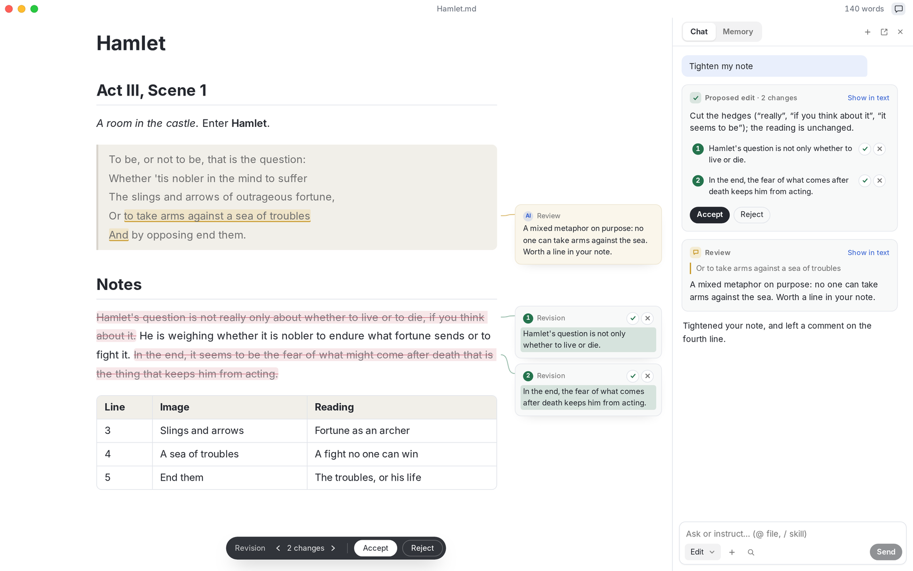
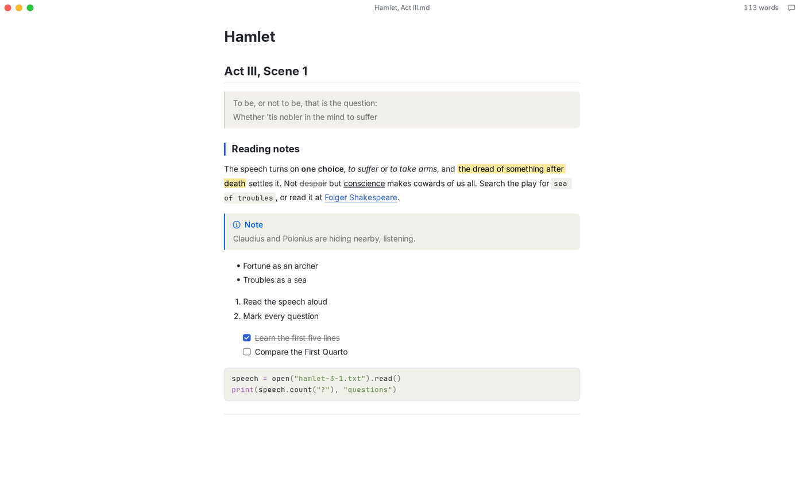
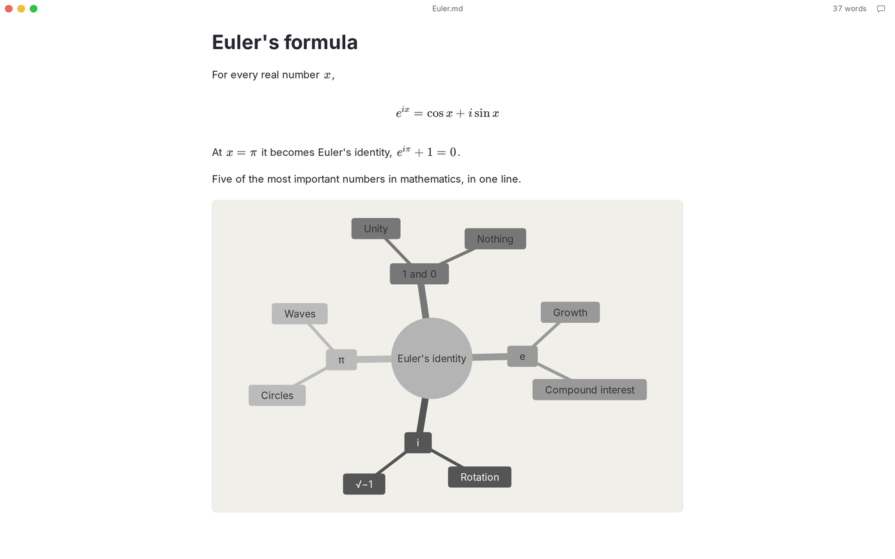
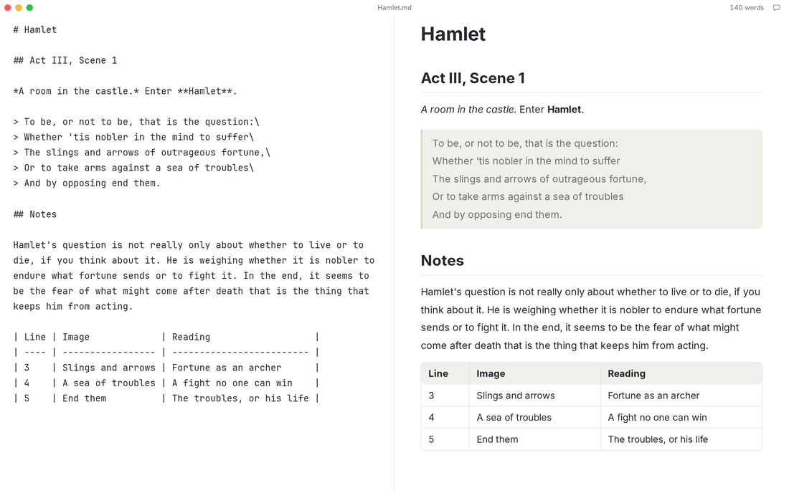
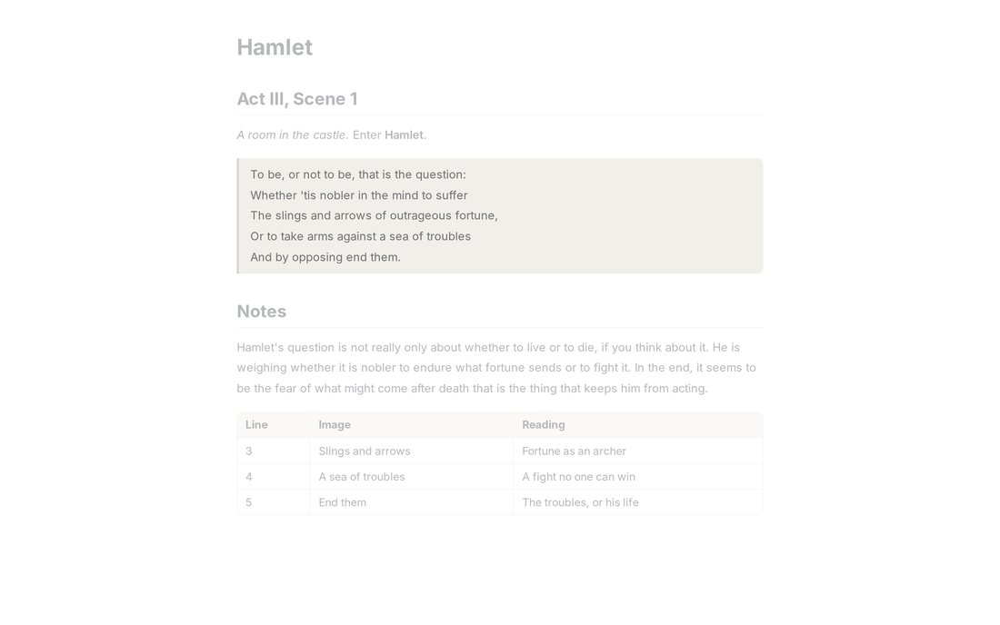
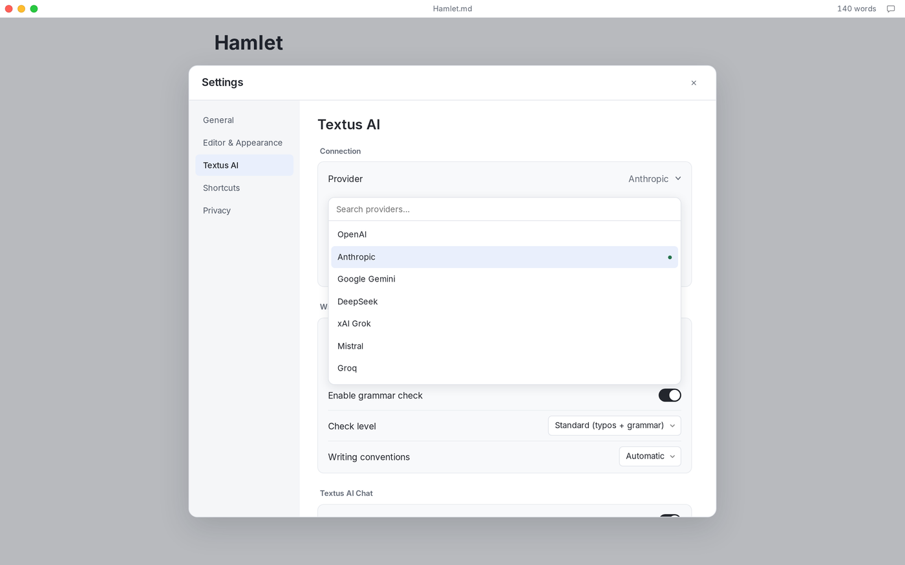

<!-- The English README is the reference: every README.<lang>.md follows its
     structure section by section (scripts/check-readmes.mjs). It follows the
     website: hero, download, writing, Textus AI, privacy, questions. -->

<p align="center">
  
</p>

<h1 align="center">Textus</h1>

<p align="center">
  <strong>The next-generation Markdown editor.</strong><br>
  You hold the pen. AI keeps your ink flowing.<br>
  <sub>Free and open source · For macOS, Windows and Linux.</sub>
</p>

<p align="center">
  <a href="https://textus.catvinci.com"><strong>Website</strong></a> ·
  <a href="https://github.com/CatVinci-Studio/Textus/releases/latest"><strong>Download</strong></a>
</p>

<p align="center">
  English ·
  <a href="./README.zh.md">简体中文</a> ·
  <a href="./README.zh-Hant.md">繁體中文</a> ·
  <a href="./README.ja.md">日本語</a> ·
  <a href="./README.ko.md">한국어</a> ·
  <a href="./README.es.md">Español</a> ·
  <a href="./README.fr.md">Français</a> ·
  <a href="./README.de.md">Deutsch</a> ·
  <a href="./README.ru.md">Русский</a> ·
  <a href="./README.pt.md">Português</a>
</p>

<p align="center">
  <a href="https://github.com/CatVinci-Studio/Textus/releases/latest"></a>
  
  <a href="./LICENSE"></a>
</p>

<p align="center">
  <br>
  <sub><i>Hamlet</i>, William Shakespeare</sub>
</p>

## Get Textus

Free and open source, under the MIT license.

| Platform              | Download                                                                                              |
| --------------------- | ----------------------------------------------------------------------------------------------------- |
| macOS · Apple Silicon | [Download .dmg](https://github.com/CatVinci-Studio/Textus/releases/latest)                            |
| Windows · x64         | [Download .exe](https://github.com/CatVinci-Studio/Textus/releases/latest)                            |
| Linux · x64           | [Download .AppImage](https://github.com/CatVinci-Studio/Textus/releases/latest) · Also as .deb · .rpm |

Or with Homebrew:

```sh
brew install --cask catvinci-studio/tap/textus
```

Arch Linux via the signed [`[catvinci]`](https://github.com/CatVinci-Studio/arch-repo) pacman repository (once; `sudo pacman -Syu` then keeps Textus up to date):

```sh
bash <(curl -fsSL https://raw.githubusercontent.com/CatVinci-Studio/arch-repo/main/install.sh) textus-bin
```

iPhone and iPad: coming soon. [All releases on GitHub](https://github.com/CatVinci-Studio/Textus/releases)

## Made for writing

### What you see is what you get

Every Markdown mark, rendered as you write. Point at a line to see its Markdown.

<p align="center">
  
</p>

### Formulas, tables, diagrams

Math renders as you type, tables line up, and a few lines of text draw a diagram.

<p align="center">
  
</p>

### Your writing style? Your call

Four writing modes, any theme you like – Typora themes included.

- **Zen Mode**: everything but your words steps away.
- **Typewriter Mode**: the line you are writing stays at the same height.
- **Split View**: Markdown on one side, the finished page on the other.
- **Source Code Mode**: the whole document as plain Markdown.

<p align="center">
  
  
</p>

### Share it anywhere

Export to PDF, Word, HTML and more.

## It suggests. You decide

Textus AI helps at every step. Every word stays yours.

- **Continuation**: Pause, and the next words appear in grey. Tab takes them.
- **AI writing**: Edits arrive as proposals, each with a reason. Take one whole, or sentence by sentence.
- **Grammar check**: Typos and grammar are flagged as you write, along with your own conventions. Alt+Enter fixes them.
- **Review**: Comments pinned to the lines they mean. Notes, not rewrites.
- **Built-in skills**: Tighten, proofread, translate, change the tone and more, one slash away.
- **It knows you**: It learns your style, remembers your characters and places, and follows your instructions.

### Use the AI you prefer

Sign in with ChatGPT or Claude, add an API key, or run a model on your own computer.

OpenAI · Anthropic · Google Gemini · DeepSeek · xAI · Mistral · Groq · OpenRouter · Kimi · GLM · Qwen · Ollama · Any OpenAI-compatible endpoint

<p align="center">
  
</p>

## Private by design

Your writing stays yours. Textus is built so that it can, and its code is open so that anyone can check.

- **On your device**: Documents are plain Markdown files, kept wherever you choose.
- **Keys kept locally**: API keys and sign-ins are stored only on your computer.
- **Straight to your provider**: AI requests travel directly from your device to the provider you pick.
- **No account**: Download it and write. There is nothing to sign up for.
- **No tracking**: No analytics, no telemetry, no ads.
- **Open source**: MIT-licensed and public, line by line, so anyone can verify all of this.

With a local model through Ollama, your words never leave your computer.

## Questions

<details>
<summary><strong>Is Textus free?</strong></summary>

Yes. It is free and open source under the MIT license, with no account and no subscription. If you use Textus AI, your provider bills you directly, or not at all with a local model.

</details>

<details>
<summary><strong>Which platforms does it run on?</strong></summary>

macOS on Apple Silicon, Windows and Linux. iPhone and iPad are coming.

</details>

<details>
<summary><strong>Do I need an AI account?</strong></summary>

No. The editor works fully without AI. For Textus AI, connect a provider of your own: sign in with ChatGPT or Claude, add an API key, or run a local model with Ollama.

</details>

<details>
<summary><strong>Does it work offline?</strong></summary>

The editor does, completely. Textus AI needs your provider, unless you run a local model.

</details>

<details>
<summary><strong>Is it plain Markdown? What can I export?</strong></summary>

Yes: plain .md files, with tables, task lists, footnotes, math and Mermaid. You can export to PDF, Word, HTML and more.

</details>

## Quick start

1. Launch Textus. It opens on a blank draft; you only need a file when you save.
2. Open **Settings → Textus AI**, choose a provider, and sign in or paste a key under **Login & credentials**.
3. Start typing. A continuation appears in grey when you pause; Tab accepts it.
4. Open the AI panel with the chat button in the window bar. **Help → AI Features Guide** covers the rest.

| Action                 | Shortcut                     |
| ---------------------- | ---------------------------- |
| AI panel               | Ctrl/⌘+Shift+L               |
| Quick Ask              | Ctrl/⌘+Shift+K               |
| Suggest completion now | Ctrl/⌘+Shift+Space           |
| Check grammar now      | Ctrl/⌘+Shift+G               |
| Accept a pending edit  | Ctrl/⌘+Enter                 |
| Split View             | Ctrl/⌘+Shift+E               |
| Zen Mode               | Ctrl/⌘+Shift+J (Esc to exit) |
| Source Code Mode       | Ctrl/⌘+/                     |

All of them can be changed in **Settings → Shortcuts**.

## Build from source

```bash
git clone https://github.com/CatVinci-Studio/Textus.git
cd Textus
npm install

npm run tauri dev     # full Tauri app (Rust shell + Vite renderer)
npm run tauri build   # bundle .dmg / -setup.exe (NSIS) / .AppImage / .deb / .rpm
npm run build         # frontend only: type-check (tsc) + vite build
```

Requires [Node.js](https://nodejs.org) 22+, [Rust](https://rustup.rs) (stable), and platform build tools (Xcode CLT on macOS; `libwebkit2gtk-4.1-dev`/`libappindicator3-dev`/`librsvg2-dev`/`patchelf` on Linux; MSVC Build Tools on Windows).

## Contributing

See [CONTRIBUTING.md](CONTRIBUTING.md) for the checks CI runs, commit conventions and the release process. [docs/TESTING.md](docs/TESTING.md) maps what the test suites cover – and what they deliberately don't. Contributions are discussed in English or Chinese.

## License

[MIT](./LICENSE) © CatVinci Studio
