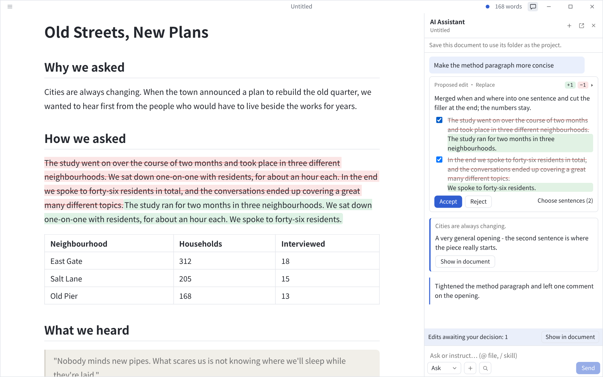
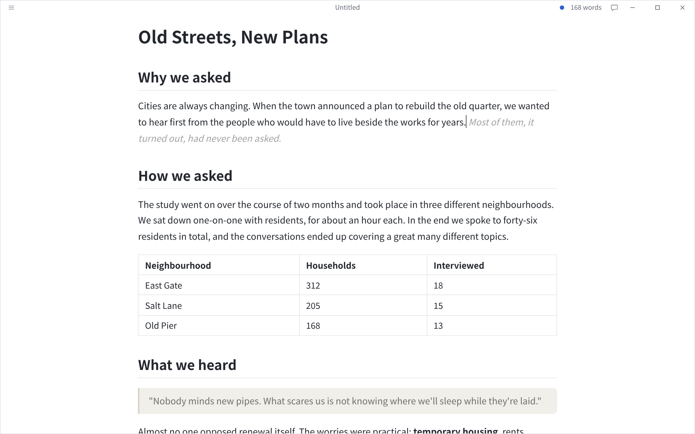

<!-- The English README is the reference: README.zh.md and README.ja.md
     follow its structure section by section (scripts/check-readmes.mjs). -->

<p align="center">
  
</p>

<h1 align="center">Levis</h1>

<p align="center">
  <strong>A WYSIWYG Markdown editor with an AI that reviews instead of rewriting.</strong><br>
  Open source and light. The AI continues, checks and suggests; every change waits for your yes.
</p>

<p align="center">
  <a href="https://github.com/CatVinci-Studio/Levis/releases/latest"><strong>Download</strong></a> ·
  <a href="./README.zh.md">中文</a> ·
  <a href="./README.ja.md">日本語</a>
</p>

<p align="center">
  <a href="https://github.com/CatVinci-Studio/Levis/releases/latest"></a>
  
  <a href="./LICENSE"></a>
</p>

<p align="center">
  
</p>

## Features

### The editor

- **True WYSIWYG.** Markdown marks appear only where the cursor is; everywhere else you read the finished page.
- Tables, math, Mermaid diagrams, syntax-highlighted code, footnotes, task lists and GitHub alerts.
- **Split view** (source beside a live preview), **typewriter mode** (the line you are writing stays centred) and **zen mode** (just the text, the current paragraph in focus).
- Tabs and windows, find and replace, Typora theme import and your own CSS.
- Export to PDF and HTML, or to Word, OpenDocument and RTF with [Pandoc](https://pandoc.org).

<p align="center">
  
  
</p>

### AI that stays out of the way

- **Continuation** as grey text: Tab takes it all, Ctrl/⌘+→ one word at a time; ask for alternatives and cycle them.
- **Grammar check** underlines issues in the paragraph you are in; Alt+Enter applies a fix.
- **AI panel** beside the document: ask about it, or ask for edits. Each edit arrives as a proposal with its reason, shown in the document - accept it, reject it, or take only the sentences you want. Ask for a review and you get comments instead of edits.
- **Quick Ask** on a selection, right where you are writing.

<p align="center">
  
</p>

### Your project, your voice

- Save a document and its folder becomes the project: the AI can read and search the text files there, and `@` brings one into the conversation.
- **Style profile** (`.levis/style.md`): written from samples you pick, so continuations and edits sound like you.
- **Library** (`.levis/library/`): characters, places and terms. The entries a passage mentions go to the AI with it, so names and facts stay consistent.

### Providers and privacy

- OpenAI, Anthropic, Google Gemini, DeepSeek, xAI, Mistral, Groq, OpenRouter, Moonshot, Zhipu, Qwen, Ollama (local) or any OpenAI-compatible endpoint.
- Sign in with your ChatGPT or Claude account, or use an API key.
- Requests go straight from your computer to the provider you choose; keys and sign-ins are stored only on your computer. With Ollama nothing leaves it.

## Install

macOS (Apple Silicon) via [Homebrew](https://brew.sh):

```sh
brew install --cask catvinci-studio/tap/levis
```

Arch Linux via the signed [`[catvinci]`](https://github.com/CatVinci-Studio/arch-repo) pacman repository (once; `sudo pacman -Syu` then keeps Levis up to date):

```sh
bash <(curl -fsSL https://raw.githubusercontent.com/CatVinci-Studio/arch-repo/main/install.sh) levis-bin
```

Or download an installer from [Releases](https://github.com/CatVinci-Studio/Levis/releases/latest):

| Platform              | Installer                                                                |
| --------------------- | ------------------------------------------------------------------------ |
| macOS (Apple Silicon) | `Levis_X.Y.Z_aarch64.dmg`                                                |
| Windows               | `Levis_X.Y.Z_x64-setup.exe`                                              |
| Linux                 | `Levis_X.Y.Z_amd64.AppImage` · `_amd64.deb` · `Levis-X.Y.Z-1.x86_64.rpm` |

## Quick start

1. Launch Levis. It opens on a blank draft; you only need a file when you save.
2. Open **Settings → AI**, choose a provider, and sign in or paste a key under **Login & credentials**.
3. Start typing. A continuation appears as grey text when you pause; Tab accepts it.
4. Open the AI panel with the chat button in the window bar. **Help → AI Features Guide** covers the rest.

| Action                    | Shortcut                     |
| ------------------------- | ---------------------------- |
| AI panel                  | Ctrl/⌘+Shift+L               |
| Quick Ask                 | Ctrl/⌘+Shift+K               |
| Continue writing          | Ctrl/⌘+Shift+Space           |
| Check grammar             | Ctrl/⌘+Shift+G               |
| Accept a pending edit     | Ctrl/⌘+Enter                 |
| Split view                | Ctrl/⌘+Shift+E               |
| Zen mode                  | Ctrl/⌘+Shift+J (Esc to exit) |
| Source mode               | Ctrl/⌘+/                     |

All of them can be changed in **Settings → Shortcuts**.

## Why Levis

Writing Markdown should feel like writing, not like editing a file: no preview pane to glance at, no syntax in the way. Levis is open source and small, and its AI is built for writers who want to stay the author - it suggests, explains, and leaves every decision to you.

## Build from source

```bash
git clone https://github.com/CatVinci-Studio/Levis.git
cd Levis
npm install

npm run tauri dev     # full Tauri app (Rust shell + Vite renderer)
npm run tauri build   # bundle .dmg / -setup.exe (NSIS) / .AppImage / .deb / .rpm
npm run build         # frontend only: type-check (tsc) + vite build
```

Requires [Node.js](https://nodejs.org) 20+, [Rust](https://rustup.rs) (stable), and platform build tools (Xcode CLT on macOS; `libwebkit2gtk-4.1-dev`/`libappindicator3-dev`/`librsvg2-dev`/`patchelf` on Linux; MSVC Build Tools on Windows).

## Contributing

See [CONTRIBUTING.md](CONTRIBUTING.md) for the checks CI runs, commit conventions and the release process. [docs/TESTING.md](docs/TESTING.md) maps what the test suites cover - and what they deliberately don't.

## License

[MIT](./LICENSE) © CatVinci Studio
