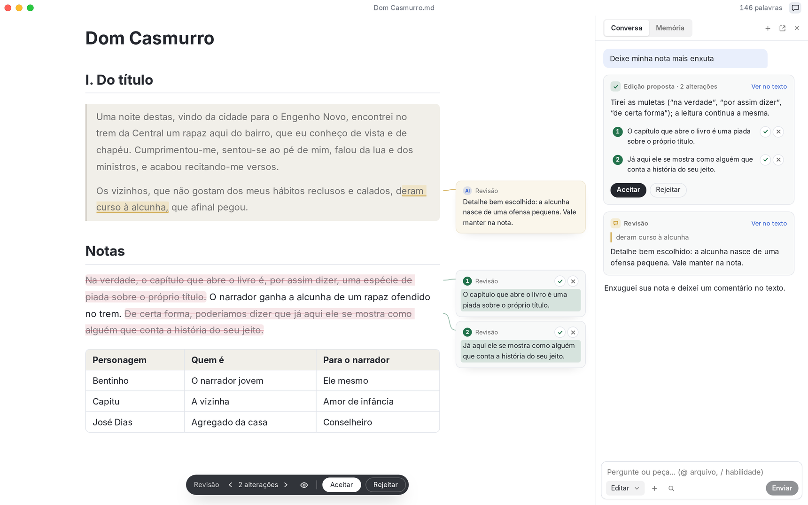
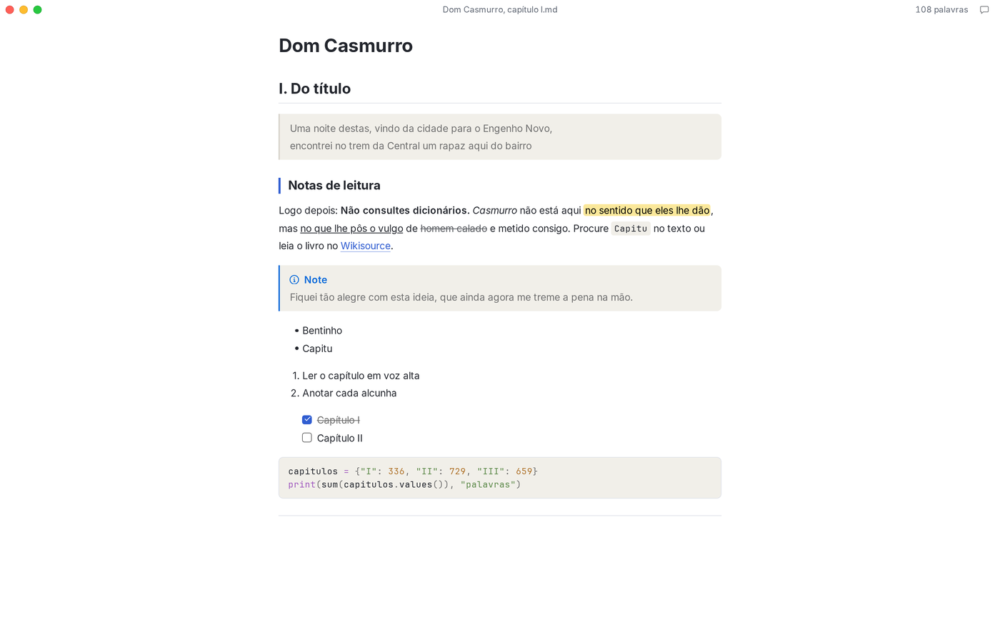
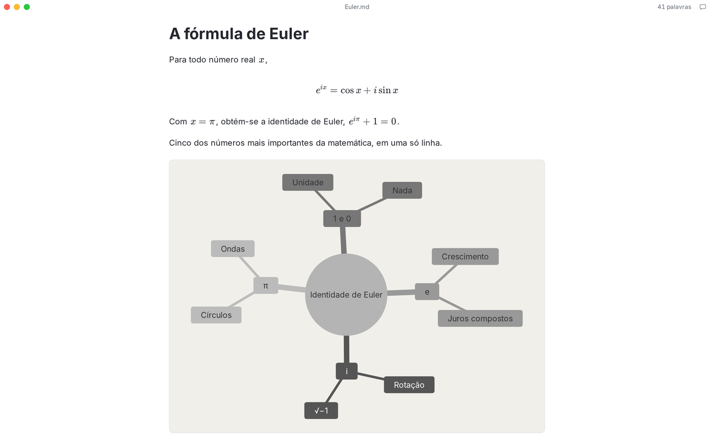
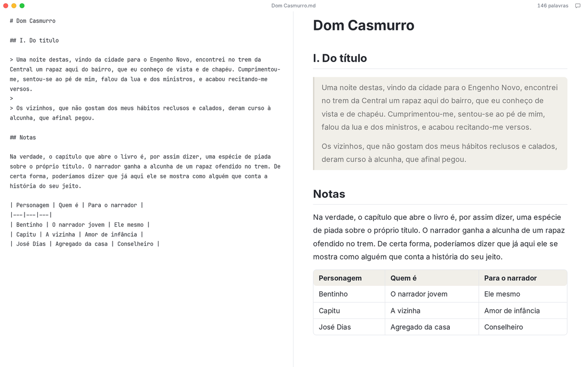
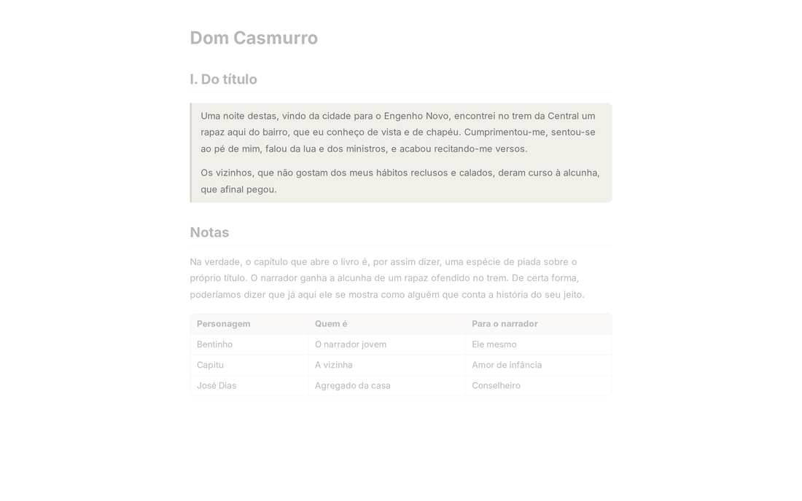
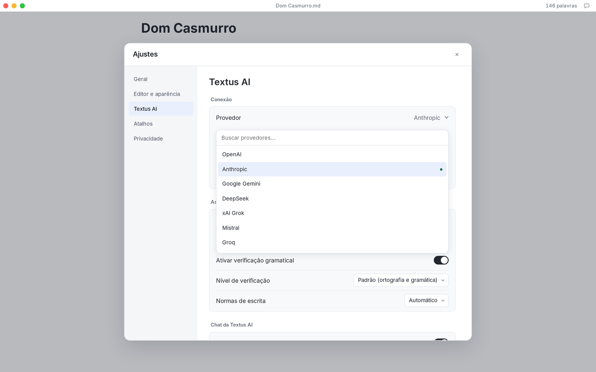

<p align="center">
  
</p>

<h1 align="center">Textus</h1>

<p align="center">
  <strong>O editor de Markdown de nova geração.</strong><br>
  A caneta é sua. A IA cuida da tinta.
</p>

<p align="center">
  <a href="https://textus.catvinci.com"><strong>Site</strong></a> ·
  <a href="https://github.com/CatVinci-Studio/Textus/releases/latest"><strong>Baixar</strong></a>
</p>

<p align="center">
  <a href="./README.md">English</a> ·
  <a href="./README.zh.md">简体中文</a> ·
  <a href="./README.zh-Hant.md">繁體中文</a> ·
  <a href="./README.ja.md">日本語</a> ·
  <a href="./README.ko.md">한국어</a> ·
  <a href="./README.es.md">Español</a> ·
  <a href="./README.fr.md">Français</a> ·
  <a href="./README.de.md">Deutsch</a> ·
  <a href="./README.ru.md">Русский</a> ·
  Português
</p>

<p align="center">
  <a href="https://github.com/CatVinci-Studio/Textus/releases/latest"></a>
  <a href="https://github.com/CatVinci-Studio/Textus/releases"></a>
  <a href="https://github.com/CatVinci-Studio/Textus/stargazers"></a>
  
  <a href="./LICENSE"></a>
  <a href="https://github.com/CatVinci-Studio/Textus/actions/workflows/ci.yml"></a>
  <a href="https://textus.catvinci.com/discord"></a>
  
  <a href="https://textus.catvinci.com"></a>
</p>

https://github.com/user-attachments/assets/f366f282-e3f9-43d9-9a29-edb6d1ace3f5

<p align="center">
  <br>
  <sub><i>Dom Casmurro</i>, Machado de Assis</sub>
</p>

## Baixe o Textus

Gratuito e de código aberto, sob a licença MIT.

| Plataforma            | Baixar                                                                                                |
| --------------------- | ----------------------------------------------------------------------------------------------------- |
| macOS · Apple Silicon | [Baixar .dmg](https://github.com/CatVinci-Studio/Textus/releases/latest)                              |
| macOS · Intel         | [Baixar .dmg](https://github.com/CatVinci-Studio/Textus/releases/latest)                              |
| Windows · x64         | [Baixar .exe](https://github.com/CatVinci-Studio/Textus/releases/latest)                              |
| Linux · x64           | [Baixar .AppImage](https://github.com/CatVinci-Studio/Textus/releases/latest) · Também em .deb · .rpm |

Ou pelo Homebrew:

```sh
brew install --cask catvinci-studio/tap/textus
```

Arch Linux pelo repositório pacman assinado [`[catvinci]`](https://github.com/CatVinci-Studio/arch-repo) (uma vez só; depois `sudo pacman -Syu` mantém o Textus atualizado):

```sh
bash <(curl -fsSL https://raw.githubusercontent.com/CatVinci-Studio/arch-repo/main/install.sh) textus-bin
```

iPhone e iPad: em breve. [Todas as versões no GitHub](https://github.com/CatVinci-Studio/Textus/releases)

## Escrita

Toda a sintaxe do Markdown, formatada enquanto você escreve. Passe o cursor sobre uma linha para ver o Markdown dela.

<p align="center">
  
</p>

As fórmulas aparecem enquanto você digita, as tabelas se alinham sozinhas e poucas linhas de texto viram um diagrama.

<p align="center">
  
</p>

### Seu estilo de escrita? Você decide

Quatro modos de escrita e o tema que você quiser, inclusive os do Typora.

| Modos de escrita         | O que faz                                                    |
| ------------------------ | ------------------------------------------------------------ |
| Modo Zen                 | Tudo sai de cena, menos as suas palavras                     |
| Modo Máquina de Escrever | A linha que você está escrevendo fica sempre na mesma altura |
| Visualização Dividida    | O Markdown de um lado, a página pronta do outro              |
| Modo Código-Fonte        | O documento inteiro em Markdown puro                         |

<p align="center">
  
  
</p>

Exporte para PDF, Word, HTML e mais.

## Textus AI

Seu assistente de escrita. Escreve com você.

### Enquanto você escreve

Pare um instante e as próximas palavras surgem em cinza. Tab para aceitar. Ortografia e gramática conferidas enquanto você escreve, de acordo com as suas normas de escrita. Alt+Enter corrige.

### Quando você pede

As edições chegam como propostas, cada uma com o seu motivo. Aceite tudo de uma vez ou frase a frase. Comentários fixados nas linhas a que se referem. Observações, não reescritas. Enxugar, revisar, traduzir, mudar o tom e mais: é só digitar uma barra.

### Ela conhece a sua obra

Aprende o seu estilo, lembra seus personagens e lugares e segue suas instruções.

### O LLM que você preferir

O Textus funciona com mais de 20 LLMs e com qualquer LLM que ofereça uma API compatível com a OpenAI.

OpenAI · Anthropic · Google Gemini · DeepSeek · xAI · Mistral · Groq · OpenRouter · Kimi · GLM · Qwen · Ollama · Qualquer endpoint compatível com OpenAI

<p align="center">
  
</p>

## O que você escreve é só seu

O que você escreve é seu. O Textus foi feito para que continue assim, e o código é aberto: qualquer pessoa pode conferir.

Os documentos são arquivos Markdown comuns, guardados onde você quiser. Chaves de API e logins ficam salvos só no seu computador. As requisições de IA saem do seu dispositivo direto para o provedor que você escolher. Baixe e comece a escrever. Não há cadastro. Sem analytics, sem telemetria, sem anúncios. Licença MIT e código público, linha por linha, para que qualquer pessoa confira tudo isso. Com um modelo local no Ollama, suas palavras nunca saem do seu computador.

## Perguntas frequentes

<details>
<summary><strong>O Textus é gratuito?</strong></summary>

Sim. É gratuito e de código aberto, sob a licença MIT, sem conta e sem assinatura. Se você usar a Textus AI, quem cobra é o seu provedor, diretamente; com um modelo local, ninguém cobra nada.

</details>

<details>
<summary><strong>Em quais plataformas ele funciona?</strong></summary>

macOS (Apple Silicon e Intel), Windows e Linux. As versões para iPhone e iPad estão a caminho.

</details>

<details>
<summary><strong>Preciso de uma conta de IA?</strong></summary>

Não. O editor funciona por completo sem IA. Para usar a Textus AI, conecte o seu próprio provedor: entre com o ChatGPT ou o Claude, adicione uma chave de API ou rode um modelo local com o Ollama.

</details>

<details>
<summary><strong>Funciona offline?</strong></summary>

O editor, sim, por completo. A Textus AI precisa do seu provedor, a menos que você rode um modelo local.

</details>

<details>
<summary><strong>É Markdown comum? Para quais formatos posso exportar?</strong></summary>

Sim: arquivos .md comuns, com tabelas, listas de tarefas, notas de rodapé, fórmulas e Mermaid. Você pode exportar para PDF, Word, HTML e mais.

</details>

## Primeiros passos

1. Abra o Textus. Ele começa com um rascunho em branco; você só precisa de um arquivo ao salvar.
2. Abra **Ajustes → Textus AI**, escolha um provedor e faça login ou cole uma chave em **Login e credenciais**.
3. Comece a escrever. Quando você para, a continuação aparece em cinza; Tab aceita.
4. Abra o Painel de IA pelo botão de chat na barra da janela. **Ajuda → Guia dos Recursos de IA** explica o resto.

| Ação                        | Atalho                         |
| --------------------------- | ------------------------------ |
| Painel de IA                | Ctrl/⌘+Shift+L                 |
| Pergunta rápida             | Ctrl/⌘+Shift+K                 |
| Sugerir continuação agora   | Ctrl/⌘+Shift+Space             |
| Verificar gramática agora   | Ctrl/⌘+Shift+G                 |
| Aceitar uma edição pendente | Ctrl/⌘+Enter                   |
| Visualização Dividida       | Ctrl/⌘+Shift+E                 |
| Modo Zen                    | Ctrl/⌘+Shift+J (Esc para sair) |
| Modo Código-Fonte           | Ctrl/⌘+/                       |

Todos podem ser alterados em **Ajustes → Atalhos**.

## Compilar a partir do código

```bash
git clone https://github.com/CatVinci-Studio/Textus.git
cd Textus
npm install

npm run tauri dev     # full Tauri app (Rust shell + Vite renderer)
npm run tauri build   # bundle .dmg / -setup.exe (NSIS) / .AppImage / .deb / .rpm
npm run build         # frontend only: type-check (tsc) + vite build
```

É preciso ter [Node.js](https://nodejs.org) 22+, [Rust](https://rustup.rs) (stable) e as ferramentas de compilação de cada plataforma (Xcode CLT no macOS; `libwebkit2gtk-4.1-dev`/`libappindicator3-dev`/`librsvg2-dev`/`patchelf` no Linux; MSVC Build Tools no Windows).

## Como contribuir

O [CONTRIBUTING.md](CONTRIBUTING.md) descreve as verificações da CI, as convenções de commit e o processo de lançamento. O [docs/TESTING.md](docs/TESTING.md) mostra o que os testes cobrem e o que deixam de fora de propósito. As conversas são em inglês ou chinês.

## Licença

[MIT](./LICENSE) © CatVinci Studio
