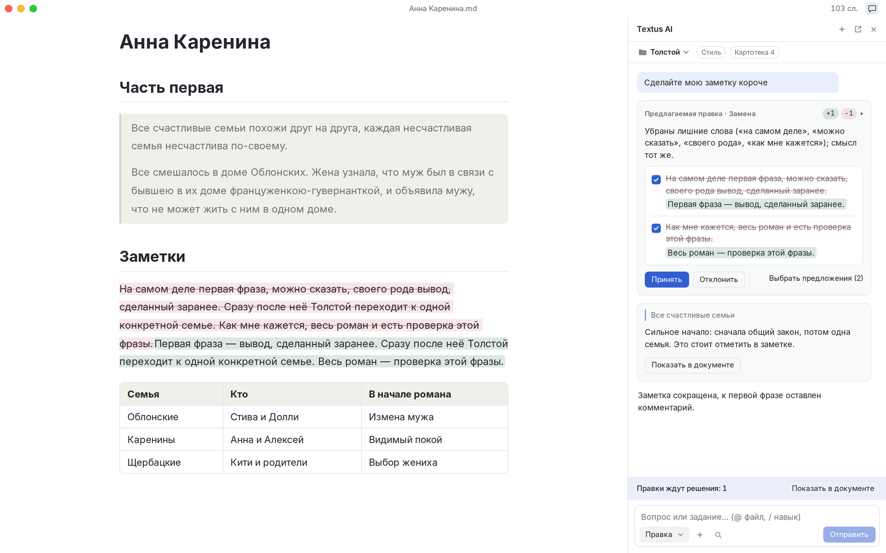
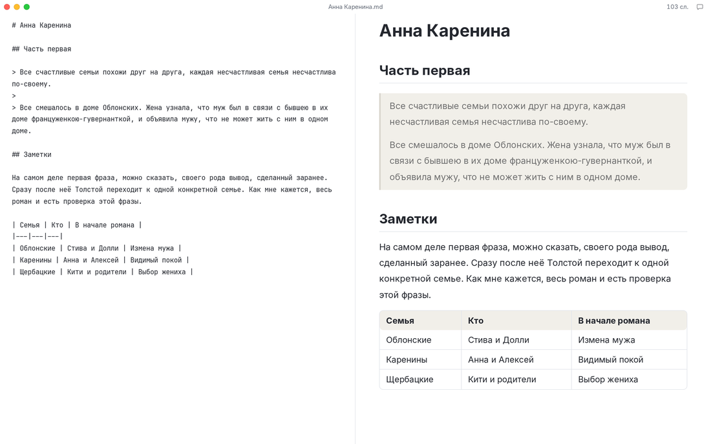
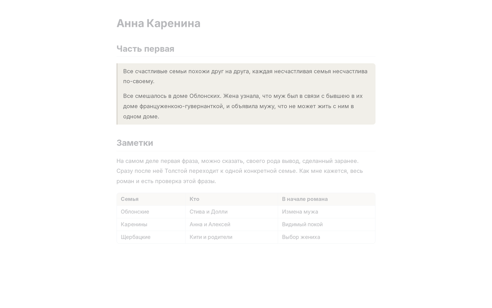

<p align="center">
  
</p>

<h1 align="center">Textus</h1>

<p align="center">
  <strong>Markdown-редактор нового поколения.</strong><br>
  Перо в ваших руках. Чернила готовит ИИ.
</p>

<p align="center">
  <a href="https://textus.catvinci.com"><strong>Сайт</strong></a> ·
  <a href="https://github.com/CatVinci-Studio/Textus/releases/latest"><strong>Скачать</strong></a>
</p>

<p align="center">
  <a href="./README.md">English</a> ·
  <a href="./README.zh.md">简体中文</a> ·
  <a href="./README.zh-Hant.md">繁體中文</a> ·
  <a href="./README.ja.md">日本語</a> ·
  <a href="./README.ko.md">한국어</a> ·
  <a href="./README.es.md">Español</a> ·
  <a href="./README.fr.md">Français</a> ·
  <a href="./README.de.md">Deutsch</a> ·
  Русский ·
  <a href="./README.pt.md">Português</a>
</p>

<p align="center">
  <a href="https://github.com/CatVinci-Studio/Textus/releases/latest"></a>
  
  <a href="./LICENSE"></a>
</p>

<p align="center">
  
</p>

## Редактор

### Что видишь, то и получаешь

Markdown оформляется прямо при наборе. Наведите курсор на строку — и увидите её разметку.

### Формулы, таблицы, диаграммы

Формулы отображаются по ходу ввода, таблицы выравниваются сами, а из пары строк текста получается диаграмма.

### Ваш стиль письма? Решать вам

Четыре режима письма и любая тема на ваш вкус – подойдут и темы Typora.

- **Режим дзен**: всё, кроме текста, отходит на второй план.
- **Режим пишущей машинки**: строка, которую вы пишете, остаётся на одной высоте.
- **Разделённый вид**: Markdown с одной стороны, готовая страница с другой.
- **Режим исходного кода**: весь документ в чистом Markdown.

<p align="center">
  
  
</p>

### Делитесь в любом формате

Экспорт в PDF, Word, HTML и другие форматы.

## Textus AI

**ИИ предлагает. Решаете вы.** Textus AI рядом на каждом шаге. А каждое слово — ваше.

- **Автодополнение**: Остановитесь — и следующие слова появятся серым. Нажмите Tab, чтобы принять.
- **Правки от ИИ**: Каждая правка — с объяснением. Примите её целиком или по предложениям.
- **Проверка грамматики**: Опечатки, ошибки и отступления от ваших норм оформления видны прямо при наборе. Исправить — Alt+Enter.
- **Рецензия**: Комментарии прямо у нужных строк. Замечания, а не переписанный за вас текст.
- **Встроенные навыки**: Сократить, вычитать, перевести, сменить тон и многое другое — достаточно набрать «/».
- **Понимает вас**: Перенимает ваш стиль, помнит ваших героев и места, следует вашим инструкциям.

**ИИ на ваш выбор**: Войдите через ChatGPT или Claude, добавьте API-ключ или запустите модель на своём компьютере.

OpenAI · Anthropic · Google Gemini · DeepSeek · xAI · Mistral · Groq · OpenRouter · Kimi · GLM · Qwen · Ollama · Любой сервис, совместимый с OpenAI

## Приватность

Так устроен Textus, и убедиться в этом может каждый: его код открыт.

- **На вашем устройстве**: Документы — обычные файлы Markdown, и хранятся они там, где решите вы.
- **Ключи — у вас**: API-ключи и данные для входа хранятся только на вашем компьютере.
- **Напрямую к провайдеру**: Запросы к ИИ идут прямо с вашего устройства к выбранному провайдеру.
- **Без аккаунта**: Скачайте и пишите. Регистрация не нужна.
- **Без слежки**: Никакой аналитики, телеметрии и рекламы.
- **Открытый код**: Лицензия MIT, весь код открыт до строчки — проверить всё это может каждый.

С локальной моделью через Ollama ваши тексты вообще не покидают компьютер.

## Установка

macOS (Apple Silicon) через [Homebrew](https://brew.sh):

```sh
brew install --cask catvinci-studio/tap/textus
```

Arch Linux через подписанный pacman-репозиторий [`[catvinci]`](https://github.com/CatVinci-Studio/arch-repo) (один раз; дальше `sudo pacman -Syu` будет обновлять Textus):

```sh
bash <(curl -fsSL https://raw.githubusercontent.com/CatVinci-Studio/arch-repo/main/install.sh) textus-bin
```

Или скачайте установщик в [Releases](https://github.com/CatVinci-Studio/Textus/releases/latest):

| Платформа             | Установщик                                                                 |
| --------------------- | -------------------------------------------------------------------------- |
| macOS (Apple Silicon) | `Textus_X.Y.Z_aarch64.dmg`                                                 |
| Windows               | `Textus_X.Y.Z_x64-setup.exe`                                               |
| Linux                 | `Textus_X.Y.Z_amd64.AppImage` · `_amd64.deb` · `Textus-X.Y.Z-1.x86_64.rpm` |

## Быстрый старт

1. Запустите Textus. Он открывается с пустым черновиком; файл понадобится только при сохранении.
2. Откройте **Настройки → Textus AI**, выберите провайдера и войдите или вставьте ключ в разделе **Вход и учётные данные**.
3. Начните писать. Когда вы остановитесь, продолжение появится серым; Tab принимает его.
4. Откройте Панель ИИ кнопкой чата в строке окна. Остальное описано в **Справка → Руководство по ИИ**.

| Действие                 | Сочетание                    |
| ------------------------ | ---------------------------- |
| Панель ИИ                | Ctrl/⌘+Shift+L               |
| Быстрый вопрос           | Ctrl/⌘+Shift+K               |
| Предложить продолжение   | Ctrl/⌘+Shift+Space           |
| Проверить грамматику     | Ctrl/⌘+Shift+G               |
| Принять ожидающую правку | Ctrl/⌘+Enter                 |
| Разделённый вид          | Ctrl/⌘+Shift+E               |
| Режим дзен               | Ctrl/⌘+Shift+J (Esc — выход) |
| Режим исходного кода     | Ctrl/⌘+/                     |

Все сочетания можно изменить в **Настройки → Сочетания клавиш**.

## Сборка из исходников

```bash
git clone https://github.com/CatVinci-Studio/Textus.git
cd Textus
npm install

npm run tauri dev     # full Tauri app (Rust shell + Vite renderer)
npm run tauri build   # bundle .dmg / -setup.exe (NSIS) / .AppImage / .deb / .rpm
npm run build         # frontend only: type-check (tsc) + vite build
```

Нужны [Node.js](https://nodejs.org) 22+, [Rust](https://rustup.rs) (stable) и инструменты сборки для вашей платформы (Xcode CLT на macOS; `libwebkit2gtk-4.1-dev`/`libappindicator3-dev`/`librsvg2-dev`/`patchelf` на Linux; MSVC Build Tools на Windows).

## Участие

В [CONTRIBUTING.md](CONTRIBUTING.md) — проверки CI, правила коммитов и порядок выпуска. В [docs/TESTING.md](docs/TESTING.md) — что покрывают тесты и что они сознательно не покрывают. Обсуждения ведутся на английском или китайском.

## Лицензия

[MIT](./LICENSE) © CatVinci Studio
