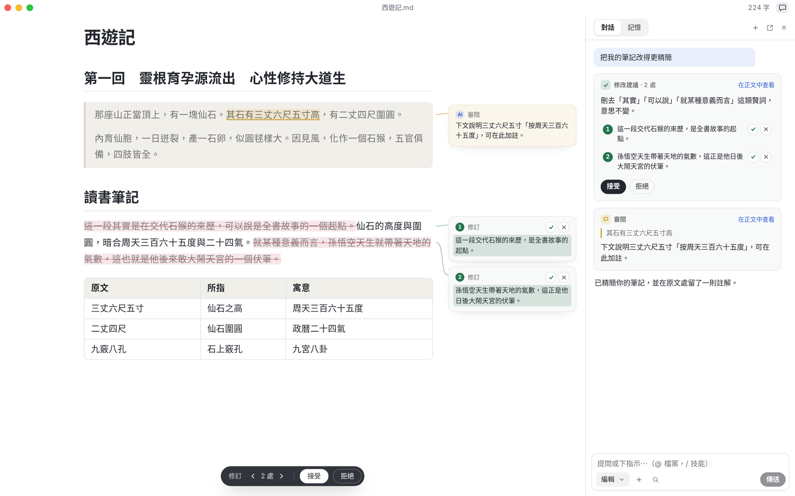
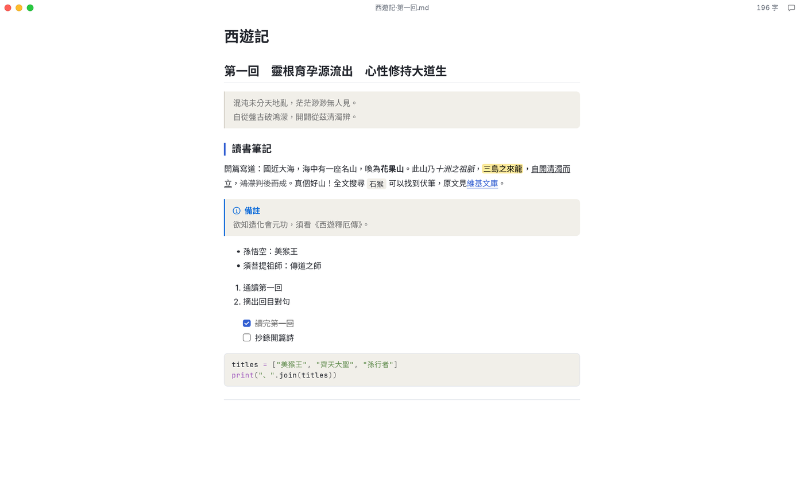
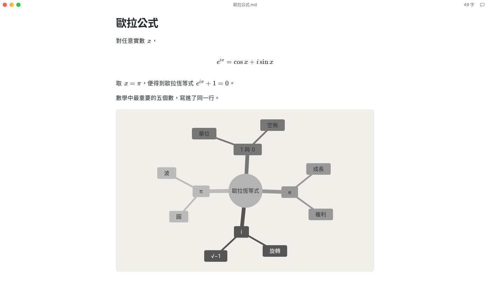
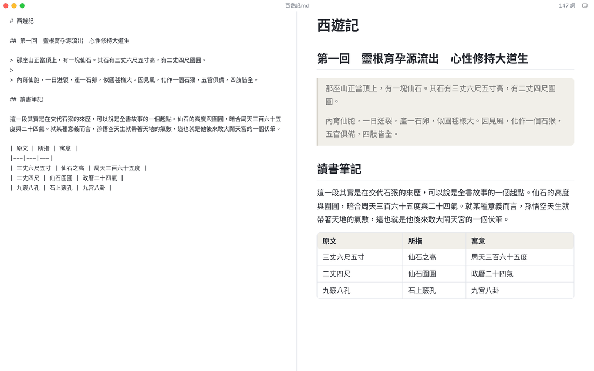
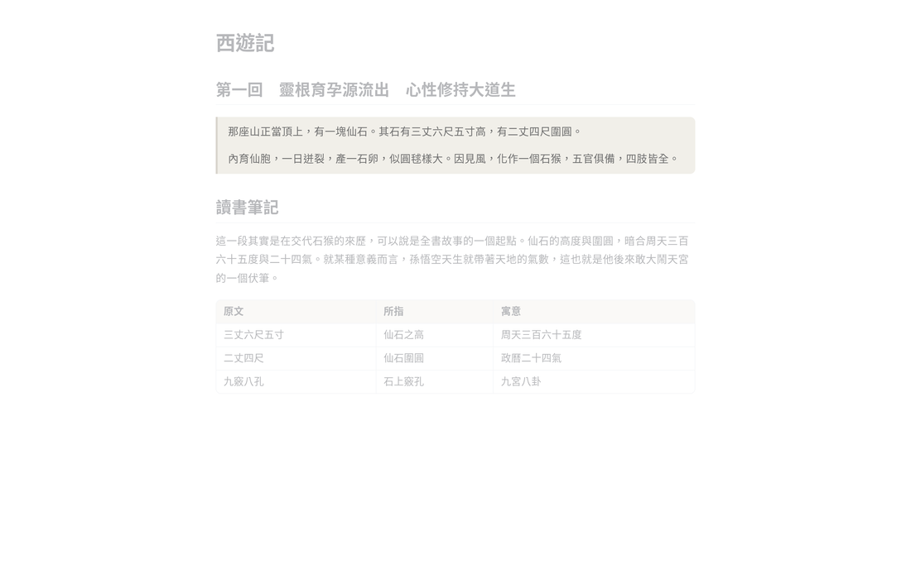
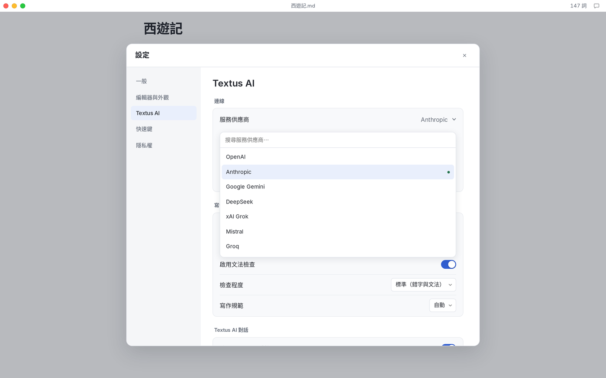

<p align="center">
  
</p>

<h1 align="center">Textus</h1>

<p align="center">
  <strong>新一代 Markdown 編輯器</strong><br>
  下筆成章，AI 研墨
</p>

<p align="center">
  <a href="https://textus.catvinci.com"><strong>官網</strong></a> ·
  <a href="https://github.com/CatVinci-Studio/Textus/releases/latest"><strong>下載</strong></a>
</p>

<p align="center">
  <a href="./README.md">English</a> ·
  <a href="./README.zh.md">简体中文</a> ·
  繁體中文 ·
  <a href="./README.ja.md">日本語</a> ·
  <a href="./README.ko.md">한국어</a> ·
  <a href="./README.es.md">Español</a> ·
  <a href="./README.fr.md">Français</a> ·
  <a href="./README.de.md">Deutsch</a> ·
  <a href="./README.ru.md">Русский</a> ·
  <a href="./README.pt.md">Português</a>
</p>

<p align="center">
  <a href="https://github.com/CatVinci-Studio/Textus/releases/latest"></a>
  <a href="https://github.com/CatVinci-Studio/Textus/releases"></a>
  <a href="https://github.com/CatVinci-Studio/Textus/stargazers"></a>
  
  <a href="./LICENSE"></a>
  <a href="https://github.com/CatVinci-Studio/Textus/actions/workflows/ci.yml"></a>
  <a href="https://textus.catvinci.com/discord"></a>
  
  <a href="https://textus.catvinci.com"></a>
</p>

https://github.com/user-attachments/assets/f366f282-e3f9-43d9-9a29-edb6d1ace3f5

<p align="center">
  <br>
  <sub>吳承恩《西遊記》</sub>
</p>

## 取得 Textus

免費開源，採用 MIT 授權。

| 平台               | 下載                                                                                          |
| ---------------- | ------------------------------------------------------------------------------------------- |
| macOS · Apple 晶片 | [下載 .dmg](https://github.com/CatVinci-Studio/Textus/releases/latest)                        |
| Windows · x64    | [下載 .exe](https://github.com/CatVinci-Studio/Textus/releases/latest)                        |
| Linux · x64      | [下載 .AppImage](https://github.com/CatVinci-Studio/Textus/releases/latest) · 另提供 .deb · .rpm |

或透過 Homebrew 安裝：

```sh
brew install --cask catvinci-studio/tap/textus
```

Arch Linux 可以使用帶簽章的 [`[catvinci]`](https://github.com/CatVinci-Studio/arch-repo) pacman 軟體庫（只需設定一次，之後 `sudo pacman -Syu` 會讓 Textus 保持最新）：

```sh
bash <(curl -fsSL https://raw.githubusercontent.com/CatVinci-Studio/arch-repo/main/install.sh) textus-bin
```

iPhone 與 iPad 版即將推出。[在 GitHub 查看所有版本](https://github.com/CatVinci-Studio/Textus/releases)

## 寫作

所有 Markdown 標記，邊寫邊排版。將指標移到任一行，就⁠能⁠看⁠到⁠原⁠始⁠寫⁠法⁠。

<p align="center">
  
</p>

公式隨打隨現，表格自動對齊，幾⁠行⁠文⁠字⁠就⁠能⁠畫⁠成⁠圖⁠表⁠。

<p align="center">
  
</p>

### 寫作風格？隨你喜歡

四種寫作模式隨心切換，主題一鍵更換，Typora 主題也能直接用。

| 寫作模式  | 作用                  |
| ----- | ------------------- |
| 禪模式   | 除了文字，其餘一切都退到幕後      |
| 打字機模式 | 正在寫的那一行始終停在同一高度     |
| 分割檢視  | 一邊寫 Markdown，一邊看排版  |
| 原始碼模式 | 整份文件以 Markdown 原文呈現 |

<p align="center">
  
  
</p>

匯出為 PDF、Word、HTML 等格式。

## Textus AI

你的寫作助手，和你一起寫。

### 寫的時候

停下筆，下文便以灰字浮現，按 Tab 接⁠受⁠。邊寫邊標出錯字與語病，並⁠對⁠照⁠你⁠的⁠寫⁠作⁠規⁠範⁠。Alt+Enter 一⁠鍵⁠修⁠正⁠。

### 需要幫忙時

修改以建議呈現，各附理由。可以整段接受，也⁠可⁠以⁠逐⁠句⁠取⁠捨⁠。批註就留在對應的句子旁。只提意見，不⁠動⁠你⁠的⁠原⁠稿⁠。精簡、校對、翻譯、調整語氣……輸⁠入 / 就⁠能⁠使⁠用⁠。

### 懂你

學習你的文風，記住筆下的人物與地點，遵⁠循⁠你⁠的⁠寫⁠作⁠指⁠示⁠。

### 不同 LLM，隨你喜歡

Textus 支援超過 20 種不同的 LLM，以及任何提供 OpenAI 相容介面的 LLM。

OpenAI · Anthropic · Google Gemini · DeepSeek · xAI · Mistral · Groq · OpenRouter · Kimi · GLM · Qwen · Ollama · 任何相容 OpenAI 介面的服務

<p align="center">
  
</p>

## 你寫的東西，只屬於你

你寫的內容只屬於你。Textus 從⁠設⁠計⁠上⁠確⁠保⁠這⁠一⁠點⁠，程⁠式⁠碼⁠也⁠完⁠全⁠公⁠開⁠，任⁠何⁠人⁠都⁠能⁠查⁠證⁠。

文件是一般的 Markdown 檔案，存⁠放⁠在⁠你⁠指⁠定⁠的⁠位⁠置⁠。API 金鑰與登入資訊，只⁠儲⁠存⁠在⁠你⁠的⁠電⁠腦⁠上⁠。AI 請求從你的裝置直接送往你⁠選⁠擇⁠的⁠服⁠務⁠供⁠應⁠商⁠。下載就能寫，不⁠必⁠註⁠冊⁠任⁠何⁠東⁠西⁠。沒有數據分析，沒有遙測，也⁠沒⁠有⁠廣⁠告⁠。每一行程式碼都以 MIT 授權公開。以⁠上⁠種⁠種⁠，任⁠何⁠人⁠都⁠能⁠查⁠證⁠。 透過 Ollama 使用本機模型時，你⁠的⁠文⁠字⁠完⁠全⁠不⁠會⁠離⁠開⁠電⁠腦⁠。

## 常見問題

<details>
<summary><strong>Textus 免費嗎？</strong></summary>

免費。Textus 以 MIT 授權開源，不需帳號，也沒有訂閱。使用 Textus AI 時，費用由你選擇的服務供應商直接收取；改用本機模型則完全免費。

</details>

<details>
<summary><strong>支援哪些平台？</strong></summary>

支援 macOS（Apple 晶片）、Windows 與 Linux。iPhone 與 iPad 版即將推出。

</details>

<details>
<summary><strong>一定要有 AI 帳號嗎？</strong></summary>

不用。即使不用 AI，編輯器的所有功能也都能正常使用。想使用 Textus AI，就連接你自己的服務供應商：以 ChatGPT 或 Claude 帳號登入、填入 API 金鑰，或透過 Ollama 執行本機模型。

</details>

<details>
<summary><strong>可以離線使用嗎？</strong></summary>

編輯器可以完全離線使用。Textus AI 需要連線到你的服務供應商；若執行本機模型，則不必連網。

</details>

<details>
<summary><strong>是標準的 Markdown 嗎？能⁠匯⁠出⁠哪⁠些⁠格⁠式⁠？</strong></summary>

是。檔案就是一般的 .md 檔，支援表格、待辦清單、註腳、數學公式與 Mermaid，也能匯出為 PDF、Word、HTML 等格式。

</details>

## 快速上手

1. 開啟 Textus。它從一份空白草稿開始，儲存時才需要選擇檔案。
2. 開啟 **設定 → Textus AI**，選擇服務供應商，在 **登入與憑證** 中登入或填入金鑰。
3. 開始寫作。停筆時，續寫會以灰色文字出現，按 Tab 接受。
4. 點視窗列裡的對話按鈕開啟 AI 面板。其餘功能請見 **說明 → AI 功能指南**。

| 操作      | 快速鍵                       |
| ------- | ------------------------- |
| AI 面板   | Ctrl/⌘+Shift+L            |
| 快速提問    | Ctrl/⌘+Shift+K            |
| 立即續寫    | Ctrl/⌘+Shift+Space        |
| 立即檢查文法  | Ctrl/⌘+Shift+G            |
| 接受待定的修改 | Ctrl/⌘+Enter              |
| 分割檢視    | Ctrl/⌘+Shift+E            |
| 禪模式     | Ctrl/⌘+Shift+J (按 Esc 離開) |
| 原始碼模式   | Ctrl/⌘+/                  |

以上快速鍵都可以在 **設定 → 快速鍵** 中修改。

## 從原始碼建置

```bash
git clone https://github.com/CatVinci-Studio/Textus.git
cd Textus
npm install

npm run tauri dev     # full Tauri app (Rust shell + Vite renderer)
npm run tauri build   # bundle .dmg / -setup.exe (NSIS) / .AppImage / .deb / .rpm
npm run build         # frontend only: type-check (tsc) + vite build
```

需要 [Node.js](https://nodejs.org) 22 以上、[Rust](https://rustup.rs)（stable）以及各平台的建置工具（macOS 上是 Xcode CLT；Linux 上是 `libwebkit2gtk-4.1-dev`/`libappindicator3-dev`/`librsvg2-dev`/`patchelf`；Windows 上是 MSVC Build Tools）。

## 參與貢獻

CI 執行的檢查、提交慣例和發布流程請見 [CONTRIBUTING.md](CONTRIBUTING.md)。各測試套件涵蓋了什麼、刻意不涵蓋什麼，請見 [docs/TESTING.md](docs/TESTING.md)。討論可以用中文或英文。

## 授權

[MIT](./LICENSE) © CatVinci Studio
