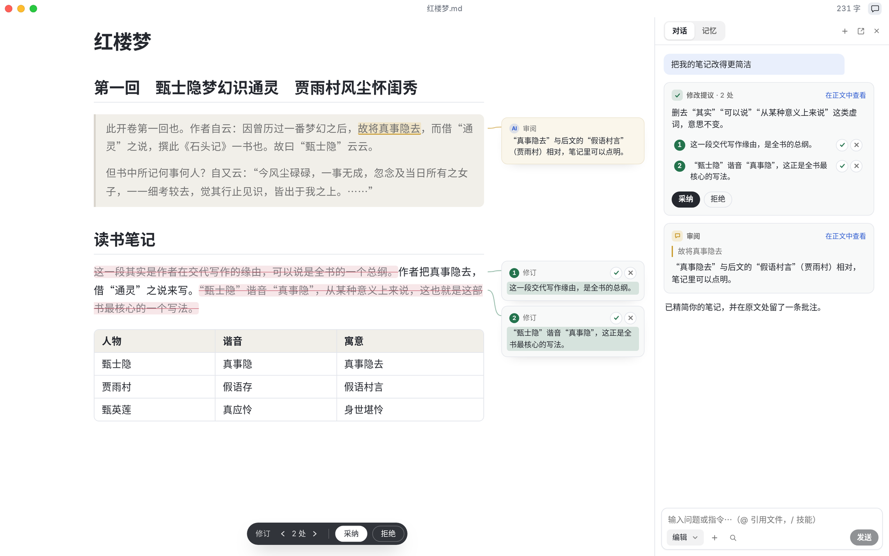
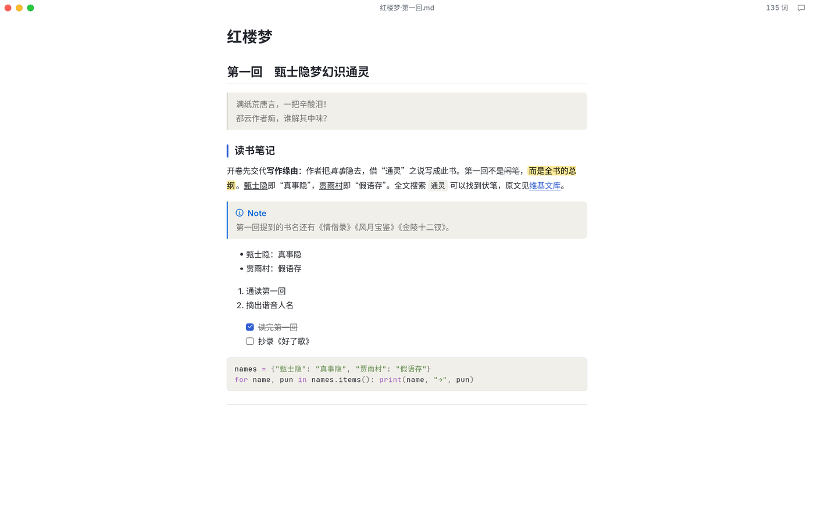
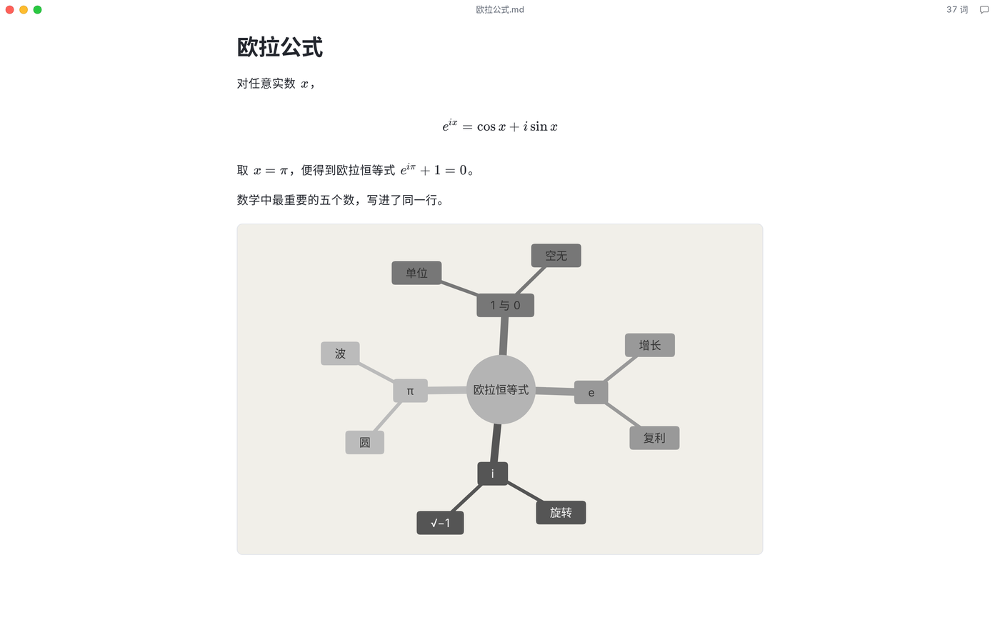
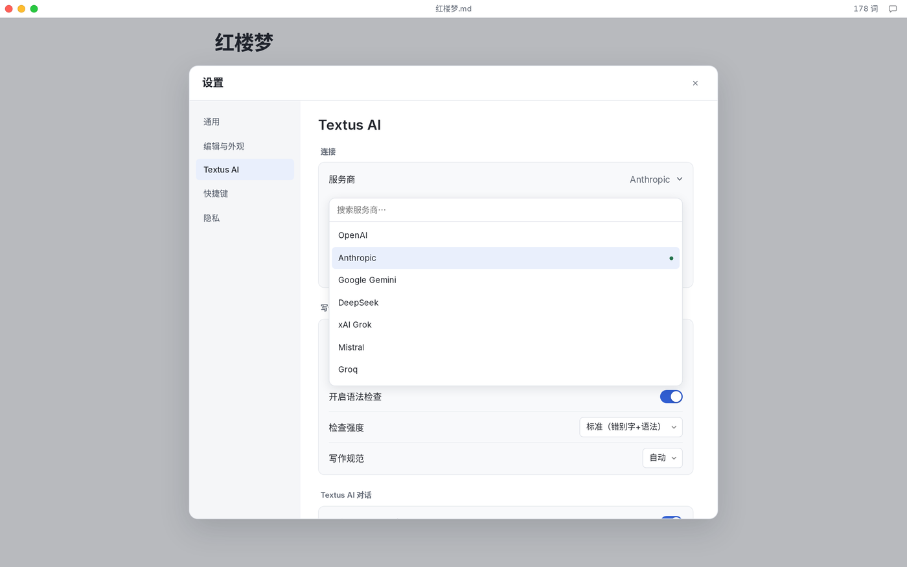

<p align="center">
  
</p>

<h1 align="center">Textus</h1>

<p align="center">
  <strong>下一代 Markdown 编辑器</strong><br>
  下笔成章，AI 研墨<br>
  <sub>免费 · 开源 · 支持 macOS、Windows 和 Linux。</sub>
</p>

<p align="center">
  <a href="https://textus.catvinci.com"><strong>官网</strong></a> ·
  <a href="https://github.com/CatVinci-Studio/Textus/releases/latest"><strong>下载</strong></a>
</p>

<p align="center">
  <a href="./README.md">English</a> ·
  简体中文 ·
  <a href="./README.zh-Hant.md">繁體中文</a> ·
  <a href="./README.ja.md">日本語</a> ·
  <a href="./README.ko.md">한국어</a> ·
  <a href="./README.es.md">Español</a> ·
  <a href="./README.fr.md">Français</a> ·
  <a href="./README.de.md">Deutsch</a> ·
  <a href="./README.ru.md">Русский</a> ·
  <a href="./README.pt.md">Português</a>
</p>

<p align="center">
  <a href="https://github.com/CatVinci-Studio/Textus/releases/latest"></a>
  
  <a href="./LICENSE"></a>
</p>

<p align="center">
  <br>
  <sub>《红楼梦》曹雪芹</sub>
</p>

## 开始使用 Textus

免费开源，采用 MIT 协议。

| 平台               | 下载                                                                                         |
| ---------------- | ------------------------------------------------------------------------------------------ |
| macOS · Apple 芯片 | [下载 .dmg](https://github.com/CatVinci-Studio/Textus/releases/latest)                       |
| Windows · x64    | [下载 .exe](https://github.com/CatVinci-Studio/Textus/releases/latest)                       |
| Linux · x64      | [下载 .AppImage](https://github.com/CatVinci-Studio/Textus/releases/latest) · 另有 .deb · .rpm |

或用 Homebrew 安装：

```sh
brew install --cask catvinci-studio/tap/textus
```

Arch Linux 可以使用带签名的 [`[catvinci]`](https://github.com/CatVinci-Studio/arch-repo) pacman 软件源（只需设置一次，之后 `sudo pacman -Syu` 会让 Textus 保持最新）：

```sh
bash <(curl -fsSL https://raw.githubusercontent.com/CatVinci-Studio/arch-repo/main/install.sh) textus-bin
```

iPhone 与 iPad 版即将推出。[在 GitHub 查看所有版本](https://github.com/CatVinci-Studio/Textus/releases)

## 专为写作而生

### 所见即所得

每一种 Markdown 标记，边写边排好。指向任意一行，就能看到它的源码。

<p align="center">
  
</p>

### 公式、表格、图表

公式边打边出，表格自动对齐，几行文字就能画出图表。

<p align="center">
  
</p>

### 写作风格？随你喜欢

四种写作模式随心切换，主题一键更换，Typora 主题也能直接用。

- **禅模式**：除了文字，其余一切都退到幕后。
- **打字机模式**：正在写的那一行始终停在同一高度。
- **分屏视图**：一边写 Markdown，一边看排版。
- **源码模式**：整篇文档以 Markdown 原文呈现。

<p align="center">
  
  
</p>

### 随处分享

导出为 PDF、Word、HTML 等格式。

## 它提议，你决定

Textus AI 一路相助，每个字仍由你决定。

- **续写**：停下笔，灰色的下文便会出现，按 Tab 收下。
- **AI 写作**：修改以提议的形式出现，各附理由。可以整段采纳，也可以逐句取舍。
- **语法检查**：边写边标出错字和语病，也会对照你的写作规范。按 Alt+Enter 即可修正。
- **审阅批注**：批注钉在对应的句子旁。只提意见，不改你的稿。
- **内置技能**：精简、校对、翻译、换个语气……输入斜杠即可调用。
- **懂你**：学习你的文风，记住你笔下的人物与地点，遵循你定下的写作要求。

### 用你喜欢的 AI

用 ChatGPT 或 Claude 账号登录，填入 API Key，或在自己的电脑上运行模型。

OpenAI · Anthropic · Google Gemini · DeepSeek · xAI · Mistral · Groq · OpenRouter · Kimi · GLM · Qwen · Ollama · 任何兼容 OpenAI 接口的服务

<p align="center">
  
</p>

## 隐私，从设计开始

你写的东西只属于你。Textus 从设计上保证这一点，代码公开，任何人都能核实。

- **留在你的设备上**：文档是普通的 Markdown 文件，放在你选的位置。
- **密钥只存本地**：API Key 和登录信息只保存在你的电脑上。
- **直达你的服务商**：AI 请求从你的设备直接发往你选择的服务商。
- **无需账号**：下载就能写，没有任何需要注册的东西。
- **不做追踪**：没有统计，没有遥测，没有广告。
- **开放源代码**：以 MIT 协议公开每一行代码，上面这些，任何人都能核实。

通过 Ollama 使用本地模型时，你的文字从不离开你的电脑。

## 常见问题

<details>
<summary><strong>Textus 免费吗？</strong></summary>

免费。Textus 以 MIT 协议开源，不需要账号，也没有订阅。如果使用 Textus AI，费用由你选择的服务商直接结算；使用本地模型则完全免费。

</details>

<details>
<summary><strong>支持哪些平台？</strong></summary>

支持 Apple 芯片的 macOS、Windows 和 Linux。iPhone 与 iPad 版即将推出。

</details>

<details>
<summary><strong>需要 AI 账号吗？</strong></summary>

不需要。不用 AI，编辑器的全部功能照样可用。想用 Textus AI，就接入你自己的服务商：用 ChatGPT 或 Claude 账号登录、填入 API Key，或用 Ollama 运行本地模型。

</details>

<details>
<summary><strong>可以离线使用吗？</strong></summary>

编辑器完全可以离线使用。Textus AI 需要连接你的服务商，运行本地模型时则无需联网。

</details>

<details>
<summary><strong>是标准 Markdown 吗？能导出什么格式？</strong></summary>

是的，就是普通的 .md 文件，支持表格、任务列表、脚注、公式和 Mermaid。可以导出为 PDF、Word、HTML 等格式。

</details>

## 快速上手

1. 打开 Textus。它从一份空白草稿开始，保存时才需要选择文件。
2. 打开 **设置 → Textus AI**，选择服务商，在 **登录与凭据** 中登录或填入密钥。
3. 开始写作。停笔时，续写会以灰色文字出现，按 Tab 采纳。
4. 点窗口栏里的对话按钮打开 AI 面板。其余功能见 **帮助 → AI 功能指南**。

| 操作      | 快捷键                       |
| ------- | ------------------------- |
| AI 面板   | Ctrl/⌘+Shift+L            |
| 快速提问    | Ctrl/⌘+Shift+K            |
| 立即触发续写  | Ctrl/⌘+Shift+Space        |
| 立即检查语法  | Ctrl/⌘+Shift+G            |
| 采纳待定的修改 | Ctrl/⌘+Enter              |
| 分屏视图    | Ctrl/⌘+Shift+E            |
| 禅模式     | Ctrl/⌘+Shift+J (按 Esc 退出) |
| 源码模式    | Ctrl/⌘+/                  |

以上快捷键都可以在 **设置 → 快捷键** 中修改。

## 从源码构建

```bash
git clone https://github.com/CatVinci-Studio/Textus.git
cd Textus
npm install

npm run tauri dev     # full Tauri app (Rust shell + Vite renderer)
npm run tauri build   # bundle .dmg / -setup.exe (NSIS) / .AppImage / .deb / .rpm
npm run build         # frontend only: type-check (tsc) + vite build
```

需要 [Node.js](https://nodejs.org) 22 以上、[Rust](https://rustup.rs)（stable）以及各平台的构建工具（macOS 上是 Xcode CLT；Linux 上是 `libwebkit2gtk-4.1-dev`/`libappindicator3-dev`/`librsvg2-dev`/`patchelf`；Windows 上是 MSVC Build Tools）。

## 参与贡献

CI 运行的检查、提交规范和发布流程见 [CONTRIBUTING.md](CONTRIBUTING.md)。各测试套件覆盖了什么、有意不覆盖什么，见 [docs/TESTING.md](docs/TESTING.md)。讨论可以用中文或英文。

## 许可证

[MIT](./LICENSE) © CatVinci Studio
