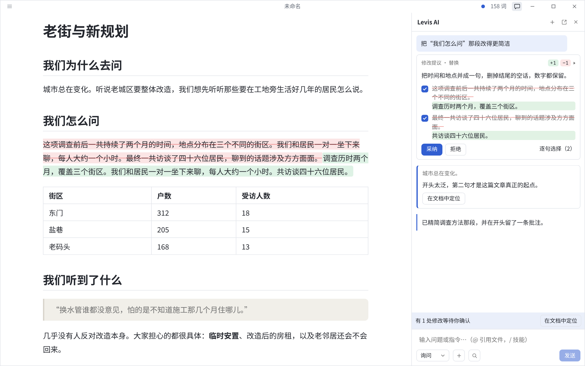
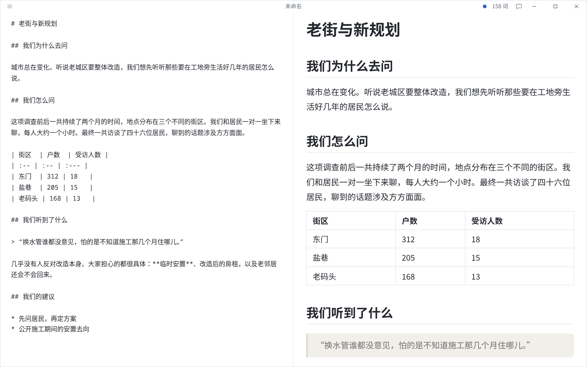
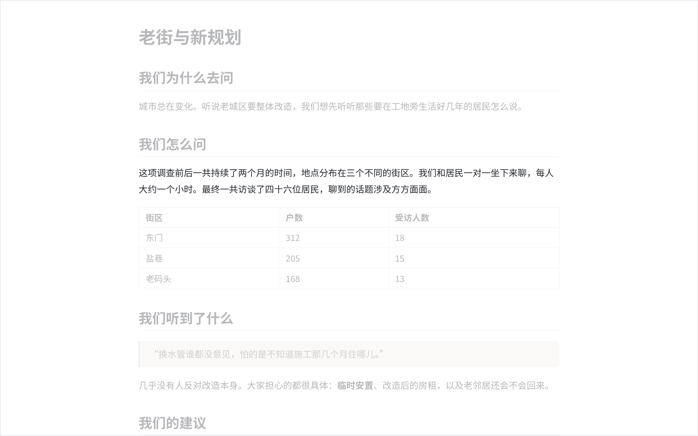
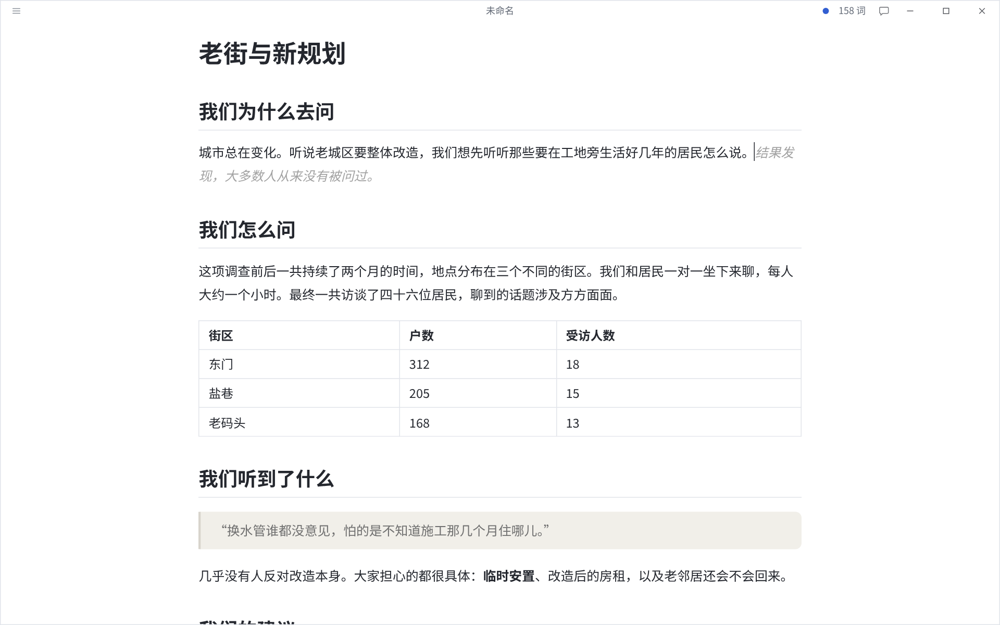

<!-- 结构与 README.md 逐节对应（scripts/check-readmes.mjs 会检查）。 -->

<p align="center">
  
</p>

<h1 align="center">Levis</h1>

<p align="center">
  <strong>所见即所得的 Markdown 编辑器，AI 只提建议，不替你改稿。</strong><br>
  开源、轻量。AI 帮你续写、检查、给出修改建议，每一处改动都由你点头。
</p>

<p align="center">
  <a href="https://github.com/CatVinci-Studio/Levis/releases/latest"><strong>下载</strong></a> ·
  <a href="./README.md">English</a> ·
  <a href="./README.ja.md">日本語</a>
</p>

<p align="center">
  <a href="https://github.com/CatVinci-Studio/Levis/releases/latest"></a>
  
  <a href="./LICENSE"></a>
</p>

<p align="center">
  
</p>

## 特点

### 编辑器

- **真正的所见即所得**：Markdown 标记只在光标所在处出现，其余地方看到的就是排好的页面。
- 表格、公式、Mermaid 图、代码高亮、脚注、任务列表和 GitHub 提示块。
- **分屏模式**（源码与实时预览并排）、**打字机模式**（正在写的那一行始终居中）和**禅模式**（只留文字，突出当前段落）。
- 多标签与多窗口、查找替换、导入 Typora 主题，也可以写自己的 CSS。
- 导出 PDF 和 HTML；装有 [Pandoc](https://pandoc.org) 时还能导出 Word、OpenDocument 和 RTF。

<p align="center">
  
  
</p>

### 不打扰的 AI

- **续写**以灰色文字出现：Tab 全部采纳，Ctrl/⌘+→ 逐词采纳；也可以要几个候选来回切换。
- **语法检查**标出当前段落里的问题，Alt+Enter 直接改正。
- **AI 面板**在文档旁边：可以就文档提问，也可以让它修改。每处修改都以建议的形式显示在文档里，附带理由——可以采纳、拒绝，或只采纳其中几句。请它审稿，它会留批注而不是直接改。
- **快速提问**：选中文字后就地提问，不用离开正在写的地方。

<p align="center">
  
</p>

### 你的项目，你的文风

- 文档保存后，它所在的文件夹就是项目：AI 可以阅读和搜索其中的文本文件，输入 `@` 可以把某个文件带进对话。
- **文风档案**（`.levis/style.md`）：从你挑选的范文生成，续写和修改都贴近你的写法。
- **资料库**（`.levis/library/`）：人物、地点、术语。一段文字提到哪些条目，就把哪些条目一起交给 AI，名字和设定前后一致。

### 服务商与隐私

- 支持 OpenAI、Anthropic、Google Gemini、DeepSeek、xAI、Mistral、Groq、OpenRouter、月之暗面、智谱、通义千问、Ollama（本地），以及任何兼容 OpenAI 的接口。
- 可以直接用 ChatGPT 或 Claude 账号登录，也可以填写 API Key。
- 请求从你的电脑直接发往你选择的服务商；密钥和登录信息只保存在你的电脑上。使用 Ollama 时，内容完全不出本机。

## 安装

macOS（Apple Silicon）可通过 [Homebrew](https://brew.sh) 安装：

```sh
brew install --cask catvinci-studio/tap/levis
```

Arch Linux 可通过签名的 [`[catvinci]`](https://github.com/CatVinci-Studio/arch-repo) pacman 软件源安装（只需配置一次，之后 `sudo pacman -Syu` 会自动升级 Levis）：

```sh
bash <(curl -fsSL https://raw.githubusercontent.com/CatVinci-Studio/arch-repo/main/install.sh) levis-bin
```

也可以从 [Releases](https://github.com/CatVinci-Studio/Levis/releases/latest) 下载安装包：

| 平台                   | 安装包                                                                   |
| ---------------------- | ------------------------------------------------------------------------ |
| macOS（Apple Silicon） | `Levis_X.Y.Z_aarch64.dmg`                                                |
| Windows                | `Levis_X.Y.Z_x64-setup.exe`                                              |
| Linux                  | `Levis_X.Y.Z_amd64.AppImage` · `_amd64.deb` · `Levis-X.Y.Z-1.x86_64.rpm` |

## 快速上手

1. 启动 Levis，直接进入空白草稿；保存时才需要文件。
2. 打开 **设置 → AI 服务**，选择服务商，在**登录与凭据**中登录或填写密钥。
3. 开始写。停顿时续写会以灰色文字出现，按 Tab 采纳。
4. 点窗口顶栏的对话按钮打开 AI 面板。其余功能见 **帮助 → AI 功能指南**。

| 操作           | 快捷键                         |
| -------------- | ------------------------------ |
| AI 面板        | Ctrl/⌘+Shift+L                 |
| 快速提问       | Ctrl/⌘+Shift+K                 |
| 续写           | Ctrl/⌘+Shift+Space             |
| 语法检查       | Ctrl/⌘+Shift+G                 |
| 采纳待确认修改 | Ctrl/⌘+Enter                   |
| 分屏模式       | Ctrl/⌘+Shift+E                 |
| 禅模式         | Ctrl/⌘+Shift+J（Esc 退出）     |
| 源码模式       | Ctrl/⌘+/                       |

以上都可以在 **设置 → 快捷键** 中修改。

## 为什么做 Levis

写 Markdown 应该像在写作，而不是在编辑一个文件：不用来回看预览，也不被语法符号打断。Levis 开源、小巧，它的 AI 为想保持作者身份的人设计——给建议、讲理由，决定权始终在你。

## 从源码构建

```bash
git clone https://github.com/CatVinci-Studio/Levis.git
cd Levis
npm install

npm run tauri dev     # 完整 Tauri 应用（Rust 后端 + Vite 前端）
npm run tauri build   # 打包 .dmg / -setup.exe（NSIS）/ .AppImage / .deb / .rpm
npm run build         # 仅前端：类型检查（tsc）+ vite build
```

需要 [Node.js](https://nodejs.org) 22+、[Rust](https://rustup.rs)（stable），以及各平台的构建工具（macOS 上是 Xcode 命令行工具；Linux 上是 `libwebkit2gtk-4.1-dev`/`libappindicator3-dev`/`librsvg2-dev`/`patchelf`；Windows 上是 MSVC Build Tools）。

## 参与贡献

CI 运行的检查、提交规范和发布流程见 [CONTRIBUTING.md](CONTRIBUTING.md)（英文）。[docs/TESTING.md](docs/TESTING.md) 列出了各测试套件覆盖的范围，以及刻意没有覆盖的部分。

## License

[MIT](./LICENSE) © CatVinci Studio
