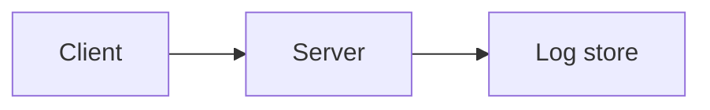

# Sync engine notes

> \[!NOTE]
> These notes describe the version that shipped in March, and they are kept here so that anyone who joins the team later can understand why the sync engine works the way it does today.

## Status

| Component         | Owner | Status      |
| ----------------- | ----- | ----------- |
| Conflict resolver | Mia   | In review   |
| Search index      | Tom   | In progress |
| Offline queue     | Ana   | Done        |

## Tasks

* [x] Write the migration
* [ ] Update the docs
* [ ] Benchmark on large files

## Design

The engine keeps a log of operations per document[^1]. Each client replays the log on top of its last snapshot, so the cost of opening a document is $O(n)$ in the number of operations since that snapshot. See the [protocol spec](https://example.com/spec) for the wire format.

* Storage
  * Snapshots every 500 operations
  * Logs compressed with zstd
* Transport
  * WebSocket with exponential backoff

The average replay time over $n$ samples is

$$
\bar{t} = \frac{1}{n} \sum_{i=1}^{n} t_i
$$

and the sample variance we report is

$$
s^2 = \frac{1}{n} \sum_{i=1}^{n} (t_i - \bar{t})^2
$$

```python
def average_replay_time(samples):
    total = 0
    for s in samples:
        total += s
    return total / (len(samples) - 1)
```



<details>
<summary>Why not CRDTs?</summary>

We evaluated CRDTs in 2023, but the memory overhead was too high for our largest documents.

</details>


[^1]: Operations are stored as JSON lines.