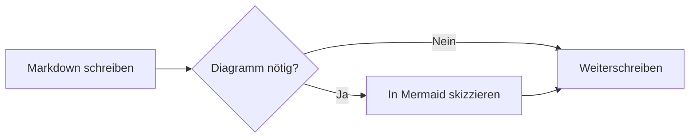
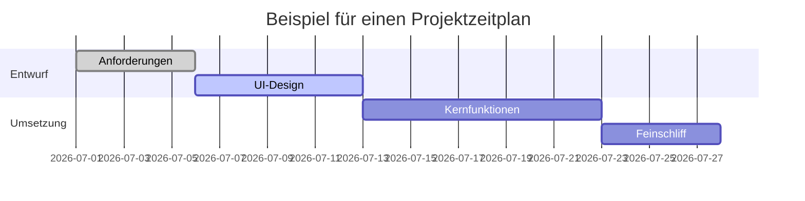
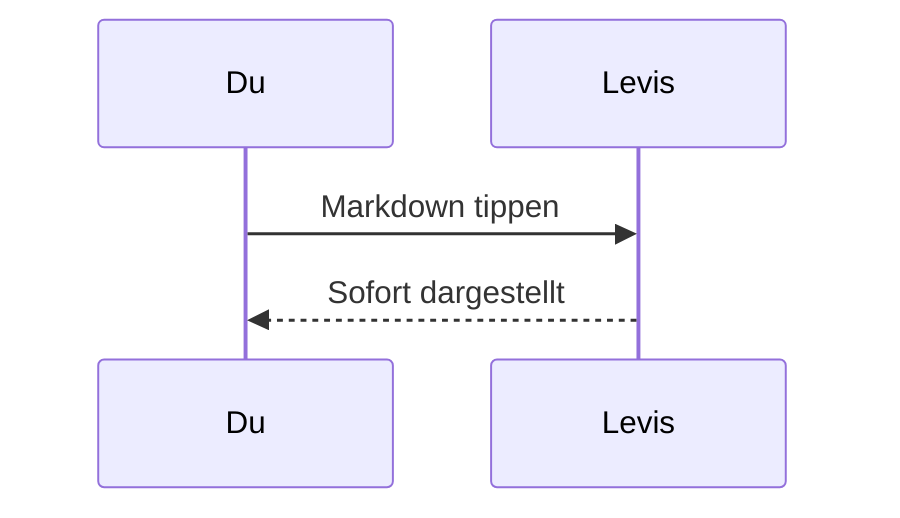

# Markdown-Anleitung für Levis

Willkommen. Dieses eingebaute Dokument zeigt, welche Markdown-Elemente Levis darstellt. Es ist nur ein ungespeicherter Entwurf – bearbeite es nach Belieben, probiere alles aus und schließe es danach, ohne zu speichern.

> [!TIP]
> Mit `Cmd+/` wechselst du zwischen WYSIWYG und Quellcodemodus und siehst die Syntax hinter jedem Beispiel hier.

## Überschriften und Zitate

Tippe am Zeilenanfang `#` und ein Leerzeichen für eine Überschrift der Ebene 1 oder `##` und ein Leerzeichen für Ebene 2. Die Überschriften oben zeigen das Ergebnis.

Ein Zitat:

> Zitierter Text kann weitere Auszeichnungen enthalten, etwa **Fettdruck** und `Code`.

Hinweise im GitHub-Stil:

> [!NOTE]
> Eine Notiz, für zusätzlichen Kontext.

> [!WARNING]
> Eine Warnung, für Dinge, auf die man achten sollte.

## Textauszeichnung

**Fett** (`**Text**`), *kursiv* (`*Text*`), ***fett und kursiv***, ~~durchgestrichen~~ (`~~Text~~`), ==hervorgehoben== (`==Text==`) und `Inline-Code`.

Links sehen so aus: [das Levis-Repository](https://github.com/CatVinci-Studio/Levis). Auch HTML im Text wird dargestellt, etwa Tasten wie <kbd>Cmd</kbd> + <kbd>S</kbd>.

Formeln im Text: die Äquivalenz von Masse und Energie $E = mc^2$, die eulersche Identität $e^{i\pi} + 1 = 0$.

## Listen

- Ungeordnete Liste
- Mit Verschachtelung
  - Ein Eintrag der zweiten Ebene
  - Noch einer

1. Geordnete Liste
2. Zweiter Eintrag

Aufgabenliste (ein Klick auf ein Kästchen setzt oder entfernt den Haken):

- [x] Etwas Erledigtes
- [ ] Etwas, das noch zu tun ist

## Tabellen

| Funktion | Syntax | Ergebnis |
| --- | --- | --- |
| Fett | `**Text**` | **Text** |
| Hervorhebung | `==Text==` | ==Text== |
| Formel im Text | `$x^2$` | $x^2$ |

Bewege den Zeiger über eine Tabelle, um Zeilen und Spalten hinzuzufügen oder zu entfernen. Tippe `| Name | Alter |` und drücke Enter, um eine Tabelle anzulegen. Enter springt eine Zeile nach unten, fügt in der letzten Zeile eine neue hinzu und verlässt die Tabelle, wenn die neue Zeile leer bleibt; mit Ctrl/⌘+Enter verlässt du sie jederzeit.

## Codeblöcke

Umgrenzte Codeblöcke mit Syntaxhervorhebung (die Sprache stellst du oben rechts im Block um). Enter in der leeren letzten Zeile verlässt den Block, Ctrl/⌘+Enter jederzeit; dasselbe gilt für Zitate.

```python
def fib(n: int) -> int:
    """Die klassische Fibonacci-Folge."""
    a, b = 0, 1
    for _ in range(n):
        a, b = b, a + b
    return a
```

```rust
fn main() {
    let greeting = "Hallo, Levis!";
    println!("{greeting}");
}
```

## Formelblöcke

Formeln zwischen `$$` setzt KaTeX als eigenen Block:

$$
\int_{-\infty}^{\infty} e^{-x^2} \, dx = \sqrt{\pi}
$$

## Diagramme (Mermaid)

Ein ```` ```mermaid ````-Codeblock wird als Live-Diagramm dargestellt. Ein Flussdiagramm:



Ein Gantt-Diagramm:



Ein Sequenzdiagramm:



## Bilder

Füge ein Bild direkt aus der Zwischenablage ein – Levis speichert es in einem Ordner `assets/` neben dem Dokument und fügt den Verweis ein. Oder schreib ihn von Hand:

Unter **Einstellungen → Editor & Design → Bilder** kannst du neu eingefügte Bilder stattdessen an deinen eigenen Bildhoster senden. Der Endpunkt empfängt `multipart/form-data` mit einem Feld `file` und gibt die öffentliche URL entweder als reinen Text oder in einem einstellbaren JSON-Feld zurück. Hochgeladene Dateien können automatisch umbenannt werden, ihren Originalnamen behalten oder vor jedem Upload nach einem Namen fragen. Wenn du den Speicherort wechselst, bleiben vorhandene Bildverweise unverändert.

```markdown

```

## Ansichten und Modi

Neben dem WYSIWYG-Editor und dem Quellcodemodus (`Cmd+/`) bietet Levis drei Arten zu schreiben (unter Windows und Linux `Ctrl` statt `Cmd`; die aktuellen Belegungen stehen unter Einstellungen → Tastenkürzel):

- **Geteilte Ansicht** (`Cmd+Shift+E`): links der Markdown-Quelltext, rechts die gerenderte Vorschau, beide scrollen gemeinsam.
- **Schreibmaschinenmodus** (Einstellungen → Editor & Design → Ansicht): Die Zeile, in der du tippst, bleibt in der Mitte des Fensters – im Editor, im Quellcodemodus und in der geteilten Ansicht.
- **Zen-Modus** (`Cmd+Shift+J`): blendet alles außer dem Text aus, wechselt in den Vollbildmodus und dimmt jeden Absatz außer dem, an dem du gerade schreibst. Mit `Esc` verlässt du ihn.

Alle drei findest du auch im Menü **Ansicht**.

## Fußnoten und Trennlinien

Fußnoten sehen so aus[^1], und darunter folgt eine horizontale Trennlinie:

---

[^1]: Der Inhalt der Fußnoten wird am Ende des Dokuments gesammelt.

Viel Freude beim Schreiben.
