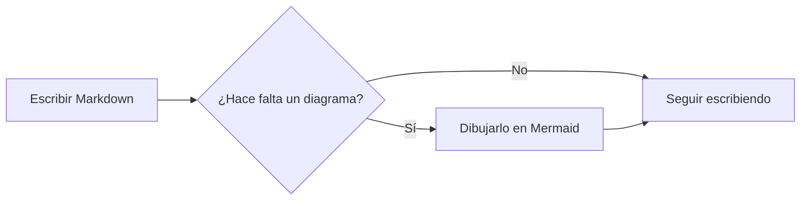
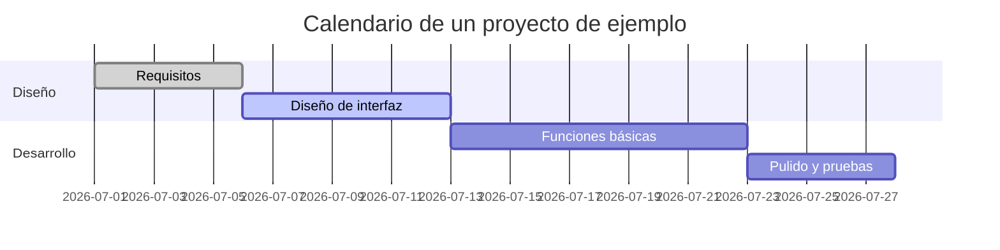
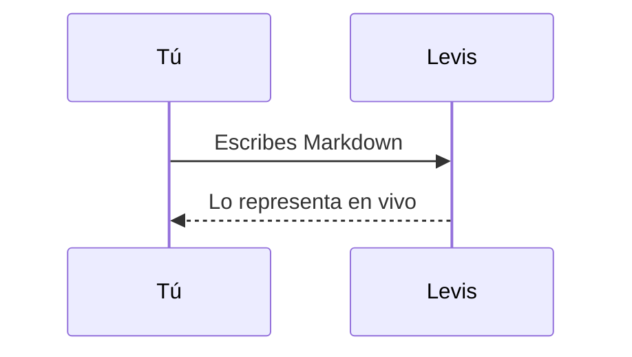

# Guía de Markdown de Levis

Te damos la bienvenida. Este documento integrado muestra el Markdown que admite Levis y cómo se ve. Es solo un borrador sin guardar: edítalo y experimenta con libertad, y después ciérralo sin guardar.

> [!TIP]
> Pulsa `Cmd+/` para alternar entre WYSIWYG y el modo código fuente, y ver la sintaxis que hay detrás de cualquier ejemplo.

## Encabezados y citas

Escribe `#` y un espacio al principio de una línea para crear un encabezado de nivel 1, o `##` y un espacio para uno de nivel 2. Los encabezados de arriba muestran el resultado.

Una cita:

> El texto citado puede contener otras marcas, como **negrita** y `código`.

Alertas al estilo de GitHub:

> [!NOTE]
> Una nota, para dar contexto adicional.

> [!WARNING]
> Una advertencia, para lo que conviene tener en cuenta.

## Estilos de texto

**Negrita** (`**texto**`), *cursiva* (`*texto*`), ***negrita y cursiva***, ~~tachado~~ (`~~texto~~`), ==resaltado== (`==texto==`) y `código en línea`.

Los enlaces se ven así: [el repositorio de Levis](https://github.com/CatVinci-Studio/Levis). También se representa el HTML en línea, como las teclas <kbd>Cmd</kbd> + <kbd>S</kbd>.

Fórmulas en línea: la equivalencia entre masa y energía $E = mc^2$, la identidad de Euler $e^{i\pi} + 1 = 0$.

## Listas

- Lista no ordenada
- Con anidación
  - Un elemento de segundo nivel
  - Otro más

1. Lista ordenada
2. Segundo elemento

Lista de tareas (haz clic en una casilla para marcarla o desmarcarla):

- [x] Algo ya hecho
- [ ] Algo por hacer

## Tablas

| Función | Sintaxis | Resultado |
| --- | --- | --- |
| Negrita | `**texto**` | **texto** |
| Resaltado | `==texto==` | ==texto== |
| Fórmula en línea | `$x^2$` | $x^2$ |

Pasa el puntero sobre una tabla para añadir o quitar filas y columnas. Escribe `| Nombre | Edad |` y pulsa Enter para crear una tabla. Enter baja una fila, añade otra al llegar a la última y, en una fila nueva que sigue vacía, sale de la tabla; Ctrl/⌘+Enter sale en cualquier momento.

## Bloques de código

Bloques de código delimitados con resaltado de sintaxis (cambia el lenguaje desde la esquina superior derecha del bloque). Enter en la última línea vacía sale del bloque, igual que Ctrl/⌘+Enter en cualquier momento; lo mismo vale para las citas.

```python
def fib(n: int) -> int:
    """La clásica sucesión de Fibonacci."""
    a, b = 0, 1
    for _ in range(n):
        a, b = b, a + b
    return a
```

```rust
fn main() {
    let greeting = "Hola, Levis";
    println!("{greeting}");
}
```

## Bloques de fórmulas

KaTeX representa las fórmulas en bloque delimitadas con `$$`:

$$
\int_{-\infty}^{\infty} e^{-x^2} \, dx = \sqrt{\pi}
$$

## Diagramas (Mermaid)

Un bloque de código ```` ```mermaid ```` se representa como un diagrama en vivo. Un diagrama de flujo:



Un diagrama de Gantt:



Un diagrama de secuencia:



## Imágenes

Pega una imagen directamente desde el portapapeles: Levis la guarda en una carpeta `assets/` junto al documento e inserta la referencia. O escribe la referencia a mano:

En **Ajustes → Editor y aspecto → Imágenes** puedes hacer que las imágenes que pegues a partir de ahora se envíen a tu propio servidor de imágenes. El endpoint recibe `multipart/form-data` con un campo `file` y puede devolver la URL pública como texto sin formato o en un campo JSON configurable. Los archivos subidos pueden renombrarse automáticamente, mantener su nombre original o pedirte un nombre antes de cada subida. Las referencias a imágenes existentes no se modifican al cambiar el modo de almacenamiento.

```markdown

```

## Vistas y modos

Además del editor WYSIWYG y del modo código fuente (`Cmd+/`), Levis ofrece tres formas de escribir (en Windows y Linux, usa `Ctrl` en lugar de `Cmd`; Ajustes → Atajos de teclado muestra los atajos vigentes):

- **Vista dividida** (`Cmd+Shift+E`): el código Markdown a la izquierda y la vista previa a la derecha, con el desplazamiento sincronizado.
- **Modo máquina de escribir** (Ajustes → Editor y aspecto → Visualización): la línea que escribes se queda en el centro de la ventana, en el editor, en el modo código fuente y en la vista dividida.
- **Modo zen** (`Cmd+Shift+J`): oculta todo menos el texto, pasa a pantalla completa y atenúa todos los párrafos salvo el que estás escribiendo. Pulsa `Esc` para salir.

Los tres están también en el menú **Visualización**.

## Notas al pie y líneas horizontales

Las notas al pie se ven así[^1], y debajo hay una línea horizontal:

---

[^1]: El contenido de las notas al pie se reúne al final del documento.

Que disfrutes escribiendo.
