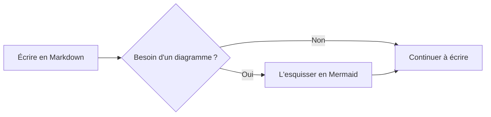
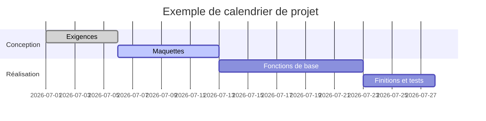
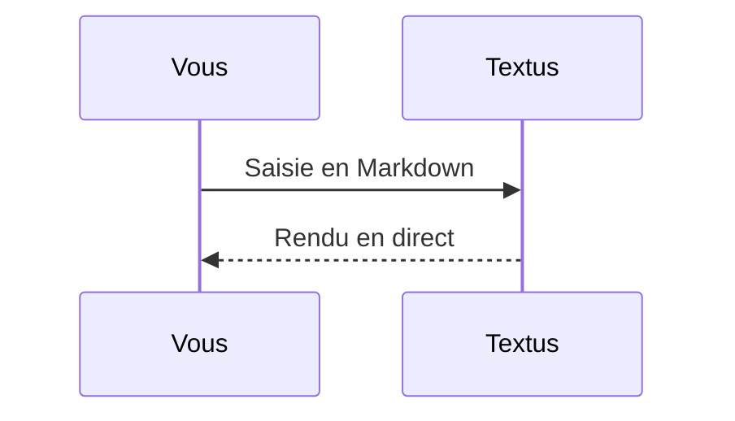

# Guide Markdown de Textus

Bienvenue dans ce document intégré, qui présente le rendu Markdown pris en charge par Textus. Ce n'est qu'un brouillon non enregistré : modifiez-le et faites des essais librement, puis fermez-le sans l'enregistrer.

> [!TIP]
> Appuyez sur `Cmd+/` pour basculer entre le mode WYSIWYG et le mode source, et voir la syntaxe brute de chaque exemple.

## Titres et citations

Tapez `#` suivi d'un espace en début de ligne pour un titre de niveau 1, ou `##` suivi d'un espace pour le niveau 2. Les titres ci-dessus montrent le résultat.

Une citation :

> Le texte cité peut contenir d'autres mises en forme, comme du **gras** et du `code`.

Les encadrés de style GitHub :

> [!NOTE]
> Une note, pour donner du contexte.

> [!WARNING]
> Un avertissement, pour ce qui demande de la vigilance.

## Styles de texte

**Gras** (`**texte**`), *italique* (`*texte*`), ***gras italique***, ~~barré~~ (`~~texte~~`), ==surligné== (`==texte==`) et `code en ligne`.

Les liens s'écrivent ainsi : [le dépôt de Textus](https://github.com/CatVinci-Studio/Textus). Le HTML en ligne s'affiche aussi, par exemple les touches du clavier <kbd>Cmd</kbd> + <kbd>S</kbd>.

Formules en ligne : l'équivalence masse-énergie $E = mc^2$, l'identité d'Euler $e^{i\pi} + 1 = 0$.

## Listes

- Liste à puces
- Avec imbrication
  - Un élément de deuxième niveau
  - Un autre

1. Liste numérotée
2. Deuxième élément

Liste de tâches (cliquez sur une case pour la cocher ou la décocher) :

- [x] Une tâche terminée
- [ ] Une tâche à faire

## Tableaux

| Fonction | Syntaxe | Résultat |
| --- | --- | --- |
| Gras | `**texte**` | **texte** |
| Surlignage | `==texte==` | ==texte== |
| Formule en ligne | `$x^2$` | $x^2$ |

Survolez un tableau pour ajouter ou supprimer des lignes et des colonnes. Tapez `| Nom | Âge |` puis appuyez sur Entrée pour créer un tableau. Dans un tableau, Entrée passe à la ligne suivante, en ajoute une sur la dernière ligne et quitte le tableau sur une nouvelle ligne restée vide ; Ctrl/⌘+Entrée le quitte à tout moment.

## Blocs de code

Blocs de code délimités, avec coloration syntaxique (changez de langage dans le coin supérieur droit du bloc). Entrée sur la dernière ligne vide quitte le bloc, tout comme Ctrl/⌘+Entrée à tout moment ; il en va de même pour les citations.

```python
def fib(n: int) -> int:
    """La suite de Fibonacci classique."""
    a, b = 0, 1
    for _ in range(n):
        a, b = b, a + b
    return a
```

```rust
fn main() {
    let greeting = "Bonjour, Textus";
    println!("{greeting}");
}
```

## Formules en bloc

Les formules en bloc entourées de `$$` sont rendues par KaTeX :

$$
\int_{-\infty}^{\infty} e^{-x^2} \, dx = \sqrt{\pi}
$$

## Diagrammes (Mermaid)

Un bloc de code ```` ```mermaid ```` s'affiche sous forme de diagramme en direct. Un organigramme :



Un diagramme de Gantt :



Un diagramme de séquence :



## Images

Collez une image directement depuis le presse-papiers : Textus l'enregistre dans un dossier `assets/` à côté du document et insère la référence. Vous pouvez aussi l'écrire à la main :

Dans **Réglages → Éditeur et apparence → Images**, vous pouvez plutôt envoyer les images nouvellement collées vers votre propre hébergeur d'images. L'URL d'envoi reçoit des données `multipart/form-data` avec un champ `file` et peut renvoyer l'URL publique soit en texte brut, soit dans un champ JSON configurable. Les fichiers envoyés peuvent être renommés automatiquement, garder leur nom d'origine, ou vous demander un nom avant chaque envoi. Les références d'images existantes ne sont jamais modifiées quand vous changez de mode de stockage.

```markdown

```

## Vues et modes

Outre l'éditeur WYSIWYG et le mode source (`Cmd+/`), Textus offre trois façons d'écrire (sous Windows et Linux, utilisez `Ctrl` au lieu de `Cmd` ; Réglages → Raccourcis indique les raccourcis en vigueur) :

- **Vue partagée** (`Cmd+Shift+E`) : la source Markdown à gauche, l'aperçu mis en forme à droite, qui défilent ensemble.
- **Mode machine à écrire** (Réglages → Éditeur et apparence → Affichage) : la ligne que vous tapez reste au milieu de la fenêtre, dans l'éditeur, en mode source comme en vue partagée.
- **Mode zen** (`Cmd+Shift+J`) : masque tout sauf le texte, passe en plein écran et atténue tous les paragraphes sauf celui que vous écrivez. Appuyez sur `Esc` pour en sortir.

Les trois se trouvent aussi dans le menu **Présentation**.

## Notes de bas de page et filets

Les notes de bas de page s'écrivent ainsi[^1], et voici un filet horizontal :

---

[^1]: Le contenu des notes est regroupé à la fin du document.

Bonne écriture.
