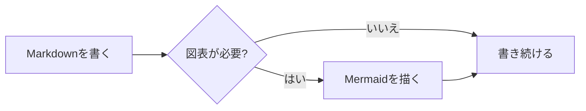
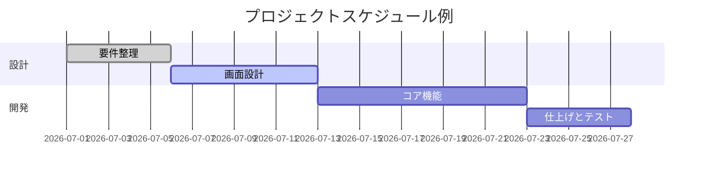
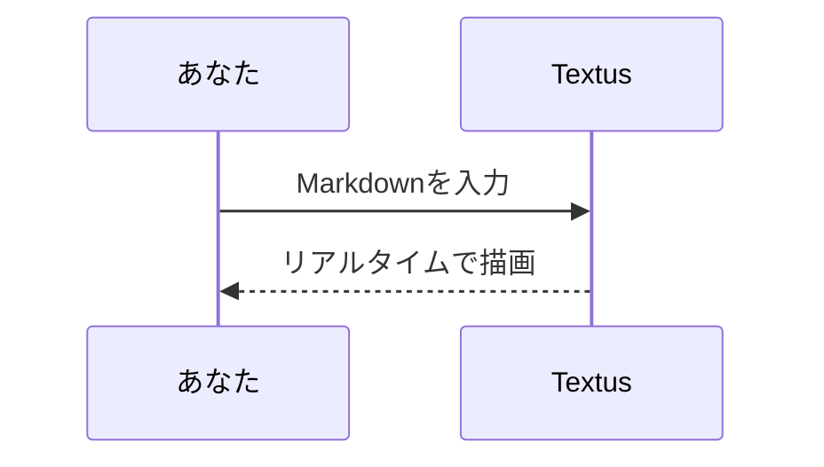

# Textus Markdown ガイド

ようこそ！これはTextusが対応するMarkdownレンダリング機能を紹介する、内蔵のデモ文書です。これは保存されていない草稿なので、自由に編集して試してかまいません —— 閉じるときに保存しなければそれで大丈夫です。

> [!TIP]
> `Cmd+/` でWYSIWYGとソースコードモードを切り替えられます。どの例も元の書き方を見比べてみてください。

## 見出しと引用

行頭に `#` とスペースを入力するとレベル1、`##` とスペースならレベル2の見出しになります。上の見出しが実際の表示例です。

引用ブロック：

> 引用文の中には **太字** や `コード` など他の記法もネストできます。

GitHub形式のアラートブロック:

> [!NOTE]
> これは補足説明に適したノートです。

> [!WARNING]
> これは注意すべき点を伝える警告です。

## インラインスタイル

**太字**、*斜体*、***太字斜体***、~~取り消し線~~、==ハイライト==、そして `インラインコード`。

リンクの書き方：[Textus リポジトリ](https://github.com/CatVinci-Studio/Textus)。インラインHTMLも描画されます。例えばキーボードキー <kbd>Cmd</kbd> + <kbd>S</kbd>。

インライン数式：質量とエネルギーの関係式 $E = mc^2$、オイラーの等式 $e^{i\pi} + 1 = 0$。

## リスト

- 箇条書きリスト
- ネストに対応
  - 2階層目の項目
  - もう1つの2階層目の項目

1. 番号付きリスト
2. 2番目の項目

タスクリスト(チェックボックスをクリックするだけで切り替え可能):

- [x] 完了した項目
- [ ] 未完了の項目

## 表

| 機能 | 記法 | 結果 |
| --- | --- | --- |
| 太字 | `**テキスト**` | **テキスト** |
| ハイライト | `==テキスト==` | ==テキスト== |
| インライン数式 | `$x^2$` | $x^2$ |

表の上にマウスを乗せると行・列の追加や削除ができます。`| 名前 | 年齢 |` と入力して Enter を押すと表になります。表の中で Enter を押すと次の行へ移り、最終行では行が追加され、空のままの新しい行でもう一度 Enter を押すと表から出ます。Ctrl/⌘+Enter ならいつでも出られます。

## コードブロック

シンタックスハイライト付きのフェンスコードブロック(右上で言語を切り替え可能)。末尾の空行で Enter を押すとブロックから出ます。Ctrl/⌘+Enter ならいつでも出られ、引用でも同じです。

```python
def fib(n: int) -> int:
    """お馴染みのフィボナッチ数列。"""
    a, b = 0, 1
    for _ in range(n):
        a, b = b, a + b
    return a
```

```rust
fn main() {
    let greeting = "こんにちは、Textus!";
    println!("{greeting}");
}
```

## 数式ブロック

`$$` で囲んだブロック数式はKaTeXによって描画されます:

$$
\int_{-\infty}^{\infty} e^{-x^2} \, dx = \sqrt{\pi}
$$

## 図表(Mermaid)

`mermaid` コードブロックはリアルタイムで図表に描画されます。フローチャート:



ガントチャート:



シーケンス図:



## 画像

クリップボードから画像を直接貼り付けると、Textusは文書のそばの `assets/` ディレクトリに保存して参照を挿入します。手書きすることもできます:

**設定 → 編集と外観 → 画像**では、今後貼り付ける画像を自分の画像ホストへ送信するように設定できます。エンドポイントは `multipart/form-data` の `file` フィールドで画像を受信し、公開 URL をプレーンテキストまたは設定可能な JSON フィールドで返します。ファイル名は自動変更、元の名前の保持、アップロード前の毎回確認から選べます。保存先を切り替えても既存の画像参照は変更されません。

```markdown

```

## 表示とモード

WYSIWYGエディタとソースコードモード(`Cmd+/`)のほかに、Textusには3つの書き方があります(WindowsとLinuxでは `Cmd` を `Ctrl` に読み替えてください。ショートカットを変更した場合は 設定 → ショートカット の設定が優先されます):

- **分割表示**(`Cmd+Shift+E`):左にMarkdownソース、右にレンダリング結果のプレビューを表示し、スクロールも連動します。
- **タイプライターモード**(設定 → 編集と外観 → テーマ):入力中の行を常にウィンドウ中央に保ちます。エディター、ソースモード、分割表示で有効です。
- **禅モード**(`Cmd+Shift+J`):本文以外をすべて隠して全画面にし、書いている段落以外を薄く表示します。`Esc` で終了します。

3つとも **表示**(View)メニューからも使えます。

## 脚注と区切り線

脚注はこのように書きます[^1]。以下は水平区切り線です:

---

[^1]: 脚注の内容は文書の末尾にまとめて表示されます。

執筆を楽しんで！
