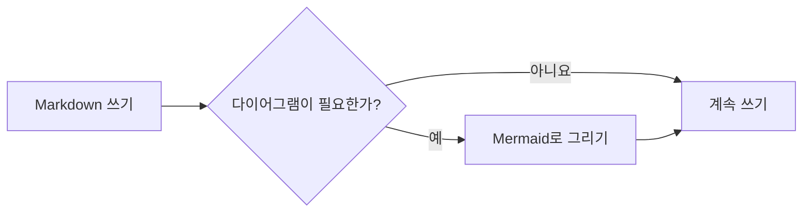
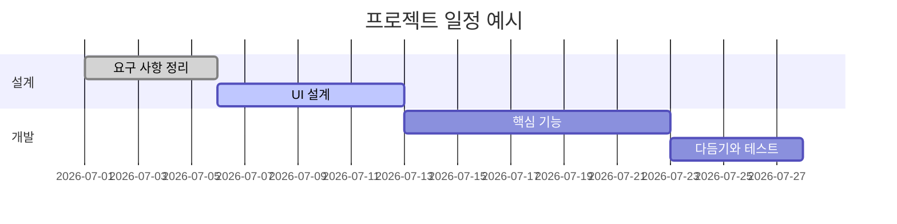
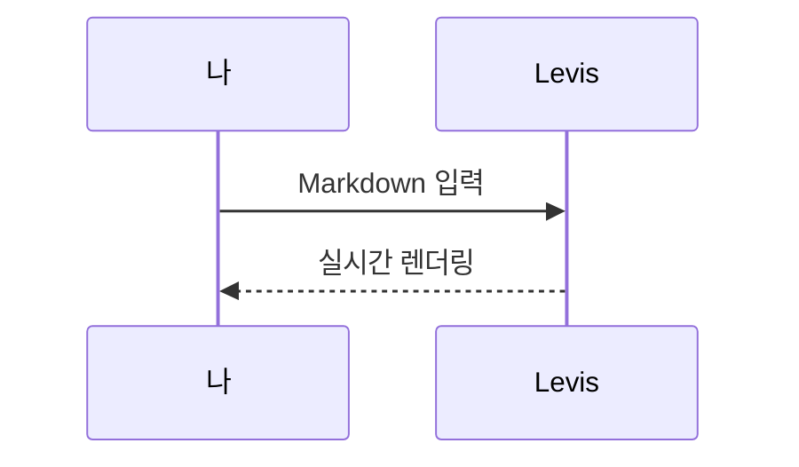

# Levis Markdown 가이드

환영합니다. 이 문서는 Levis가 지원하는 Markdown 렌더링을 보여 주는 내장 문서입니다. 저장되지 않은 초안일 뿐이니 마음껏 고치고 실험해 본 다음 저장하지 않고 닫으면 됩니다.

> [!TIP]
> `Cmd+/` 키를 누르면 WYSIWYG 모드와 소스 모드를 오가며 여기 있는 예시의 원래 문법을 볼 수 있습니다.

## 제목과 인용

줄 맨 앞에 `#` 기호와 공백을 넣으면 1단계 제목, `##` 기호와 공백을 넣으면 2단계 제목이 됩니다. 위의 제목들이 렌더링된 결과입니다.

인용문:

> 인용문 안에도 **굵게**나 `코드` 같은 다른 서식을 넣을 수 있습니다.

GitHub 스타일 알림:

> [!NOTE]
> 참고 알림으로, 덧붙일 정보를 전할 때 씁니다.

> [!WARNING]
> 경고 알림으로, 주의할 점을 알릴 때 씁니다.

## 인라인 스타일

**굵게**(`**텍스트**`), *기울임꼴*(`*텍스트*`), ***굵은 기울임꼴***, ~~취소선~~(`~~텍스트~~`), ==강조 표시==(`==텍스트==`), 그리고 `인라인 코드`.

링크는 이렇게 씁니다: [Levis 저장소](https://github.com/CatVinci-Studio/Levis). 인라인 HTML도 렌더링됩니다(예: 키보드 키 <kbd>Cmd</kbd> + <kbd>S</kbd>).

인라인 수식: 질량-에너지 등가 원리 $E = mc^2$, 오일러 등식 $e^{i\pi} + 1 = 0$.

## 목록

- 순서 없는 목록
- 중첩 가능
  - 2단계 항목
  - 또 다른 항목

1. 순서 있는 목록
2. 두 번째 항목

할 일 목록(체크박스를 클릭하면 바뀝니다):

- [x] 끝낸 일
- [ ] 할 일

## 표

| 기능 | 문법 | 결과 |
| --- | --- | --- |
| 굵게 | `**텍스트**` | **텍스트** |
| 강조 표시 | `==텍스트==` | ==텍스트== |
| 인라인 수식 | `$x^2$` | $x^2$ |

표 위에 포인터를 올리면 행과 열을 추가하거나 삭제할 수 있습니다. `| 이름 | 나이 |`처럼 입력하고 Enter 키를 누르면 표가 만들어집니다. 표 안에서 Enter 키를 누르면 아래 행으로 이동하고, 마지막 행에서는 행이 추가되며, 비워 둔 새 행에서 누르면 표에서 나갑니다. Ctrl/⌘+Enter 키를 누르면 언제든지 나갈 수 있습니다.

## 코드 블록

구문 강조가 적용되는 펜스 코드 블록입니다(블록 오른쪽 위에서 언어를 바꿀 수 있습니다). 비어 있는 마지막 줄에서 Enter 키를 누르면 블록에서 나가고, Ctrl/⌘+Enter 키를 누르면 언제든지 나갈 수 있습니다. 인용에서도 마찬가지입니다.

```python
def fib(n: int) -> int:
    """고전적인 피보나치 수열."""
    a, b = 0, 1
    for _ in range(n):
        a, b = b, a + b
    return a
```

```rust
fn main() {
    let greeting = "안녕하세요, Levis!";
    println!("{greeting}");
}
```

## 수식 블록

`$$`로 감싼 블록 수식은 KaTeX로 렌더링됩니다:

$$
\int_{-\infty}^{\infty} e^{-x^2} \, dx = \sqrt{\pi}
$$

## 다이어그램(Mermaid)

코드 블록을 ```` ```mermaid ````로 시작하면 실시간 다이어그램으로 렌더링됩니다. 순서도:



간트 차트:



시퀀스 다이어그램:



## 이미지

클립보드에서 이미지를 바로 붙여넣으면 Levis가 문서 옆의 `assets/` 폴더에 저장하고 참조를 삽입합니다. 직접 쓸 수도 있습니다:

**설정 → 편집기 및 모양 → 이미지**에서는 새로 붙여넣는 이미지를 직접 운영하는 이미지 호스팅으로 보내도록 바꿀 수 있습니다. 엔드포인트는 `file` 필드가 있는 `multipart/form-data`를 받고, 공개 URL을 일반 텍스트로 반환하거나 지정한 JSON 필드에 담아 반환하면 됩니다. 업로드하는 파일은 자동으로 이름을 바꾸거나, 원래 이름을 유지하거나, 업로드할 때마다 이름을 묻게 할 수 있습니다. 저장 방식을 바꿔도 기존 이미지 참조는 바뀌지 않습니다.

```markdown

```

## 보기와 모드

WYSIWYG 편집기와 소스 모드(`Cmd+/`) 외에도 Levis에는 세 가지 쓰기 방식이 있습니다(Windows와 Linux에서는 `Cmd` 대신 `Ctrl`을 쓰세요. 지금 지정된 단축키는 설정 → 단축키에서 볼 수 있습니다):

- **분할 보기**(`Cmd+Shift+E`): 왼쪽에 Markdown 소스, 오른쪽에 렌더링된 미리 보기가 표시되고 함께 스크롤됩니다.
- **타자기 모드**(설정 → 편집기 및 모양 → 보기): 입력 중인 줄이 창 가운데에 머무릅니다. 편집기, 소스 모드, 분할 보기 모두에서 작동합니다.
- **젠 모드**(`Cmd+Shift+J`): 본문 외의 모든 것을 숨기고 전체 화면으로 바꾸며, 지금 쓰고 있는 문단을 뺀 나머지 문단을 흐리게 표시합니다. `Esc` 키를 누르면 빠져나옵니다.

세 가지 모두 **보기** 메뉴에도 있습니다.

## 각주와 구분선

각주는 이렇게 씁니다[^1]. 아래는 가로 구분선입니다:

---

[^1]: 각주 내용은 문서 끝에 모아서 표시됩니다.

즐겁게 써 보세요.
