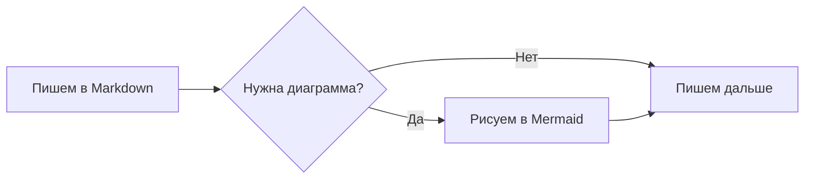
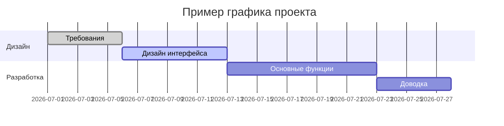
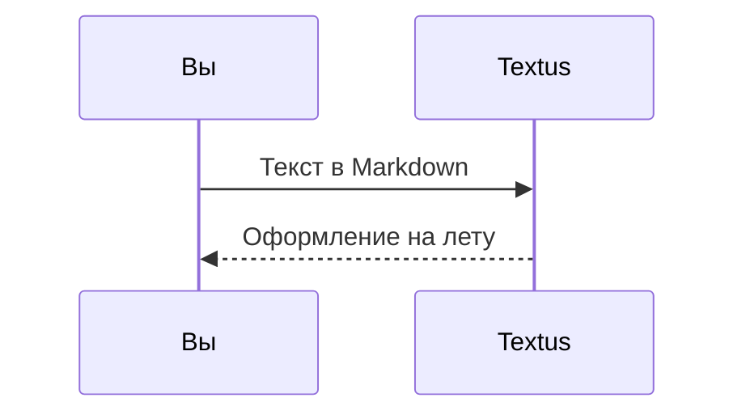

# Руководство по Markdown в Textus

Этот встроенный документ показывает, какое оформление Markdown поддерживает Textus. Это просто несохранённый черновик — смело редактируйте его и экспериментируйте, а потом закройте без сохранения.

> [!TIP]
> Нажмите `Cmd+/`, чтобы переключиться между визуальным режимом и режимом исходного кода и увидеть разметку любого примера на этой странице.

## Заголовки и цитаты

Наберите в начале строки `#` и пробел, чтобы получить заголовок первого уровня, или `##` и пробел — для второго уровня. Заголовки выше показывают результат.

Цитата:

> В цитату можно вкладывать другую разметку, например **жирный** и `код`.

Выноски в стиле GitHub:

> [!NOTE]
> Заметка — для дополнительного контекста.

> [!WARNING]
> Предупреждение — о том, на что стоит обратить внимание.

## Стили текста

**Жирный** (`**текст**`), *курсив* (`*текст*`), ***жирный курсив***, ~~зачёркнутый~~ (`~~текст~~`), ==выделение цветом== (`==текст==`) и `код в строке`.

Ссылки выглядят так: [репозиторий Textus](https://github.com/CatVinci-Studio/Textus). Встроенный HTML тоже отображается, например клавиши <kbd>Cmd</kbd> + <kbd>S</kbd>.

Формулы в строке: эквивалентность массы и энергии $E = mc^2$, тождество Эйлера $e^{i\pi} + 1 = 0$.

## Списки

- Маркированный список
- С вложенностью
  - Пункт второго уровня
  - Ещё один

1. Нумерованный список
2. Второй пункт

Список задач (нажмите на флажок, чтобы отметить его или снять отметку):

- [x] Уже сделано
- [ ] Ещё предстоит сделать

## Таблицы

| Оформление | Синтаксис | Результат |
| --- | --- | --- |
| Жирный | `**текст**` | **текст** |
| Выделение цветом | `==текст==` | ==текст== |
| Формула в строке | `$x^2$` | $x^2$ |

Наведите указатель на таблицу, чтобы добавить или удалить строки и столбцы. Наберите `| Имя | Возраст |` и нажмите Enter, чтобы создать таблицу. Enter переходит на строку ниже, в последней строке добавляет новую, а в новой пустой строке выводит из таблицы; Ctrl/⌘+Enter выходит из неё в любой момент.

## Блоки кода

В блоках кода работает подсветка синтаксиса (язык переключается в правом верхнем углу блока). Enter на пустой последней строке выводит из блока, как и Ctrl/⌘+Enter в любой момент; в цитатах это работает так же.

```python
def fib(n: int) -> int:
    """Классическая последовательность Фибоначчи."""
    a, b = 0, 1
    for _ in range(n):
        a, b = b, a + b
    return a
```

```rust
fn main() {
    let greeting = "Привет, Textus!";
    println!("{greeting}");
}
```

## Блоки формул

Блочные формулы в обрамлении `$$` отображаются с помощью KaTeX:

$$
\int_{-\infty}^{\infty} e^{-x^2} \, dx = \sqrt{\pi}
$$

## Диаграммы (Mermaid)

Блок кода ```` ```mermaid ```` превращается в живую диаграмму. Блок-схема:



Диаграмма Ганта:



Диаграмма последовательности:



## Изображения

Вставьте изображение прямо из буфера обмена — Textus сохранит его в папку `assets/` рядом с документом и вставит ссылку на него. Или напишите ссылку вручную:

```markdown

```

В разделе **Настройки → Редактор и оформление → Изображения** можно вместо этого отправлять новые вставленные изображения на собственный хостинг. Адрес загрузки получает `multipart/form-data` с полем `file` и может вернуть публичный URL обычным текстом или в настраиваемом поле JSON. Загружаемые файлы можно переименовывать автоматически, оставлять с исходным именем или каждый раз спрашивать имя перед загрузкой. При смене способа хранения уже вставленные ссылки на изображения не меняются.

## Виды и режимы

Кроме визуального редактора и режима исходного кода (`Cmd+/`), в Textus есть ещё три способа писать (в Windows и Linux вместо `Cmd` нажимайте `Ctrl`; текущие сочетания клавиш — в разделе «Настройки → Сочетания клавиш»):

- **Разделённый вид** (`Cmd+Shift+E`): слева исходный код Markdown, справа — просмотр результата; обе части прокручиваются вместе.
- **Режим пишущей машинки** (Настройки → Редактор и оформление → Вид): строка, которую вы набираете, остаётся посередине окна — в редакторе, в режиме исходного кода и в разделённом виде.
- **Режим дзен** (`Cmd+Shift+J`): скрывает всё, кроме текста, разворачивает окно на весь экран и приглушает все абзацы, кроме того, над которым вы работаете. Чтобы выйти, нажмите `Esc`.

Все три есть и в меню **Вид**.

## Сноски и разделители

Сноска выглядит так[^1], а ниже — горизонтальная линия:

---

[^1]: Текст сносок собирается в конце документа.

Пишите с удовольствием.
