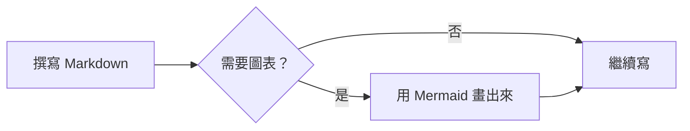
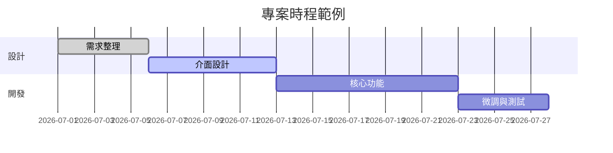
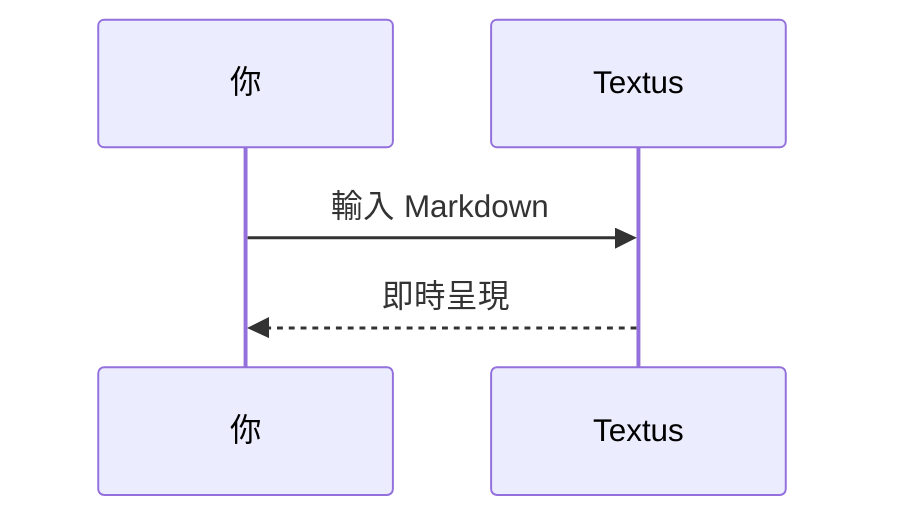

# Textus Markdown 指南

這份內建文件示範 Textus 支援的 Markdown 呈現效果。它只是一份未儲存的草稿，可以隨意編輯、試驗，關閉時選擇不儲存即可。

> [!TIP]
> 按 `Cmd+/` 可在所見即所得與原始碼模式之間切換，看看每個範例背後的原始語法。

## 標題與引用

在行首輸入 `#` 和空格就是第一級標題，輸入 `##` 和空格則是第二級標題。上方的標題就是實際的呈現效果。

引用區塊：

> 引用的文字裡也能使用其他標記，例如**粗體**和 `程式碼`。

GitHub 風格的提示區塊：

> [!NOTE]
> 這是一則附註，用來補充說明。

> [!WARNING]
> 這是一則警告，提醒需要留意的地方。

## 行內樣式

**粗體**（`**文字**`）、*斜體*（`*文字*`）、***粗斜體***、~~刪除線~~（`~~文字~~`）、==醒目提示==（`==文字==`），以及 `行內程式碼`。

連結的寫法：[Textus 的原始碼存放庫](https://github.com/CatVinci-Studio/Textus)。行內 HTML 也會呈現，例如鍵盤按鍵 <kbd>Cmd</kbd> + <kbd>S</kbd>。

行內數學公式：質能等價 $E = mc^2$，歐拉恆等式 $e^{i\pi} + 1 = 0$。

## 清單

- 項目符號清單
- 可以巢狀排列
  - 第二層項目
  - 另一個第二層項目

1. 編號清單
2. 第二項

待辦清單（按一下核取方塊即可切換）：

- [x] 已完成的事項
- [ ] 待辦的事項

## 表格

| 功能 | 語法 | 效果 |
| --- | --- | --- |
| 粗體 | `**文字**` | **文字** |
| 醒目提示 | `==文字==` | ==文字== |
| 行內公式 | `$x^2$` | $x^2$ |

將指標移到表格上，即可新增或刪除列與欄。輸入 `| 姓名 | 年齡 |` 後按 Enter 就會建立表格。按 Enter 會移到下一列，在最後一列按則會新增一列；在留空的新列上再按一次 Enter，就會離開表格。Ctrl/⌘+Enter 隨時都能離開。

## 程式碼區塊

具備語法突顯的圍欄式程式碼區塊（可從區塊右上角切換語言）。在最後一個空行按 Enter 會離開區塊，也可以隨時按 Ctrl/⌘+Enter 離開；引用區塊也一樣。

```python
def fib(n: int) -> int:
    """經典的費氏數列。"""
    a, b = 0, 1
    for _ in range(n):
        a, b = b, a + b
    return a
```

```rust
fn main() {
    let greeting = "你好，Textus";
    println!("{greeting}");
}
```

## 數學公式區塊

以 `$$` 包住的區塊公式由 KaTeX 呈現：

$$
\int_{-\infty}^{\infty} e^{-x^2} \, dx = \sqrt{\pi}
$$

## 圖表（Mermaid）

以 ```` ```mermaid ```` 開頭的程式碼區塊會即時呈現為圖表。流程圖：



甘特圖：



循序圖：



## 圖片

直接從剪貼簿貼上圖片，Textus 會把它存進文件旁邊的 `assets/` 資料夾，並插入參照。也可以手動撰寫：

在**設定 → 編輯器與外觀 → 圖片**中，可以改為將新貼上的圖片上傳到你自己的圖片託管服務。上傳端點會以 `multipart/form-data` 的 `file` 欄位接收圖片，並以純文字回傳公開 URL，或將 URL 放在可自訂的 JSON 欄位中。上傳的檔案可以自動重新命名、保留原始檔名，或在每次上傳前詢問你。切換儲存方式時，既有的圖片參照都不會改變。

```markdown

```

## 檢視與模式

除了所見即所得編輯器和原始碼模式（`Cmd+/`），Textus 還有三種寫作方式（在 Windows 和 Linux 上以 `Ctrl` 取代 `Cmd`；目前的按鍵設定可在「設定 → 快速鍵」中查看）：

- **分割檢視**（`Cmd+Shift+E`）：左邊是 Markdown 原始碼，右邊是呈現後的預覽，兩邊同步捲動。
- **打字機模式**（設定 → 編輯器與外觀 → 檢視）：正在輸入的那一行始終保持在視窗中央——在編輯器、原始碼模式和分割檢視中都適用。
- **禪模式**（`Cmd+Shift+J`）：隱藏文字以外的一切，進入全螢幕，並淡化正在撰寫的段落以外的所有段落。按 `Esc` 離開。

這三種模式也都在**檢視**選單中。

## 註腳與分隔線

註腳的寫法像這樣[^1]，下面是一條水平分隔線：

---

[^1]: 註腳內容會集中顯示在文件末尾。

祝寫作愉快。
